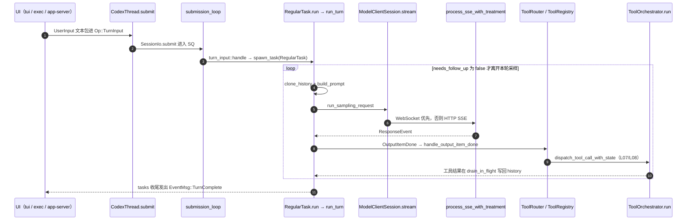

# Codex 源码研读

**结论**：本仓库是 `openai/codex` 的学习 fork，代码停在 `67f0994b532b8740f14b5b738af7b7b2a915b1d6`（`git rev-parse HEAD` 已核对）。15 课按「一个 turn」往下读：protocol → session/SQ → `run_turn` → model client → prompt，再进入 history、tools、安全、集成和 UI。学完应能在面试里 5 分钟讲清分层，并对照自己的 Python agent **supply-chain-copilot**（Harness loop、permissions、retries/circuit breaker、JSONL trace；该项目源码不在本仓库，文件级对比标为待确认）。

## 目标

| 目标 | 验收 |
|---|---|
| 讲清分层 | protocol / runtime(`codex-core`) / model client / tools / safety / UI，每层说出 crate |
| 讲清一个 turn | `Op::TurnInput` → `TurnComplete`，能点到文件和函数（L02–L07） |
| 讲清安全 | approval × sandbox、execpolicy、`ToolOrchestrator`（L08–L10） |
| 讲清集成 | MCP、`codex exec`、app-server、config / AGENTS.md（L11–L13） |
| 对照自己的项目 | harness / permissions 对比表（L15） |
| 面试 | 每课 2 题，导师打分都 ≥ 8/10 才勾「面试题已过」 |

计划总时长约 60.5h（原资料 78–86h 压缩后）。行号以本 commit 为准，后续若自己改代码，用 `rg -n` 重定位。

## 课程索引

| 课 | 文件 | 主题 | 小时 | 周 |
|---|---|---|---|---|
| L01 | [lessons/L01-layout.md](lessons/L01-layout.md) | 仓库布局与构建 | 2.5 | W10（11/2–11/8） |
| L02 | [lessons/L02-session.md](lessons/L02-session.md) | Session / Thread 与 SQ/EQ | 4 | W10 |
| L03 | [lessons/L03-run-turn.md](lessons/L03-run-turn.md) | `run_turn` agent loop | 6 | W10 |
| L04 | [lessons/L04-model-client.md](lessons/L04-model-client.md) | Model client 与 Responses streaming | 3.5 | W10 |
| L05 | [lessons/L05-prompt.md](lessons/L05-prompt.md) | Prompt / instructions 组装 | 3 | W11（11/9–11/15） |
| L06 | [lessons/L06-history-compaction.md](lessons/L06-history-compaction.md) | History 与 compaction | 4 | W11 |
| L07 | [lessons/L07-tools.md](lessons/L07-tools.md) | 工具定义与分发 | 6 | W11 |
| L08 | [lessons/L08-approval-execpolicy.md](lessons/L08-approval-execpolicy.md) | 审批、execpolicy、Orchestrator | 6 | W12（11/16–11/22） |
| L09 | [lessons/L09-sandbox.md](lessons/L09-sandbox.md) | Sandbox | 6 | W12 |
| L10 | [lessons/L10-apply-patch.md](lessons/L10-apply-patch.md) | apply_patch | 3 | W12 |
| L11 | [lessons/L11-mcp-client.md](lessons/L11-mcp-client.md) | MCP client | 3 | W13（11/23–11/29） |
| L12 | [lessons/L12-exec-app-server.md](lessons/L12-exec-app-server.md) | `codex exec` 与 app-server | 4 | W13 |
| L13 | [lessons/L13-config-agents-md.md](lessons/L13-config-agents-md.md) | Config 与 AGENTS.md | 2.5 | W13 |
| L14 | [lessons/L14-tui-rollout-otel.md](lessons/L14-tui-rollout-otel.md) | TUI、rollout、otel | 4 | W13 |
| L15 | [lessons/L15-capstone.md](lessons/L15-capstone.md) | 全链路 + 项目对比 | 3 | W13（计划 11/28；11/29 buffer） |

进度表：[PROGRESS.md](PROGRESS.md)。L06–L15 由并行任务写课稿；本页链接指向约定文件名。

## 一个 turn 的请求链

符号均在本 commit 用 `rg` 确认。`ToolOrchestrator` 只确认到模块注释与 `run` 入口（L08 展开内部）。



| 层 | 课 | 一句话 |
|---|---|---|
| 布局 / 构建 | L01 | `codex-rs/` workspace，166 个 member |
| Runtime | L02–L03 | SQ/EQ、`Session`、`run_turn` |
| Model / context | L04–L06 | 流式 client、prompt、history / compaction |
| Tools | L07、L10 | router / registry、apply_patch |
| Safety | L08–L09 | approval、execpolicy、orchestrator、sandbox |
| Integration | L11–L13 | MCP、exec / app-server、config / AGENTS.md |
| UI / ops | L14 | TUI、rollout、otel |
| Capstone | L15 | 时序图 + 与 supply-chain-copilot 对比 |

## 相对旧笔记要改的点

旧地图写了 `Op::UserInput`、`process_sse` 当生产入口、`core/*_prompt.md` 按模型选用、约 130 个 crate。本 commit 的事实：

| 旧说法 | 本 commit |
|---|---|
| `Op::UserInput` | 无此变体。文本类型是 `user_input::UserInput`；提交操作是 `Op::TurnInput`（`protocol.rs:749`）。另有 `Op::UserInputAnswer`（`protocol.rs:843`），那是回答 `request_user_input` |
| `process_sse` 解析线上 SSE | `process_sse` 在 `#[cfg(test)]`（`sse/responses.rs:566`）。生产函数是私有的 `process_sse_with_treatment`（同文件 582，由 91 行调用） |
| `core/gpt_*_prompt.md` 按模型选择 | 5 个文件在磁盘上。全仓库 `rg` 无引用。现行 base instructions 见 L05 |
| 约 130 crate | `codex-rs/Cargo.toml` 的 `members` 解析为 **166** 个 package，无重名 |
| `session_prefix.rs` 组装 prompt | 该文件格式化 inter-agent completion，不组装 `Prompt` |
| `run_turn` 直接发 `TurnComplete` | `EventMsg::TurnComplete` 在 `tasks/mod.rs:894`，任务收尾时发出 |
| `codex-rs/mcp-server/` | workspace 无此 member。`codex mcp` 是 CLI 子命令；Codex 当 server 看 app-server（L12） |

## 用 Cursor 本地学

1. 打开本仓库（`Daryl9441/codex-learning`），确认 `git rev-parse HEAD` 为 `67f0994b532b8740f14b5b738af7b7b2a915b1d6`。
2. Agent 模式。规则文件 `.cursor/rules/codex-tutor.mdc` 为 `alwaysApply: true`。
3. 对话里说 `开始 L01`（或 `开始 Lxx`）。导师读 `study/lessons/Lxx-*.md`，一次一节，等你说「继续」。
4. 练习改动放在单独分支（例如 `study/L02-op-log`），不要直接改 `main` 上的课稿。
5. 两道面试题都 ≥ 8/10 后，导师更新 [PROGRESS.md](PROGRESS.md)。

## 环境

依据已读的 `docs/install.md` 与 `codex-rs/rust-toolchain.toml`。

| 项 | 要求 |
|---|---|
| OS | macOS 12+、Ubuntu 20.04+ / Debian 10+，或 Windows 11 的 WSL2 |
| Rust | `codex-rs/rust-toolchain.toml`：channel `1.95.0`，components `clippy`、`rustfmt`、`rust-src` |
| just | `cargo install --locked just`（`justfile` 的 `working-directory` 是 `codex-rs`） |
| 可选 | `dotslash`、`cargo-nextest`（`just test`） |

```bash
cd codex-rs
cargo build -p codex-cli
# 仓库根目录：
just codex
just exec -- "say hi"
```

`codex exec` 需要登录或 API key，会打到模型。离线优先 `cargo test -p <crate>`。日志：`RUST_LOG`（见 `docs/install.md`）。`codex exec` 默认日志级别是 `error`。

## 进度清单

勾选规则见 [PROGRESS.md](PROGRESS.md)。

- [ ] L01 布局 / 构建
- [ ] L02 Session / SQ
- [ ] L03 `run_turn`
- [ ] L04 model client
- [ ] L05 prompt
- [ ] L06 history / compaction
- [ ] L07 tools
- [ ] L08 approval / execpolicy
- [ ] L09 sandbox
- [ ] L10 apply_patch
- [ ] L11 MCP
- [ ] L12 exec / app-server
- [ ] L13 config / AGENTS.md
- [ ] L14 TUI / rollout / otel
- [ ] L15 capstone

## 写课稿时跑过的命令

| 命令 | 结果 |
|---|---|
| `git rev-parse HEAD` | `67f0994b532b8740f14b5b738af7b7b2a915b1d6` |
| 解析 `codex-rs/Cargo.toml` `members` | 166 |
| `cargo metadata --no-deps --format-version 1` 后 `jq` 计数 | **171**。比 members 多 5 个 path 包：`app_test_support`、`codex-chatgpt`、`codex-message-history`、`codex-windows-sandbox`、`core_test_support` |
| `cargo tree -p codex-core --depth 1` | 已跑通。直接依赖里有 `codex-api`、`codex-protocol`、`codex-tools`、`codex-context-fragments` |
| `cargo check -p codex-core` | 第一次失败：`openssl-sys` 找不到系统 OpenSSL。安装 `pkg-config` 与 `libssl-dev` 后，`Finished dev profile ... in 2m 19s`，退出码 0。`docs/install.md` 没有写这一步 |
| `just` | 本环境没有 `just` 二进制，未跑 `just codex` |
| `cargo test -p codex-api --lib sse -- --list` | 52 tests |
| `cargo test -p codex-api --lib sse::responses::tests::parses_items_and_completed -- --exact` | 1 passed |
| `cargo test -p codex-core --lib session::tests -- --list`、`codex exec`、`codex debug prompt-input` | 未跑 |
