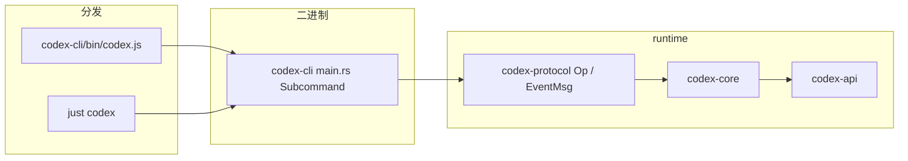

# L01 · 仓库布局与构建

## 结论

- 产品主体在 `codex-rs/`：Cargo workspace，本 commit 的 `members` 是 **166** 个 package（解析 `codex-rs/Cargo.toml`，无缺失、无重名）。
- 分层：`codex-protocol`（`Op` / `EventMsg`）→ `codex-core`（session / turn）→ `codex-api`（HTTP/SSE/WebSocket）→ `codex-tools`（工具 spec）→ `codex-cli` / `codex-tui` / `codex-exec` / `codex-app-server`（入口）。
- UI 不调用 `run_turn`。它们提交 `Op`，再消费 `EventMsg`。
- npm 包 `codex-cli/` 只负责分发 Rust 二进制（`package.json` 的 `bin.codex` = `bin/codex.js`）。
- 工具链钉在 `codex-rs/rust-toolchain.toml` 的 `1.95.0`。根目录 `justfile` 把工作目录设成 `codex-rs`。

## 学习目标

- 说出 6 层各自的 crate 名（package name，不是目录名）。
- 从 `codex-rs/cli/src/main.rs` 的 `Subcommand` 指出 exec / mcp / app-server / sandbox / debug 入口。
- 能解释为什么 `codex-api` 和 `codex-tools` 单独成 crate。

## 前置

- 无。先完成本课再读 L02。
- 确认 `git rev-parse HEAD` = `67f0994b532b8740f14b5b738af7b7b2a915b1d6`。

## 调用链

本课没有一条运行时调用链。构建与进程入口如下。



| 入口 | 位置 | 作用 |
|---|---|---|
| `just codex` | `justfile:17` | `cargo run --bin codex` |
| `just exec` | `justfile:21` | `cargo run --bin codex -- exec` |
| 无子命令 | `cli/src/main.rs` `Subcommand` 为 `Option`（约 141 行） | 交互 TUI |
| `Exec` | `main.rs:154` | `codex exec` |
| `Mcp` | `main.rs:166` | MCP 客户端管理，不是 mcp-server |
| `AppServer` | `main.rs:172` | JSON-RPC server |
| `Sandbox` | `main.rs:191` | 沙箱子命令 |
| `Debug` / `PromptInput` | `main.rs:195`、`269` | 含 `debug prompt-input`（L05） |

## 关键代码导读

| 文件 | 符号 | 作用 | 阅读要点 |
|---|---|---|---|
| `codex-rs/Cargo.toml` | `workspace.members` | 列出全部 crate | 数成员用脚本解析，不要用「约 130」 |
| `codex-rs/cli/src/main.rs:145` | `enum Subcommand` | 多子命令 | 隐藏项：`Execpolicy`、`ResponsesApiProxy`、`StdioToUds` |
| `codex-rs/protocol/src/protocol.rs:696` | `pub enum Op` | UI → core 的指令 | 用户文本不是 `Op::UserInput`，见 L02 |
| `codex-rs/protocol/src/protocol.rs:1518` | `pub enum EventMsg` | core → UI 的事件 | `TurnStarted` 1569，`TurnComplete` 1578 |
| `codex-rs/protocol/Cargo.toml` | package `codex-protocol` | 协议 crate | 库名 `codex_protocol` |
| `codex-rs/core/Cargo.toml` | package `codex-core` | agent loop | 依赖 `codex-api`、`codex-context-fragments`、`codex-config` 等 |
| `codex-rs/codex-api/` | package `codex-api` | Responses 传输 | 可脱离 TUI 单测 SSE |
| `codex-rs/tools/` | package `codex-tools` | tool spec / schema | core 的 router 依赖它，UI 不该复制 schema |
| `codex-rs/rust-toolchain.toml` | channel `1.95.0` | 编译器版本 | 系统 rustc 1.83 不能编这个 workspace |
| `docs/install.md` | Build from source | 官方构建步骤 | `cd codex-rs && cargo build`；just 用 `cargo install --locked just` |
| `codex-cli/package.json` | `bin.codex` | npm 包装 | 学习 runtime 时可以先不看 JS |

已确认存在的目录 / crate（package 名）：

| 目录 | package |
|---|---|
| `core` | `codex-core` |
| `protocol` | `codex-protocol` |
| `codex-api` | `codex-api` |
| `tools` | `codex-tools` |
| `apply-patch` | `codex-apply-patch` |
| `config` | `codex-config` |
| `codex-mcp` | `codex-mcp` |
| `rmcp-client` | `codex-rmcp-client` |
| `execpolicy` | `codex-execpolicy` |
| `sandboxing` | `codex-sandboxing` |
| `linux-sandbox` | `codex-linux-sandbox` |
| `windows-sandbox-rs` | `codex-windows-sandbox`（path 依赖，`Cargo.toml:338`；**不在** `members` 列表。members 里是 `windows-sandbox-rs/tests/support` 与 `windows-sandbox-service`） |
| `cli` | `codex-cli` |
| `exec` | `codex-exec` |
| `tui` | `codex-tui` |
| `app-server` | `codex-app-server` |
| `rollout` | `codex-rollout` |
| `thread-store` | `codex-thread-store` |
| `state` | `codex-state` |
| `sdk/typescript`、`sdk/python`、`sdk/python-runtime` | 不在 Cargo members 里 |

顶层还有 `docs/`、`scripts/`、`tools/`、`third_party/`、`patches/`、`MODULE.bazel`、`BUILD.bazel`、`justfile`、`flake.nix`。`ls` 已看到。

## 演示命令

在 `codex-rs/` 下执行。需要 rustup 拉到 1.95.0 之后才有意义。

```bash
git rev-parse HEAD
# 期望：67f0994b532b8740f14b5b738af7b7b2a915b1d6

python3 - <<'PY'
import os, re
text=open("Cargo.toml").read()
m=re.search(r"members\s*=\s*\[(.*?)\]", text, re.S)
members=[x.strip().strip('"') for x in m.group(1).split(",") if x.strip()]
print(len(members))
PY
# 期望：166

cargo metadata --no-deps --format-version 1 | jq -r '.packages[].name' | sort | wc -l
cargo tree -p codex-core --depth 1
```

| 命令 | 本环境 |
|---|---|
| `git rev-parse HEAD` | 已核对，等于该 SHA |
| members 计数 | 已核对，166 |
| `cargo metadata --no-deps … \| wc -l` | 已跑，输出 **171** |
| `cargo tree -p codex-core --depth 1` | 已跑。depth 1 含 `codex-api`、`codex-protocol`、`codex-tools`、`codex-context-fragments` |
| `cargo check -p codex-core` | 已跑。缺 OpenSSL 时失败；装上 `libssl-dev` 后退出码 0 |
| `cargo build -p codex-cli`、`just codex` | 未跑。本环境无 `just` |

## 动手练习

1. 在 `codex-rs` 跑上面的 `cargo metadata` 与 `cargo tree -p codex-core --depth 1`。
2. 把直接依赖分成：协议、传输、工具、配置、沙箱。只保留 depth 1 的 crate 名。
3. 可选：`cargo build -p codex-cli`，再在仓库根 `just codex`（先 `cargo install --locked just`）。

**预期**：`wc -l` 是 **171**（本环境已跑出这个数）。`members` 仍是 166。多出来的 5 个是 path 包，不是 members：`app_test_support`、`codex-chatgpt`、`codex-message-history`、`codex-windows-sandbox`、`core_test_support`。`cargo tree` 的 depth 1 里能看到 `codex-protocol` 与 `codex-api`。

**撤回**：这两条命令不改文件。若装了 just 或写了 target/，不要提交 `target/`。

## 引导问题

1. 为什么 tui / exec / app-server 与 core 用 `Op` / `EventMsg` 解耦？
2. 为什么 `codex-api`、`codex-tools` 单独成 crate？

先自己答，再翻面试题。

## 面试题

1. 画 Codex 的进程内分层，并说出每层 crate。
2. 如果把 `Op` 换成 UI 直接调用 `run_turn`，会失去什么？（对照 supply-chain-copilot 的 Harness：一个进程里的 loop 和多入口共享 runtime 有何差别。）

<details>
<summary>参考答案</summary>

1. **分层（结论 → 机制）**
   - protocol：`codex-protocol` 的 `Op`（`protocol.rs:696`）与 `EventMsg`（`1518`）。UI 只依赖这一层的类型。
   - runtime：`codex-core` 的 `CodexThread` / `submission_loop` / `run_turn`。
   - model client：`codex-core` 的 `ModelClientSession` 调 `codex-api`。
   - tools：`codex-tools` 的 spec，加上 core 里的 router / registry（L07）。
   - safety：`codex-execpolicy`、`codex-sandboxing`、`ToolOrchestrator`（L08，本课只记 crate）。
   - UI：`codex-cli` 分发到 `codex-tui`、`codex-exec`、`codex-app-server`。
   - 满分要点：package 名说对，并指出没有独立 mcp-server crate。

2. **解耦的取舍**
   - 三个入口可以并发演进，core 只有一个 submission queue。
   - 取消、审批、事件回放都走同一条 `EventMsg`，exec 的 `--json` 与 TUI 不用各写一套 loop。
   - 代价：多一次队列和序列化，调试要同时看 `Op` 变体和 task。
   - supply-chain-copilot：用户描述是单进程 Harness loop。那更简单，但每加一个入口（CLI、HTTP、队列消费者）都容易把权限和重试抄进各入口。Codex 把入口收成 `Op`。Python 侧具体模块名未在本仓库核实，标待确认。

</details>

## 与 supply-chain-copilot 对比

| 问题 | Codex（已核实） | supply-chain-copilot（仅用户描述） |
|---|---|---|
| 进程边界 | UI crate 与 `codex-core` 用队列消息 | 单 Python 进程里的 Harness loop |
| 权限 | 独立 crate + 后面的 Orchestrator | 有 permissions，位置待确认 |
| 可观测 | `EventMsg` 流；otel 在 L14 | JSONL trace |

## 待确认

- `cargo build -p codex-cli` 与 `just codex`。check 只覆盖了 `codex-core` 及其依赖，没有链出 CLI 二进制，也没有安装 `just`。
- 你自己的机器若没有 OpenSSL 开发包，`cargo check` 会在 `openssl-sys` 失败。官方 `docs/install.md` 未写 `libssl-dev`；这是本环境补上的系统包，不是仓库里的脚本。
