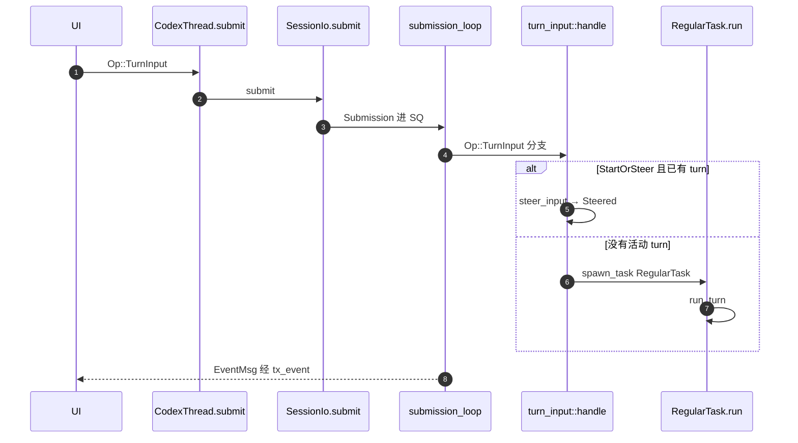

# L02 · Session / Thread 与 SQ/EQ

## 结论

- 一个 thread 对应一个 `CodexThread`（`core/src/codex_thread.rs:194`）。它的 `submit`（244 行）只是把 `Op` 交给 `SessionIo::submit`（`session/mod.rs:1085`）。
- `Session`（`session/session.rs:61`）注释写明：同一时间最多一个 running task，可被用户输入打断。
- SQ：`submission_loop`（`session/handlers.rs:459`）从 `Receiver<Submission>` 读 `Op`。EQ：`Session.tx_event`（`session.rs:64`）发出 `EventMsg`。
- 用户句子的类型是 `codex_protocol::user_input::UserInput`。装进 `TurnInputRequest` 后，操作变体是 **`Op::TurnInput`**（`protocol.rs:749`）。没有 `Op::UserInput`。
- 已有 turn 时，`start_or_steer` 调 `Session::steer_input`（`turn_input.rs:397`、方法在 868 行），成功则 `TurnInputSubmission::Steered`（411 行）。没有活动 turn 才 `spawn_task(..., RegularTask::new())`（466 行）。
- `TurnContext`（`turn_context.rs:324`）是这一 turn 的配置快照；`Session` 活过多个 turn。

## 学习目标

- 从 `Op::TurnInput` 走到 `RegularTask::run`，中间函数名说全。
- 说清 turn 进行中再来一条用户消息时，消息进了哪条队列。
- 说清 Interrupt 时 history 里多了什么（marker），以及 tool 取消时谁构造 aborted output。

## 前置

- L01。能打开 `protocol.rs` 里的 `Op` 与 `EventMsg`。

## 调用链



| 顺序 | 位置 | 做什么 |
|---|---|---|
| 1 | `protocol.rs:696` `Op` | 指令枚举。`kind()` 在 1090 行，`TurnInput` 的 kind 字符串是 `turn_input` |
| 2 | `codex_thread.rs:244` `CodexThread::submit` | 转发到 `self.io.submit` |
| 3 | `session/mod.rs:1085` `SessionIo::submit` | 包成 `Submission`（`submission.rs:9`） |
| 4 | `handlers.rs:459` `submission_loop` | `select!`：关停、收 SQ、mailbox |
| 5 | `handlers.rs:502` | 已有 `debug!`，字段 `operation = sub.op.kind()` |
| 6 | `handlers.rs:582` | `Op::TurnInput` → `turn_input::handle` |
| 7 | `turn_input.rs:234` `handle` | 按 `TurnInputMode` 分发 |
| 8 | `turn_input.rs:352` `start_or_steer` | 先 `steer_input`，失败 `NoActiveTurn` 再 spawn |
| 9 | `tasks/mod.rs:273` `spawn_task` | 单活动 task |
| 10 | `tasks/regular.rs:40` `RegularTask::run` | 发 `TurnStarted`，再循环 `run_turn` |
| 11 | `tasks/mod.rs:894` | 正常结束发 `EventMsg::TurnComplete` |
| 12 | `handlers.rs:514` | `Op::Interrupt` → `interrupt` |
| 13 | `tasks/mod.rs:103` `interrupted_turn_history_marker` | 往 history 写打断说明 |

## 关键代码导读

| 文件 | 符号 | 作用 | 阅读要点 |
|---|---|---|---|
| `protocol.rs:749` | `Op::TurnInput` | 开始或 steer 一轮 | 带 `reply: oneshot`，调用方能知道 Started 还是 Steered |
| `protocol.rs:699` | `Op::Interrupt` | 打断当前 task | 注释：不杀后台 terminal；回应是 `TurnAborted` |
| `protocol.rs:843` | `Op::UserInputAnswer` | 回答 elicitation | 不要和用户 prompt 搞混 |
| `protocol.rs:1578` | `EventMsg::TurnComplete` | turn 结束事件 | 发出点在 task 收尾，不在 `run_turn` 末尾 |
| `session.rs:60-61` | `Session` | thread 的可变状态与服务 | 「at most 1 running task」 |
| `turn_context.rs:324` | `TurnContext` | 单 turn 快照 | `config`、`provider`、`sub_id`；cwd 字段已 deprecated |
| `turn_context.rs:1162` | `new_turn_with_sub_id` | 用指定 submission id 建 turn | 真正逻辑在 `new_turn_with_sub_id_if`（1183） |
| `input_queue.rs:116` | `InputQueue` | 活动 turn 的 pending input + mailbox | steer 的用户文本进 `TurnInputQueue`（108 行） |
| `tasks/regular.rs:115` | `loop { run_turn }` | turn 内还可以再跑 | `has_pending_input` 为真就用空 input 再进 `run_turn` |
| `tasks/mod.rs:79` | `InterruptedTurnHistoryMarker` | ContextualUser 或 Developer | 由 `agent_interrupt_message_enabled` 和 multi-agent 版本决定（85 行起） |
| `tools/parallel.rs:370` | 取消分支 | 未完成的 tool task | 调 `aborted_response`，避免只有 call 没有 output |

`Session` 与 `TurnContext`：Session 持有线程级队列、features、事件发送端；TurnContext 在 admit 时冻结这一 turn 的 model / cwd / provider。采样时还有更细的 `StepContext`（`run_turn` 里 `capture_step_context`）。Step 级切换留到 L03/L05，本课先分清 Session 活得更久。

## 演示命令

`submission_loop` 已经打 `debug!`（`handlers.rs:502`）。`RUST_LOG=codex_core=info` **看不到** 这条。要看现成日志：

```bash
cd codex-rs
# 需先 cargo build -p codex-cli，且能登录
RUST_LOG=codex_core::session::handlers=debug \
  cargo run --bin codex -- exec "say hi"
```

期望日志里有 `operation=turn_input` 和 `Submission`。模型是否真的回复取决于账号，那一部分待确认。

只想离线确认符号：

```bash
rg -n "enum Op|TurnInput \{|fn submission_loop|fn steer_input|struct TurnContext" \
  codex-rs/protocol/src/protocol.rs \
  codex-rs/core/src/session/handlers.rs \
  codex-rs/core/src/session/turn_input.rs \
  codex-rs/core/src/session/turn_context.rs
```

本环境已用 `rg` 核对上表行号。`codex exec` 未跑（无登录，且当时工具链还在安装）。

## 动手练习

在分支 `study/L02-op-log` 上，给 `submission_loop` 的 `debug!` 旁边加一行：

```rust
tracing::info!(operation = sub.op.kind(), "study_op");
```

然后：

```bash
cd codex-rs
cargo build -p codex-cli
RUST_LOG=codex_core=info cargo run --bin codex -- exec "say hi"
```

**预期**：info 级别能看到 `study_op`，且第一条相关 operation 是 `turn_input`。随后是否出现 `shutdown` 取决于进程怎么退出。若未登录，进程会在更早失败，日志里可能没有 `turn_input`——把实际日志贴出来，不要假装看到了。

**撤回**：

```bash
git restore codex-rs/core/src/session/handlers.rs
# 或丢掉整个练习分支
```

不要把这行 `info!` 留在学习主分支。

## 引导问题

1. turn 进行中用户再发消息会怎样？
2. Interrupt 如何让 function_call 与 output 配对？
3. `TurnContext` 和 `Session` 的边界是什么？

## 面试题

1. 描述 SQ/EQ。为什么一个 session 同时只跑一个 `RegularTask`，而不是每个用户消息一个 task？
2. 对照 supply-chain-copilot 的 Harness：Codex 的 steer（排队进当前 turn）和「直接新开一轮」差在哪？你的 JSONL trace 会把 steer 记成新的 span 还是同一 turn？

<details>
<summary>参考答案</summary>

1. **SQ/EQ**
   - 客户端 `CodexThread::submit` → `SessionIo` 把 `Submission` 送进 channel。`submission_loop` 单线程 `match` `Op`，所以 TurnInput、Interrupt、审批回复有确定顺序。
   - 事件从 `tx_event` 出去，UI 不共享 `Session` 内部锁。
   - 单活动 task：`Session` 注释与 `spawn_task` 的设计。第二个用户输入走 `steer_input` 进 `InputQueue`，由当前 `run_turn` 在采样后 drain（L03），避免两套工具并发改同一 workspace。
   - 代价：长 turn 的延迟；公平性靠 steer，不靠第二个 task。

2. **Interrupt 与配对**
   - `Op::Interrupt` → `interrupt` → 取消 task 的 `CancellationToken`。
   - 已 `tokio::spawn` 的工具在取消路径上写 `ToolCallRuntime::aborted_response`（`parallel.rs:385` 附近），让 call 有一条 output。
   - task abort 之后，若 reason 是 Interrupted，`interrupted_turn_history_marker` 再写入一条 TurnAborted 文本（user 或 developer role），并 `flush_rollout` 后才发 `TurnAborted`（`tasks/mod.rs:1029-1047`）。
   - `context_manager/normalize.rs` 的 `ensure_call_outputs_present` 是 history 不变量（L06），**不在** interrupt 函数里直接调用。强制超时（`GRACEFULL_INTERRUPTION_TIMEOUT_MS`）之后 tool 是否一定已经把 output 写入 history：本课没有把那条竞态跑完，标待确认。

3. **和 supply-chain-copilot**
   - Codex 的 steer 仍属于同一个 `turn_id`（`TurnInputSubmission::Steered` 带回 `turn_id`）。
   - 若你的 Harness 把每条用户消息当成新的 trace span，面试时要说明：Codex 把「插话」收进当前 turn 的 pending input，下一轮采样才看见。你的 JSONL 是否同样折叠，源码不在本仓库，待确认。

</details>

## 与 supply-chain-copilot 对比

| 问题 | Codex | 你的项目（描述级） |
|---|---|---|
| 循环宿主 | `submission_loop` + 单 `RegularTask` | Harness loop |
| 进行中的新消息 | `steer_input` → `InputQueue` | 待确认：排队、丢弃、还是并行 |
| 取消 | `CancellationToken` + aborted tool output + history marker | 待确认有没有「补一条失败 output」 |
| 追踪 | `EventMsg` + rollout（L14） | JSONL trace |

## 待确认

- 本环境未执行 `codex exec`，因此「日志里第一条是 `turn_input`」只是从 `match` 顺序推断，不是实测输出。
- Interrupt 在 grace timeout 打满时，aborted `function_call_output` 与 marker 的落盘顺序。
- `Session::steer_input`（`turn_input.rs:868`）内部如何调用 `InputQueue::extend_pending_input_*`：入口已定位，函数体未逐行抄进本课。
