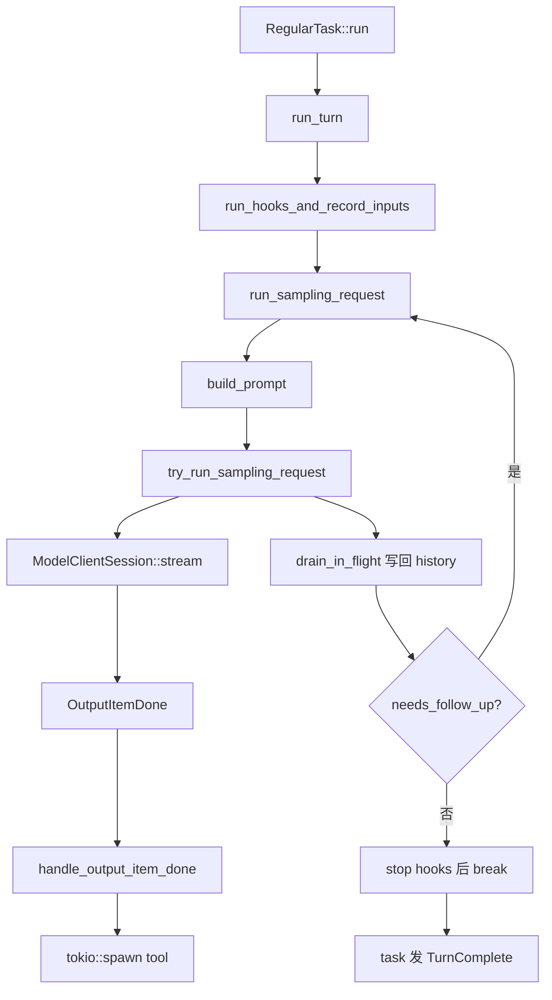

# L03 · Agent loop：`run_turn`

## 结论

- `RegularTask::run`（`tasks/regular.rs:40`）准备 prewarm 后循环调用 `run_turn`（`session/turn.rs:177`）。`run_turn` 返回后若 `input_queue.has_pending_input` 仍为真，用空 input 再进一次（`regular.rs:131-135`）。
- `run_turn` 的外层循环：把 pending 用户输入写入 history → `run_sampling_request` → 看 `needs_follow_up`。为真就继续采样；为假则跑 stop hooks，然后 `break`（`turn.rs:750-857`）。
- `needs_follow_up = model_needs_follow_up || has_pending_input`（`turn.rs:636`）。模型侧在工具调用或 `FunctionCallError::RespondToModel` 时置位（`stream_events_utils.rs:368`、`436`）。
- 工具不是等整段 `response.completed` 才开始。`OutputItemDone` 时 `handle_output_item_done`（`stream_events_utils.rs:316`）调用 `handle_tool_call`，后者在返回 future **之前** `tokio::spawn` 真正的 dispatch（`tools/parallel.rs:272`）。采样循环要等流结束才 `drain_in_flight`（`turn.rs:3560`，收集函数在 2676）。源码注释：结果按序收集发生在 stream 结束之后（`parallel.rs:335`）。
- `TurnComplete` 仍由 task 收尾发出（L02），不是 `run_turn` 的返回值类型。

## 学习目标

- 默写一轮：用户输入 → 采样 → tool spawn → drain → 再采样或结束。
- 分清三类 follow-up：模型要工具、队列里还有用户话、stop hook 要求继续。
- 说出哪些 `CodexErrorDetails` **不会** retry（context window、usage limit）。

## 前置

- L02 的 `Op::TurnInput`、`RegularTask`、`InputQueue`。

## 调用链



| 顺序 | 位置 | 作用 |
|---|---|---|
| 1 | `turn.rs:177` `run_turn` | 一个 turn 里的采样循环 |
| 2 | `turn.rs:212` | `model_client.new_session()`，或用 prewarm 的 `ModelClientSession` |
| 3 | `turn.rs:219` `run_pre_sampling_compact` | 采样前压缩（细节 L06） |
| 4 | `turn.rs:404` `run_hooks_and_record_inputs` | 定义在 965 行；先记下本 turn 输入 |
| 5 | `turn.rs:490` 循环 | `can_drain_pending_input` 为真才取 steer |
| 6 | `turn.rs:594` `run_sampling_request` | 定义在 1792 行，内部带 retry |
| 7 | `turn.rs:1854` `build_prompt` | 定义在 1751 行 |
| 8 | `turn.rs:2729` `try_run_sampling_request` | 消费 `ResponseEvent` |
| 9 | `turn.rs:3129` | `handle_output_item_done` |
| 10 | `turn.rs:3560` `drain_in_flight` | 把 tool 结果写入 history |
| 11 | `turn.rs:636` | 计算 `needs_follow_up` |
| 12 | `turn.rs:1592` `run_auto_compact` | token 超限且还要 follow-up 时（709 行调用） |

## 关键代码导读

| 文件 | 符号 | 作用 | 阅读要点 |
|---|---|---|---|
| `turn.rs:177` | `run_turn` | 外层 ReAct 循环 | 开头注释：有 function call 就执行并把结果放进下一次采样 |
| `turn.rs:481-486` | 注释 | pending input 何时进 history | 开场先采样原始 input；compact 之后若还要工具，先不 drain |
| `turn.rs:1792` | `run_sampling_request` | 单次「请求模型」含重试 | `stream_max_retries()`（1822）；`ResponsesStreamRetryState`（1832） |
| `turn.rs:1835` | `loop` | 失败则再取 history 再请求 | 第一次用传入的 history，其后 `clone_history()`（1842） |
| `turn.rs:2729` | `try_run_sampling_request` | 读流 | `FuturesOrdered` 收集 tool future（2870） |
| `stream_events_utils.rs:316` | `handle_output_item_done` | 区分 tool 与普通消息 | tool：立刻 `record_completed_response_item` 再 spawn；普通消息走 `finalize_non_tool_response_item` |
| `stream_events_utils.rs:352` | 注释 | dispatch 不等待 future 被 poll | `defer_tool_dispatch` 为真时才把 spawn 推迟到 future 里 |
| `parallel.rs:272` | `tokio::spawn` | 真正执行工具 | 并行与否由 `tool_supports_parallel` 选读锁或写锁（286-297） |
| `turn.rs:2676` | `drain_in_flight` | 按完成顺序记结果 | `FuturesOrdered` 保持入队顺序 |
| `responses_retry.rs:58` | `handle_response_stream_error` | 决定 retry 或返回错误 | `retry_delay` 为 `None` 就终止 |
| `protocol/src/error.rs:426` | `retry_delay` | 终端错误表 | `ContextWindowExceeded`、`UsageLimitReached` 在 447、452 行，返回 `None` |
| `error.rs:460` | 可重试变体 | Stream、Timeout、5xx、ConnectionFailed 等 | 有 server advice 用 advice，否则 backoff |
| `responses_retry.rs:97` | `UnboundedConnectionRetries` | 仅连接失败且 feature 打开 | 延迟 5s 起，封顶 60s（23-24 行常量） |

结束条件（同时满足才离开 `run_turn` 的采样环）：

- `model_needs_follow_up == false`（没有未完成的工具后续）
- `has_pending_input == false`（没有待写入的 steer）
- stop hook 没有 `should_block` 并塞回一段 prompt（769 行会 `continue`）
- `should_stop` 或走完 post-turn compact 尝试后 `break`（798、857）

`RegularTask` 还可能因为队列里又来了输入再调用一次 `run_turn`。那是 task 级的第二层循环。

## 演示命令

离线列举 turn 测试（编译很重）：

```bash
cd codex-rs
cargo test -p codex-core --lib session::tests -- --list | head
```

`session::tests` 是 `session/mod.rs:5838` 的 `#[cfg(test)] mod tests`，对应 `session/tests.rs`。本环境写课时 **没有** 跑完这条（见待确认）。

只读核对：

```bash
rg -n "fn run_turn|fn run_sampling_request|fn try_run_sampling_request|fn drain_in_flight|needs_follow_up =" \
  codex-rs/core/src/session/turn.rs
```

在线练习（要登录，会花钱）：让模型跑两次 shell，看采样循环次数。课稿不要求你改日志也能推断：每次 `post sampling token usage` 是 `trace!`（`turn.rs:654`），默认 info 级别看不到。要观察循环，在练习分支把该 `trace!` 改成 `info!`，或把 `RUST_LOG` 开到 `codex_core=trace`（输出会很大）。

## 动手练习

分支 `study/L03-follow-up-log`：

在 `turn.rs` 计算完 `needs_follow_up` 的 `trace!` 旁加：

```rust
tracing::info!(
    model_needs_follow_up,
    has_pending_input,
    needs_follow_up,
    "study_sampling_iter"
);
```

用会触发两次 shell 的 prompt 跑 `codex exec`（prompt 自定，例如列出当前目录再 `echo ok`）。没有 API key 就只跑 `cargo test -p codex-core --lib session::tests -- --list`，把前 20 行存进笔记。

**预期**：每个采样迭代一行 `study_sampling_iter`。有工具时 `model_needs_follow_up=true`，最后一次两者都为 false 后循环结束。`--list` 的预期是列出 `session::tests::...`，不要求全绿。

**撤回**：`git restore codex-rs/core/src/session/turn.rs`。

## 引导问题

1. tool 是边 stream 边执行，还是等 `response.completed`？为什么？
2. 哪些错误 retry，哪些直接失败（context window exceeded、usage limit）？
3. turn 什么时候结束（`needs_follow_up`）？

## 面试题

1. 手写这个 coding-agent loop 的结束条件。把「工具已 spawn」和「工具结果已写回 history」分成两拍。
2. 设计题：supply-chain-copilot 的 retry / circuit breaker 若套在这一层，应该包住 `try_run_sampling_request` 还是包住单个 tool？Codex 把连接重试放在哪一层？

<details>
<summary>参考答案</summary>

1. **两拍**
   - `OutputItemDone` 到达（流还没结束）就 `tokio::spawn` 工具，所以 CPU/进程与后续 delta 重叠。
   - `drain_in_flight` 在 `drop(stream)` 之后，保证本响应的 item 都已进 history，再按 `FuturesOrdered` 顺序写 output。下一次 `build_prompt` 才能看到成对的 call/output。
   - 若在 completed 之前就把 output 送进同一次请求，服务端的这一 response 已经在生成，客户端插不进去。所以 follow-up 是下一次采样。
   - 结束：`needs_follow_up` 为假且 stop hook 不要求继续；然后 task 发 `TurnComplete`。

2. **重试分层**
   - 采样流：`run_sampling_request` 的 loop + `handle_response_stream_error`。`CodexErr::retry_delay` 对 `ContextWindowExceeded` 和 `UsageLimitReached` 返回 `None`（`error.rs:447-452`），这两个直接失败（context window 在 `run_turn` 里还有 compact 分支，`turn.rs:861` 起，那是另一条恢复路径，不是同一函数里的盲重试）。
   - 可重试：`Stream`、`Timeout`、`InternalServerError`、`ConnectionFailed` 等（`error.rs:460`）。连接失败还有 feature `UnboundedConnectionRetries`。
   - 工具失败不是这条 retry。工具错误变成 `function_call_output` 交给模型，或 `Fatal` 直接失败（`parallel.rs:138`）。
   - supply-chain-copilot 的 circuit breaker：适合包住「打模型」的传输，不要包住整个 Harness，否则一次 usage limit 会熔断后续所有工具。Codex 的预算在 `retry_delay == None` 与 provider 的 `stream_max_retries`。Python 项目里 breaker 的阈值源码不在本仓库，待确认。

</details>

## 与 supply-chain-copilot 对比

| 问题 | Codex | 你的 Harness |
|---|---|---|
| 循环 | `run_turn` 采样环 + `RegularTask` 外环 | 用户描述的 Harness loop |
| 重试 | 采样流上的 `responses_retry`；usage/context 不盲重试 | retries + circuit breaker，包住哪一层待确认 |
| 工具并行 | spawn 于 item.done，收集于 drain | 待确认是否等整段模型输出再执行 |
| 插话 | pending input 算进 `needs_follow_up` | 待确认 |

## 待确认

- `cargo test -p codex-core --lib session::tests -- --list` 未在写课时跑完。
- `defer_tool_dispatch == true` 时 spawn 推迟到 future 被 poll（也就是 drain）。哪些 hook 会把这个标志打开：`try_run_sampling_request` 里有局部变量，本课没有把每个调用点列全。
- mailbox preemption（`turn.rs:3145` 起）会提前结束流并 `needs_follow_up = true`。那是多 agent 邮箱，不是普通用户 steer 的主路径。
