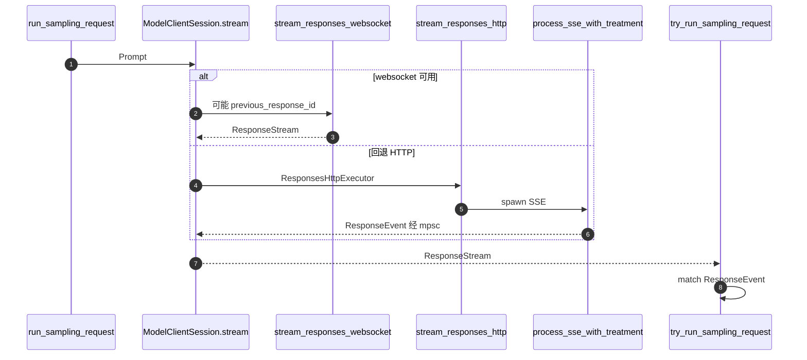

# L04 · Model client 与 Responses streaming

## 结论

- `Prompt`（`core/src/client_common.rs:23`）是一次模型请求的载荷：`input`、`tools`、`parallel_tool_calls`、`base_instructions`、`output_schema`。`get_formatted_input_for_request`（59 行）目前主要是按模型规范化图片 detail。
- `ModelClient`（`client.rs:299`）活在 session：auth、provider、传输回退。`ModelClientSession`（328 行）活在一个 turn：懒连接的 Responses WebSocket、`x-codex-turn-state` 粘滞路由。注释要求每个 Codex turn 新建 session，不能跨 turn 复用 turn-state（325 行）。
- `ModelClientSession::stream`（2499 行）在 `WireApi::Responses` 上优先 WebSocket；失败或未启用则 `ResponsesHttpExecutor::stream_responses_http`（1905 行，类型在 346 行）。
- 采样侧每次用 `clone_history().for_prompt` 做成完整 `Prompt`（`turn.rs:1842-1859`）。`build_responses_request`（`client.rs:1023`）从这份完整 input 起步。WebSocket 若能续接，再换成 `previous_response_id` + 增量 items（`stream_responses_websocket`，2271 行）。`previous_response_id` 在 `client.rs` 里只出现在这条 WebSocket 路径。
- SSE 生产解析是私有函数 `process_sse_with_treatment`（`codex-api/src/sse/responses.rs:582`），由同文件 91 行在 `tokio::spawn` 里调用。`process_sse`（566 行）标了 `#[cfg(test)]`。
- 事件类型是 `codex_api::ResponseEvent`（`codex-api/src/common.rs:81`），`client_common.rs` 再 `pub use`。

## 学习目标

- 指出 session 级 client 和 turn 级 session 各缓存什么。
- 说明「本地总是组完整 history」和「WebSocket 可能只发增量」如何同时成立。
- 列出 `ResponseEvent` 里采样循环真正会分支处理的变体，以及谁消费它们。

## 前置

- L03：`run_sampling_request` 调 `client_session.stream`。

## 调用链



| 顺序 | 位置 | 作用 |
|---|---|---|
| 1 | `client.rs:1-26` 模块注释 | prewarm 是 `generate=false`，为了复用连接和 `previous_response_id` |
| 2 | `client.rs:1023` `build_responses_request` | 完整 input + `prompt_cache_key`（1168 行） |
| 3 | `client.rs:2102` `stream_responses_websocket` | 增量续接发生在这里 |
| 4 | `client.rs:2499` `stream` | 选择传输 |
| 5 | `codex-api/src/endpoint/responses.rs:70` `stream_request` | HTTP endpoint；`stream` 在 110 行 |
| 6 | `endpoint/responses_websocket.rs:254` `stream_request` | WebSocket endpoint |
| 7 | `sse/responses.rs:91` | HTTP body 字节流 → `process_sse_with_treatment` |
| 8 | `common.rs:81` `ResponseEvent` | 通道里的枚举 |
| 9 | `turn.rs:2899` 起 | 采样循环 `match` 这些事件 |
| 10 | `model-provider-info/src/lib.rs:116` `WireApi` | 默认 `Responses`；`chat` 已移除（109 行常量说明） |
| 11 | `responses_headers.rs` | 请求头辅助，与 retry 文件分开 |
| 12 | `responses_retry.rs` | L03 已讲的重试决策 |

Provider 注册表：`codex-model-provider-info`。文件头写明内置默认值，以及 `~/.codex/config.toml` 的 `model_providers` 可覆盖（`lib.rs:1-6`）。内置 id 包含 OpenAI、Ollama（`ollama-chat` 已删除，110 行）、Amazon Bedrock 等。本课不逐个背 id。

## 关键代码导读

| 文件 | 符号 | 作用 | 阅读要点 |
|---|---|---|---|
| `client_common.rs:23` | `Prompt` | 请求载荷 | `parallel_tool_calls` 在 `build_prompt` 里被设为 `true`（`turn.rs:1765`） |
| `client_common.rs:118` | `ResponseStream` | 客户端看到的流 | 内含 channel 与可选 interrupt |
| `client.rs:299` | `ModelClient` | session 级 | WebSocket 一旦回退 HTTP，注释说本 session 后续 turn 也走 HTTP（292 行） |
| `client.rs:328` | `ModelClientSession` | turn 级 | `turn_state: OnceLock<String>` 存 `x-codex-turn-state` |
| `client.rs:346` | `ResponsesHttpExecutor` | 无 WebSocket 状态的 HTTP | `stream` 在回退时 `ResponsesHttpExecutor::new` |
| `client.rs:710` | `prompt_cache_key` | 缓存键策略 | 放进 `ResponsesApiRequest`（1168） |
| `client.rs:1052` | 稳定前缀 id | `Uuid::v5(thread_id)` | 注释：每次重建 prompt-only items，但 id 按内容哈希，重试和 resume 保持身份 |
| `common.rs:81` | `ResponseEvent` | 流事件 | 见下表 |
| `sse/responses.rs:566` | `process_sse` | 测试包装 | 不要在生产调用图里把它当成入口 |
| `sse/responses.rs:582` | `process_sse_with_treatment` | 真正的 SSE 状态机 | 测试通过 `process_sse` 间接覆盖它 |

`ResponseEvent` 变体（`common.rs:82-134`）与消费者：

| 变体 | 谁消费（`try_run_sampling_request` 的 `match`） |
|---|---|
| `Created` | `turn.rs:2997`：记下 `response_id`，写入 `ResponseId` 与 Guardian 的 `ParentResponse` |
| `OutputItemAdded` | `turn.rs:3179`，开始向 UI 流式一个 item |
| `OutputItemDone` | `turn.rs:3011` 分支，随后 `handle_output_item_done`（3129 行调用） |
| `OutputTextDelta` | `turn.rs:3379` |
| reasoning 各类 delta | 同一 `match` 的后部（`ReasoningRawContentDelta` 等，约 3520 行仍在这个循环里） |
| `Completed` | `turn.rs:3323`：`response_completed = true`，带 `token_usage` 与 `end_turn` |
| `RateLimits` | `turn.rs:3310` |
| `ServerModel` | `turn.rs:3263`，可能警告模型被服务端改写 |
| `ModelsEtag` | `turn.rs:3316`，`models_manager.refresh_if_new_etag` |
| `SafetyBuffering` | `turn.rs:3294`，发 `EventMsg::SafetyBuffering` |
| `GuardianAssessment` | `turn.rs:3289`，留给随后的 `OutputItemDone`，不直接写入普通 history |

`Completed.end_turn` 的注释（`common.rs:106`）：有的 provider 不设置，客户端要自己的 fallback。`needs_follow_up` 不以这个字段为唯一条件（L03）。

WebSocket 相对 HTTP SSE（读 `client.rs` 模块注释与 `ModelClientSession` 文档，不另编好处）：

- 同一 turn 内复用连接。
- 能带 `previous_response_id`，只送增量 items。
- sticky header `x-codex-turn-state` 必须在本 turn 的后续请求（重试、增量）里原样带回，不能带到下一 turn。
- prewarm：`generate=false` 的 `response.create`，失败则交给普通 retry / HTTP fallback。

## 演示命令

```bash
cd codex-rs
cargo test -p codex-api sse -- --test-threads=8
rg -n "fn process_sse|fn process_sse_with_treatment|pub enum ResponseEvent" \
  codex-rs/codex-api/src/sse/responses.rs \
  codex-rs/codex-api/src/common.rs
```

`rg` 已核对。本环境已跑：

```text
cargo test -p codex-api --lib sse -- --list
# 52 tests, 0 benchmarks
cargo test -p codex-api --lib sse::responses::tests::parses_items_and_completed -- --exact
# ok. 1 passed
```

过滤名是 `sse::responses::tests::...`，不是裸的 `sse` 当唯一模块。现有测试从 `sse/responses.rs:1644` 起，在 `#[cfg(test)]` 里调用 `process_sse`。整包 `cargo test -p codex-api sse`（跑全部 52 个）没有执行。

## 动手练习

在 `codex-api` 的 SSE 测试模块加一个测试：构造一小段 SSE，至少包含 `response.output_text.delta` 与 `response.completed`，断言 `process_sse` 送出的 `ResponseEvent` 顺序里先有 `OutputTextDelta`，后有 `Completed`。

先读 `sse/responses.rs:729` 附近现有 `tokio::spawn(process_sse(...))` 的写法，照它的 `ByteStream` 造输入。不要猜事件名字——以文件里已经解析的 `kind` 字符串为准。

**预期**：`cargo test -p codex-api sse -- <你的测试名>` 通过。若 `kind` 字符串和你手写的不一致，测试失败，把解析分支的行号记进笔记。

**撤回**：删掉新增测试，或 `git restore codex-rs/codex-api/src/sse/responses.rs`。放在分支 `study/L04-sse-fixture`。

## 引导问题

1. 每轮是发完整 history，还是依赖服务端状态？prompt cache 怎么被用到？
2. WebSocket 比 HTTP SSE 多做什么？
3. `ResponseEvent` 有哪些变体，各由谁消费？

## 面试题

1. 解释 Codex 为什么本地仍 `clone_history()`，同时又在 WebSocket 上发 `previous_response_id`。prompt cache 依赖哪两个机制？
2. 设计题：supply-chain-copilot 若只有「每次 POST 全量 JSON」，要加流式和熔断，应该模仿 `ModelClient` / `ModelClientSession` 的哪条边界？

<details>
<summary>参考答案</summary>

1. **完整 history 与增量**
   - 采样循环不信任服务端记得全部对话：每次 `for_prompt` 得到完整 `Vec<ResponseItem>`，再 `build_prompt`。
   - HTTP 路径没有 `previous_response_id`（`client.rs` 里该字段只出现在 `stream_responses_websocket`）。
   - WebSocket 在 continuation 匹配时改发增量，省带宽，也让服务端把新 items 接在上次 response 后面。续接失败会走 full（`client.rs:2246` 附近的 `non-incremental request` 日志）。
   - prompt cache：请求字段 `prompt_cache_key`（`client.rs:1168`）；另外 base instructions / tools 用 thread 命名空间的 `Uuid::v5` 固定 item id（1052 行注释），让前缀在重试和 resume 时不变。
   - 不要说「只靠 previous_response_id 就不用发 history」。那只在 WebSocket 续接成功时成立。

2. **和 supply-chain-copilot**
   - `ModelClient` = 进程/会话级连接与鉴权；`ModelClientSession` = 一轮对话的路由粘滞。熔断（circuit breaker）应放在 client 的传输重试旁边，轮次对象不要自己记失败计数，否则 turn 结束计数就丢了，或者反过来把上一 turn 的打开电路带进新 turn。
   - 你的项目若把 HTTP 客户端做成函数内局部变量，就没有粘滞和回退状态。JSONL trace 可以记录 `transport=websocket|http` 和是否 incremental。具体字段名待确认。

</details>

## 与 supply-chain-copilot 对比

| 问题 | Codex | 你的项目 |
|---|---|---|
| 客户端寿命 | `ModelClient` 跨 turn，`ModelClientSession` 单 turn | 待确认 |
| 重试 | `responses_retry` + provider `stream_max_retries` | retries / circuit breaker |
| 流式 | SSE 或 WebSocket → `ResponseEvent` | 待确认是否流式 |
| 缓存 | `prompt_cache_key` + 稳定 item id | 待确认 |

## 待确认

- 全部 52 个 `sse::` 测试是否都通过。本环境只 `--list`，并单跑了 `parses_items_and_completed`（通过）。
- WebSocket 帧是否也走 `process_sse_with_treatment`。`responses_websocket.rs` 引入的是 `process_responses_event`（该文件第 19 行 `use`），不是 `process_sse`。两边事件如何汇合到同一个 `ResponseEvent`，本课没有逐行对完。
- 非 OpenAI provider（Ollama、LM Studio、Azure）在本 commit 的默认表里的完整 id 列表。文件里有 Ollama 与 Bedrock 常量；LM Studio / Azure 的条目没有在写课时逐条打开，不要背未核对的 id。
