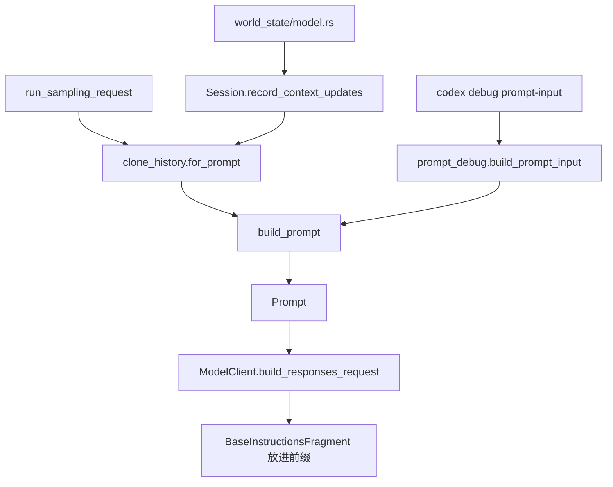

# L05 · Prompt / instructions 组装

## 结论

- 一次请求的 `Prompt` 由 `build_prompt`（`session/turn.rs:1751`）装出来：history items、`tool_router.model_visible_specs()`、`parallel_tool_calls: true`、`base_instructions`、可选 `output_schema`。
- 这些 history items 来自 `ContextManager::for_prompt`（调用点 `turn.rs:1846`），不是把 `core/*.md` 文件按模型名拼起来。
- `ContextualUserFragment` trait 定义在 crate `codex-context-fragments`（`context-fragments/src/lib.rs:18`），`core/src/context/mod.rs:69` 再导出。每种注入物在 `core/src/context/` 里实现 `role()` / `content_kind()`。
- 角色不是都叫 system：
  - base instructions 片段 `BaseInstructionsFragment` role = `developer`（`context/base_instructions.rs:46`）
  - `DeveloperInstructions` role = `developer`（`developer_instructions.rs:29`）
  - `UserInstructions`（AGENTS.md）role = `user`（`user_instructions.rs:22`），kind `agents_md.instructions`
  - 环境：`EnvironmentsState` role = `user`（`context/world_state/environment.rs:210`）。`environment_context.rs` 是 `FileSystemContext` 的渲染，不是这个 fragment 本身
  - 换模型：`ModelSwitchInstructions` role = `developer`，标记 `<model_switch>`（`model_switch_instructions.rs:24-33`）
- `core/` 下 5 个 `*prompt.md` 在磁盘上，全仓库 `rg` 不到引用。现行模板入口是 `models-manager/src/model_info.rs:16` 的 `BASE_INSTRUCTIONS`（`include_str!("../prompt.md")`）以及 `prompts` crate 的 `render_model_instructions`（`prompts/src/model_instructions.rs:8`），读的是 `ModelInfo.instructions_template`。
- 调试入口是 CLI：`codex debug prompt-input`（`cli/src/main.rs:269`、处理函数 2066 行），内部调用 `codex_core::build_prompt_input`（`lib.rs:132` 导出，实现 `prompt_debug.rs:26`）。

## 学习目标

- 指出 base / developer / user 三类 fragment 的 `role()`。
- 说明稳定前缀（base instructions、tools）为什么在请求里重建但仍可能命中 cache（接 L04 的 item id）。
- 能用 `debug prompt-input` 或读 `build_prompt_input` 讲出「这段文字从哪个 fragment 来」。

## 前置

- L03 的 `build_prompt` 调用点，L04 的 `Prompt` 与 `prompt_cache_key`。

## 调用链



| 顺序 | 位置 | 作用 |
|---|---|---|
| 1 | `session/mod.rs:5185` 文档注释 | 无 reference snapshot 时注入完整上下文，否则只发 diff |
| 2 | `session/mod.rs:5191` | 全量注入且发生过模型切换时，前面加 `<model_switch>` developer 消息 |
| 3 | `context/world_state/model.rs:128` | 有 instructions hash 时用 `ModelInstructions`；否则在模型变了且 instructions 非空时用 `ModelSwitchInstructions` |
| 4 | `turn.rs:1846` | `for_prompt` |
| 5 | `turn.rs:1751` `build_prompt` | 装 `Prompt`。`incremental_tools` 为真时 tools 和 base_instructions 置空（1760、1766），改由 history 里的 items 携带 |
| 6 | `client.rs:1075` | 非空 `base_instructions.text` 变成 `BaseInstructionsFragment` 放进前缀 |
| 7 | `prompt_debug.rs:26` | 不开 `run_turn`，建一个临时 thread 来取 input 列表 |
| 8 | `cli/src/main.rs:2163` | `run_debug_prompt_input_command` 调用它 |

`session_prefix.rs` **不是**这条链。它格式化 subagent 完成/失败时给模型看的短文本（文件头 16 行注释）。不要在 prompt 组装里搜它。

## 关键代码导读

| 文件 | 符号 | 作用 | 阅读要点 |
|---|---|---|---|
| `turn.rs:1751` | `build_prompt` | 组装 `Prompt` | tools 来自 `step_context.tool_router.model_visible_specs()` |
| `context/mod.rs:1` | 模块注释 | fragments 注入 model input | trait 在另一个 crate |
| `context-fragments/src/lib.rs:18` | `ContextualUserFragment` | 统一渲染接口 | 名字带 User，role 仍可以是 developer |
| `context/base_instructions.rs:41` | `BaseInstructionsFragment` | 基础说明 | 只认 role `developer` 且 kind `model.base_instructions` 的 history item（16 行起 `text_from_item`） |
| `context/developer_instructions.rs:20` | `DeveloperInstructions` | 开发者说明 | metadata 标记 `developer_instructions` |
| `context/user_instructions.rs:13` | `UserInstructions` | AGENTS.md | role `user`，标记 `# AGENTS.md instructions` … `</INSTRUCTIONS>` |
| `context/model_instructions.rs:20` | `ModelInstructions` | 替换 base instructions | role `developer`；`None` 表示不改，`Some` 包括空串表示替换（16 行注释） |
| `context/model_switch_instructions.rs:11` | `ModelSwitchInstructions` | 换模型提示 | 正文要求按新 instructions 继续 |
| `world_state/environment.rs:205` | `EnvironmentsState` | 环境上下文 | role **`user`**，kind `environments.environment_context` |
| `environment_context.rs:10` | `FileSystemContext` | 把 permission profile 渲染成 `<filesystem>` | 被环境 fragment 使用，自己不是 `ContextualUserFragment` |
| `models-manager/src/model_info.rs:16` | `BASE_INSTRUCTIONS` | 内置模板 | 文件 `models-manager/prompt.md` |
| `prompts/src/model_instructions.rs:8` | `render_model_instructions` | 按 `ModelInfo` 渲染 | 读 `instructions_template()` |
| `protocol/src/models.rs:1694` | `BASE_INSTRUCTIONS_DEFAULT` | 协议侧默认文本 | `include_str!("prompts/base_instructions/default.md")` |
| `prompt_debug.rs:84` | `build_prompt_input_from_session` | 真正组 input | 注释：不进入 `run_turn` |
| `core/gpt_5_codex_prompt.md` 等 5 个文件 | 无符号 | 旧文案残留 | `rg` 无引用。不要当成运行时选择器 |

磁盘上的未引用文件：

- `codex-rs/core/gpt_5_codex_prompt.md`
- `codex-rs/core/gpt_5_1_prompt.md`
- `codex-rs/core/gpt_5_2_prompt.md`
- `codex-rs/core/gpt-5.2-codex_prompt.md`
- `codex-rs/core/gpt-5.1-codex-max_prompt.md`

环境上下文用 user/developer 而不是改 system 字符串：本 commit 里 `EnvironmentsState.role()` 返回 `"user"`。base 与 model switch 用 `"developer"`。`build_responses_request` 把 base instructions 放进可哈希的前缀，环境 diff 走 history 更新（`record_context_updates_and_set_reference_context_item` 的注释：平时只发 diff）。这样 cwd、沙箱、shell 变化不会改写那份稳定 base。是否因此一定命中服务端 prompt cache：还要服务端认 `prompt_cache_key` 和前缀，客户端只能保证自己把前缀 id 稳定下来（L04）。

## 演示命令

已在本环境执行的是检索，不是 CLI：

```bash
rg -n "fn build_prompt_input|build_prompt_input\(" \
  codex-rs/core/src/prompt_debug.rs \
  codex-rs/core/src/lib.rs \
  codex-rs/cli/src/main.rs
```

结果：定义 `prompt_debug.rs:26`，导出 `lib.rs:132`，调用 `cli/src/main.rs:2163`。子命令枚举 `DebugSubcommand::PromptInput` 在 `main.rs:269`。

要打印一次 prompt（需要能加载配置；会起一个临时 thread，`prompt_debug.rs:33` 把 `config.ephemeral = true`）：

```bash
cd codex-rs
cargo run --bin codex -- debug prompt-input "say hi"
```

`DebugPromptInputCommand` 还有 `--image`（`main.rs:305`）。本环境未运行该二进制。

离线看 fragment 测试（同样可能很慢）：

```bash
rg -n "model_switch" codex-rs/core/src/session/tests.rs | head
# 已见测试名 build_initial_context_prepends_model_switch_message（session/tests.rs:11759）
```

## 动手练习

1. 分支 `study/L05-prompt-map`。不要改业务代码。
2. 跑 `codex debug prompt-input "say hi"`，把 JSON 里每段的 role 和开头标记抄成表：`model.base_instructions`、`# AGENTS.md instructions`、`<filesystem>` 或 `environments.environment_context`、普通用户句。
3. 若命令因登录/配置失败，改为只读：打开 `user_instructions.rs`、`world_state/environment.rs`、`base_instructions.rs`，用上表的 `role()` 填同一张表，并注明「未跑 CLI」。

**预期**：AGENTS.md 与环境在 user；base 与 `<model_switch>` 在 developer。5 个 `core/*_prompt.md` 不会出现在调用栈里。

**撤回**：无代码改动则不用撤回。若你为了实验改了 `~/.codex/config.toml`，自己备份恢复；不要提交 home 目录配置。

## 引导问题

1. environment context 为什么作为 user（本 commit 的 `EnvironmentsState`）而不是写进 base instructions？
2. 切换模型时如何补发 instructions？
3. 哪些内容放进稳定前缀以命中缓存？

## 面试题

1. 把一次 prompt 分成「稳定前缀」和「会变的 history」。各举两个本仓库里的 fragment，并说出 role。
2. 设计题：supply-chain-copilot 的系统提示若把工具列表、权限和用户任务拼成一个字符串，换权限时 cache 会怎样？Codex 的 diff 注入解决了什么，又把复杂度留在哪？

<details>
<summary>参考答案</summary>

1. **前缀 vs history**
   - 稳定前缀：`BaseInstructionsFragment`（developer，`client.rs:1075` 放进 prefix）；Responses Lite 时 tools 变成 `AdditionalTools` developer item，并用 `Uuid::v5` 固定 id（`client.rs:1059-1068`）。
   - 会变：`UserInstructions` / AGENTS.md（user）；`EnvironmentsState`（user）。模型切换时 `ModelSwitchInstructions`（developer，`<model_switch>`）或 `ModelInstructions` 作为 history 里的一次更新，而不是默默改掉旧 base 的字节却不告诉模型。
   - `incremental_tools` 为真时 `build_prompt` 把 tools 和 base 留空，说明它们已经在 history 里，避免每次请求重复塞一份不同 id 的副本。

2. **和 supply-chain-copilot**
   - 把权限、工具 schema、用户任务合成一条 system，任何一个字段变化都会让整段 cache 失效。
   - Codex 把易变部分做成带 kind 的 fragment，并在已有 snapshot 时只发 diff（`session/mod.rs:5188`）。
   - 复杂度在：必须保持 call/output 成对、fragment kind 稳定、切换模型时补 `<model_switch>`。你的 JSONL trace 若只存最终拼好的字符串，就看不出哪一段变了。建议按 kind 分段记录。Python 侧现在是否分段，待确认。

</details>

## 与 supply-chain-copilot 对比

| 问题 | Codex | 你的项目 |
|---|---|---|
| 提示分层 | fragment + role + kind | 待确认是否一条 system 字符串 |
| 权限如何进提示 | `FileSystemContext` 进环境 fragment，role user | permissions 模块，是否进 prompt 待确认 |
| 调试 | `codex debug prompt-input` | 待确认 |
| 追踪 | history items 可进 rollout（L14） | JSONL trace |

## 待确认

- `cargo run --bin codex -- debug prompt-input` 在无登录时的退出码与输出。`build_prompt_input` 会建 `AuthManager` 和 `ThreadManager`（`prompt_debug.rs:35-73`），失败模式没有在本环境跑出来。
- `models-manager/prompt.md` 与 `protocol` 的 `BASE_INSTRUCTIONS_DEFAULT` 谁在一次真实请求里胜出。两边 `include_str!` 都存在；选择逻辑在 `render_model_instructions` / `ModelInfo.instructions_template`，本课没有把配置覆盖的优先级读完。
- `core/*_prompt.md` 是否被仓库外的文档或发布脚本使用。仓库内 `rg` 无匹配，仓库外未查。
