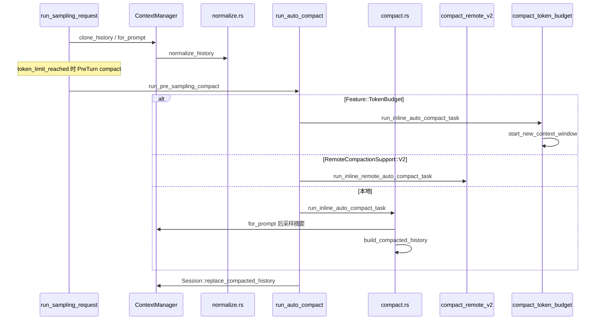

# L06 · History 管理与 Compaction

基线：`67f0994b532b8740f14b5b738af7b7b2a915b1d6`。下文 `file:line` 均在该 commit 用 `rg` 核对。行号会随版本漂移。

## 结论

- `ContextManager`（`core/src/context_manager/history.rs`）是线程 transcript：追加 item、截断超长 tool output、在送给模型前归一化。
- 采样前 `run_sampling_request` 调用 `for_prompt`，不把原始 history 原样发出。缺的 call output 会补 `"aborted"`，孤儿 output 会删掉。
- Auto compact 入口是 `session/turn.rs::run_auto_compact`。三条实现互斥：`Feature::TokenBudget` 只开新窗口；provider 能力 `RemoteCompactionSupport::V2` 走远程摘要；否则本地让模型写 summary。
- 本地 compaction 不保留整段旧对话。`build_compacted_history` 从最新用户消息往回保留，预算 `COMPACT_USER_MESSAGE_MAX_TOKENS = 20_000`，再追加一条 summary user message。
- 阈值不是单一配置项。`ModelInfo::auto_compact_token_limit` 取 `min(字段, context_window 的 90%)`；硬顶是 `effective_context_window_percent`（默认 95）的可用窗口。

## 学习目标

- 画出 history 写入、`for_prompt`、auto/manual compact 三条路径。
- 说出 compact 之后 history 里还剩什么，以及为什么必须保持 call/output 成对。
- 能对比本地摘要、远程 compaction v2、token-budget 换窗。

## 前置

- L03：`run_turn` / `needs_follow_up`。
- L04：`Prompt.input` 是发给 Responses API 的全量输入。
- L05：`build_prompt` 只组装已经准备好的 `Vec<ResponseItem>`，不负责截断 history。

## 调用链



手动 `/compact` 不走 `run_auto_compact`，走 `tasks/compact.rs::CompactTask::run`，分支顺序相同：TokenBudget → remote v2 → `compact::run_compact_task`。

| 顺序 | 位置 | 做什么 |
|---|---|---|
| 1 | `session/turn.rs:1457` `run_pre_sampling_compact` | 先处理换模型 compact，再看 token 是否到限 |
| 2 | `session/context_window.rs:26` `context_window_token_status` | 计算 `token_limit_reached` |
| 3 | `session/turn.rs:1592` `run_auto_compact` | 选择三种实现之一 |
| 4 | `session/turn.rs:1792` `run_sampling_request` | `history.for_prompt`（约 1845 行）再 `build_prompt`（1751） |
| 5 | `session/mod.rs:3847` `record_conversation_items` | 工具结果写回；3964 行 `record_annotated_items` |

## 关键代码导读

| file | symbol | 作用 | 阅读要点 |
|---|---|---|---|
| `core/src/context_manager/history.rs:102` | `ContextManager` | 持有 `Arc<Vec<ResponseItemEnvelope>>` | 只读快照共享 vector；改历史才 `Arc::make_mut` |
| `history.rs:531` | `record_items` | 追加 item，截断 function/custom tool output | 正式写入走 `record_annotated_items`（543），内部同一套截断 |
| `history.rs:631` | `for_prompt` | 生成模型可见 history | 先 `normalize_history`，再把解析失败的图片换成占位文本 |
| `history.rs:1036` | `normalize_history` | 三条不变量 | call 必有 output；output 必有 call；按 modality 去掉 image/audio |
| `history.rs:1160` | `estimate_item_token_count` | 粗估 token | 注释写明是字节启发式，不是 tokenizer |
| `history.rs:1469` | `is_user_turn_boundary` | 用户轮边界 | summary user message **不算**边界，避免 rollback 吃掉摘要 |
| `context_manager/normalize.rs:21` | `ensure_call_outputs_present` | 补缺失 output | 文本是 `"aborted"`；synthetic id 用固定 UUID v5，为了 prompt cache |
| `normalize.rs:171` | `remove_orphan_outputs` | 删除没有 call 的 output | 会 `error_or_panic`，然后仍删除 |
| `normalize.rs:346` | `strip_images_when_unsupported` | 模型不支持图片时剥离 | 同文件还有 `strip_audio_when_unsupported` |
| `session/context_window.rs:8` | `ContextWindowTokenStatus` | 阈值状态 | `token_limit_reached` 或满窗口，或带 buffer 的 auto-compact 限额 |
| `protocol/src/openai_models.rs:563` | `ModelInfo::auto_compact_token_limit` | 有效阈值 | 有 context window 时为 `min(配置, window*9/10)` |
| `models-manager/src/model_info.rs:29` | `with_config_overrides` | 把 `model_auto_compact_token_limit` 写进 `ModelInfo` | config 字段本身在 `core/src/config/mod.rs:659` |
| `config/mod.rs:661` | `model_auto_compact_token_limit_scope` | `Total` 或 `BodyAfterPrefix` | `BodyAfterPrefix` 只数 compaction 前缀之后的 token（`context_window.rs:68`） |
| `compact.rs:64` | `COMPACT_USER_MESSAGE_MAX_TOKENS` | 20_000 | 只约束保留的用户消息，不是整段摘要 |
| `compact.rs:117` | `run_inline_auto_compact_task` | 本地 auto compact | 用 `config.compact_prompt`，否则 `SUMMARIZATION_PROMPT` |
| `compact.rs:154` | `run_compact_task` | 本地手动 compact | `CompactionTrigger::Manual` |
| `compact.rs:587` | `collect_user_messages` | 抽出用户文本 | **仅测试**（`#[cfg(test)]`）。生产用 `collect_annotated_user_messages`（594） |
| `compact.rs:621` | `is_summary_message` | 识别已有摘要 | 以 `SUMMARY_PREFIX` 开头的用户消息不再当原始用户消息保留 |
| `compact.rs:701` | `build_compacted_history` | 重建 history | 从新到旧填满 20k token，最后 push `CompactionSummary` |
| `compact.rs:650` | `insert_initial_context_before_last_real_user_or_summary` | 把初始 context 插回去 | 插在最后一条真实用户消息之前，让摘要/用户消息留在后面 |
| `compact_token_budget.rs:34` | 同名 `run_inline_auto_compact_task` | 不开模型摘要 | `Session::start_new_context_window` |
| `compact_remote_v2.rs:87` | `RETAINED_MESSAGE_TOKEN_BUDGET` | 远程保留预算 64_000 | 与本地 20_000 不是同一个常数 |
| `compact_remote_v2.rs:112` | `run_inline_remote_auto_compact_task` | 远程 auto compact | `turn.rs:14` 把它 alias 成 `run_inline_remote_auto_compact_task_v2` |
| `tasks/compact.rs:18` | `CompactTask` | 手动任务 | `Feature::TokenBudget` 时调用 `run_manual_compact_task` |
| `session/async_compaction.rs:41` | `enabled` | 后台 compact | 需要 `Feature::AsyncCompaction`、非 TokenBudget、且 provider 是 V2 |
| `session/mod.rs:4496` | `replace_compacted_history` | 用摘要替换活 history | compact 成功后的安装点 |

计划勘误：

| 计划写法 | 代码事实 |
|---|---|
| `collect_user_messages` 是生产 API | 生产路径是 `collect_annotated_user_messages`；同名函数只在测试里可见 |
| 只有 `compact.rs` 的 `run_inline_auto_compact_task` | `compact_token_budget.rs:34` 也有同名函数，且 `run_auto_compact` **先**判断 `Feature::TokenBudget` |
| 阈值只看 `model_auto_compact_token_limit` | 该字段经 `with_config_overrides` 进入 `ModelInfo`；`auto_compact_token_limit()` 还会和 90% context window 取 min。另外 `full_context_window_limit_reached` 用默认 95% 窗口 |

## 演示命令

```bash
cd codex-rs
rg -n "fn run_auto_compact|fn for_prompt|fn build_compacted_history|fn context_window_token_status" core/src
rg -n "model_auto_compact_token_limit" core/src/config/mod.rs protocol/src/openai_models.rs models-manager/src/model_info.rs
cargo test -p codex-core --lib compact -- --test-threads=8
cargo test -p codex-core --lib context_manager -- --test-threads=8
```

`codex-core` 编译很重。离线先读测试名：

```bash
rg -n "^fn |^async fn " core/src/compact_tests.rs core/src/context_manager/history_tests.rs | head
```

把 `model_auto_compact_token_limit` 调小再跑长对话会打到模型 API，本课不要求在线执行。看事件名用 `rg -n "ContextCompaction" protocol/src`。

## 动手练习

1. 读 `context_window.rs` 的 `Total` 与 `BodyAfterPrefix` 分支，在笔记里写：同样 100k token，哪种 scope 先触发。
2. 读 `build_compacted_history_with_limit`：用户消息超过剩余 token 时，文本被截断，图片/音频不克隆进保留项。
3. 跑上一节的 `cargo test`。期望：`compact` 与 `context_manager` 相关 lib test 通过。失败时保留编译错误，不要改断言去迎合。

回滚：本练习只读代码、只跑测试。若你在实验分支改了 `model_auto_compact_token_limit` 的测试夹具，用 `git checkout -- codex-rs/core` 丢掉改动。不要把实验写进本课文档。

## 引导问题

1. auto compact 阈值从哪来？
   - 参考答案：`config.model_auto_compact_token_limit` 覆盖模型元数据（`models-manager/src/model_info.rs:29`）。真正比较用 `ModelInfo::auto_compact_token_limit()`（有窗口时再与 90% 取 min）。`context_window_token_status` 还把「已用 token ≥ 有效 context window（默认 95%）」当成必须 compact。`scope=BodyAfterPrefix` 时，限额优先用 config 字段，用量是当前 token 减去窗口 prefill。
2. compaction 后保留哪些用户消息？为什么？
   - 参考答案：本地路径从最新往旧保留，直到 20_000 token；跳过已经是 summary 的用户消息。摘要单独作为最后一条 `CompactionSummary`。保留最近用户原话，是为了摘要丢细节时模型仍能看见最新目标。初始 context（环境/指令片段）会插回，不靠摘要复述。
3. 远程 vs 本地 compaction 的取舍？
   - 参考答案：本地在客户端再打一次 Responses 请求生成摘要，实现在 `compact.rs`，保留预算 20k。远程 v2 由支持 `RemoteCompactionSupport::V2` 的 provider 压缩，保留预算常数是 64k，并可后台跑（`async_compaction.rs`，仍受 `async_compaction_threshold_percent` 约束）。`Feature::TokenBudget` 两边都不摘要，直接换 context window。远程省本地 prompt、依赖服务端；本地可在不支持远程的 provider 上工作，多一次模型调用。

## 面试题

1. 设计题：长对话 coding agent 的 history 要满足哪些不变量？Codex 怎么做？
2. 对比题：用 token 阈值做 compaction，和用 max steps / cost cap 停机，解决的是不是同一个问题？

<details>
<summary>参考答案</summary>

1. 不变量：每条 function/custom/tool-search call 都有 output；没有孤儿 output；模型不支持的 image/audio 不能进 prompt；截断 tool output 只影响活 history，不改 rollout 原文（`record_items` 注释）。Codex 在 `for_prompt` → `normalize_history` 里修配对，缺 output 填 `"aborted"`，synthetic id 稳定以便 cache。Compaction 后再 `replace_compacted_history`，而不是在旧 vector 上打洞。取舍：归一化发生在发送前，内存里的 raw history 仍可能短暂不成对，所以任何直接读 raw item 的代码不能假设已经归一化。
2. Compaction 解决的是「上下文装不下，但任务还要继续」：用摘要换窗口，循环继续。max steps / cost cap 解决的是「不许无限烧钱或无限循环」：到限就停。两者互补。只做 cap，长任务会在窗口满时失败；只做 compaction，失控 agent 会无限摘要。Codex 的 compact 失败会变成 turn error（`run_compact_task_inner` 对非 PreTurn 失败发 `EventMsg::Error`），不是静默丢掉历史。

</details>

## 与 supply-chain-copilot 对比

| 维度 | Codex | supply-chain-copilot | 可借鉴 |
|---|---|---|---|
| 停机 | context window / auto-compact 阈值；compact 失败则报错 | harness 的 max steps 与 cost cap | 两套都要：窗口策略 + 预算停机 |
| 历史 | `ContextManager` + 摘要替换；call/output 配对 | JSONL trace 记录过程 | trace 保留原文；模型输入可以是另一份裁剪视图。Codex 的 rollout 与 `for_prompt` 就是这种分离 |
| 秘密 | tool output 按 token 截断；shell env 另有 redaction（L08） | redaction | 截断防爆窗口，redaction 防泄密，不要互相替代 |
| 重试 | compact 采样复用 `stream_max_retries` | retry + circuit breaker | 摘要请求要有重试上限；连续失败应停，而不是每轮都 compact |

## 待确认

- `cargo test -p codex-core --lib compact` 与 `context_manager` **没有跑**。`codex-core` 的编译图会带上带 v8 patch 的整个 workspace；本环境为了避开 `rusty_v8` 的 Chromium submodule，只编过不含 core 的四个 crate（见 L08/L10 的验证）。符号和行号是用 `rg` 对 `67f0994b` 核对的，不是测试运行时核对的。
- `Feature::TokenBudget`、`Feature::AsyncCompaction`、`RemoteCompactionSupport::V2` 的默认开关：未读一份真实 `~/.codex/config.toml`。
- 把 `model_auto_compact_token_limit` 调小后的在线事件序列：需要 API，未跑。
