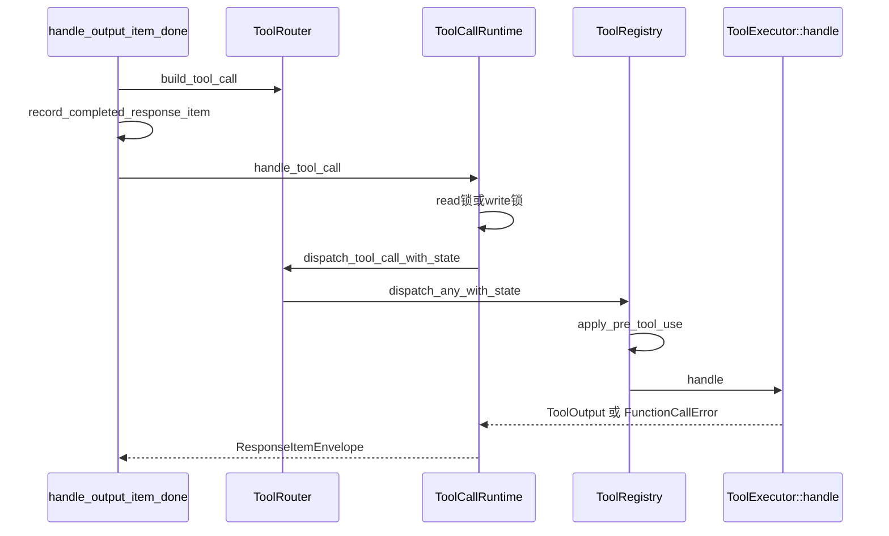

# L07 · 工具定义与分发

基线：`67f0994b532b8740f14b5b738af7b7b2a915b1d6`。`file:line` 已用 `rg` 核对。

## 结论

- 本 turn 暴露哪些工具由 `build_tool_router` → `build_core_tool_registry` 决定，不是模型临时发明。
- 一个 `function_call` 在 SSE item 完成时就入队执行，不等整个 response 结束。入口是 `handle_output_item_done`。
- 并行由每个 handler 的 `supports_parallel_tool_calls` 决定。默认 `false`。`ToolCallRuntime` 用一把 `RwLock`：并行拿读锁，独占拿写锁。
- 错误分两种：`FunctionCallError::RespondToModel` 变成 `function_call_output` 文本；`Fatal` 直接变成 `CodexErr::Fatal`，不交回模型。
- 计划里的 `handlers/current_time.rs` 存在，但工具名是命名空间 `clock` 下的 `curr_time`，不是 `current_time`。它没有参数。带参数的小工具看 `sleep.rs`。

## 学习目标

- 能从 `ResponseItem::FunctionCall` 追到 handler，再追到写回 history 的 output。
- 知道 spec、registry、router、runtime 各管一段。
- 在单独分支上加一个 `echo` 工具，并知道怎么删掉。

## 前置

- L03：`try_run_sampling_request` 消费流，`needs_follow_up` 为真才会再采样。
- L04：Responses API 的 tools 来自 `Prompt.tools`。
- L06：output 写回 `ContextManager` 后，下一轮 `for_prompt` 才会看见。

## 调用链



| 顺序 | 位置 | 做什么 |
|---|---|---|
| 1 | `core/src/stream_events_utils.rs:316` `handle_output_item_done` | `build_tool_call` 成功则 `needs_follow_up = true` |
| 2 | `core/src/tools/router.rs:271` `build_tool_call` | `FunctionCall` / client `ToolSearchCall` / `CustomToolCall` → `ToolCall`；其他 item 返回 `Ok(None)` |
| 3 | `core/src/tools/parallel.rs:107` `handle_tool_call` | 真正调度。`Fatal` 上升为 turn 错误（138 行） |
| 4 | `parallel.rs:286` | `supports_parallel` 则 `lock.read()`，否则 `lock.write()` |
| 5 | `router.rs:367` `dispatch_tool_call_with_state` | 组装 `ToolInvocation` |
| 6 | `registry.rs:724` `dispatch_any_with_state` | 找不到工具 → `RespondToModel`；payload 类型不对 → `Fatal` |
| 7 | `registry.rs:1086` `apply_pre_tool_use` | hook 可以拦住调用 |
| 8 | handler `handle` | 例如 `CurrentTimeHandler::handle` |
| 9 | `parallel.rs:454` `failure_response` | 非 Fatal 错误写成 `FunctionCallOutput`，`success: Some(false)` |
| 10 | `session/mod.rs:3847` `record_conversation_items` | 结果进入 history（L06） |

审批和沙箱不在这条通用链上。shell / `apply_patch` 的 handler 内部再进 `ToolOrchestrator`（L08、L10）。`curr_time` 不进 orchestrator。

## 关键代码导读

| file | symbol | 作用 | 阅读要点 |
|---|---|---|---|
| `core/src/tools/spec_plan.rs:122` | `build_tool_router` | 组装本 step 的 `ToolRouter` | 再往下看 `build_core_tool_registry`（296） |
| `spec_plan.rs:1383` | clock 工具注册 | feature 开关 | `CurrentTimeReminder` 或模型声明 `clock` 才 `registry.add(CurrentTimeHandler)`；`sleep` 另看 `Feature::SleepTool` |
| `core/src/tools/router.rs:99` | `ToolRouter` | spec 列表 + `ToolRegistry` | `model_visible_specs` 是广告给模型的表面；执行走 registry |
| `router.rs:260` | `tool_supports_parallel` | 问 registry | 未注册工具当不能并行 |
| `router.rs:271` | `build_tool_call` | item → `ToolCall` | namespace 用 `ToolName::new(...).with_default_namespace()` |
| `router.rs:367` | `dispatch_tool_call_with_state` | 唯一执行入口 | 测试里还有 `dispatch_tool_call_with_code_mode_result`，标了 `dead_code` |
| `core/src/tools/registry.rs:428` | `ToolRegistry` | `IndexMap<ToolName, RegisteredTool>` | `add` 在 502 行，收 `CoreToolRuntime` |
| `registry.rs:715` | `supports_parallel_tool_calls` | 并行判定 | `ToolExposure::Hidden` 视为不可并行 |
| `registry.rs:724` | `dispatch_any_with_state` | 分发 | 未知工具文案回模型；payload 不匹配是 Fatal |
| `core/src/tools/parallel.rs:49` | `ToolCallRuntime` | 调度器 | `parallel_execution: Arc<RwLock<()>>` |
| `tools/src/tool_executor.rs:122` | `supports_parallel_tool_calls` | 默认 `false` | 只读、无副作用的工具要自己返回 `true` |
| `tools/src/function_call_error.rs:5` | `FunctionCallError` | 两种错误 | core 在 `core/src/function_tool.rs:4` 再导出 |
| `core/src/tools/handlers/current_time.rs:50` | `CurrentTimeHandler` | 小工具样板 | 名 `clock` / `curr_time`；无参数；并行 `true`；`is_builtin_control_tool` |
| `handlers/sleep.rs:30` | `SleepHandler` | 带参数样板 | `parse_arguments`（`handlers/mod.rs:90`）；不覆盖并行，因此独占 |
| `handlers/mod.rs:63` | `pub use current_time::CurrentTimeHandler` | 导出给 spec_plan | 新工具要加一行 `pub use` |
| `handlers/plan.rs` | `update_plan` | 几乎无副作用 | 计划里写的「只发事件」仍在这个 handler；细节本课不展开 |
| `core/src/tools/orchestrator.rs:42` | `ToolOrchestrator` | 审批→沙箱→重试 | 只被需要沙箱的 runtime 调用，不是每个工具 |

计划勘误：

| 计划写法 | 代码事实 |
|---|---|
| 仿照 `current_time` 做 `echo` | 文件在，工具名是 `curr_time`。`echo` 需要参数，解析应抄 `sleep.rs` |
| `dispatch_any_with_state` 在 `tools/registry.rs` 的 crate `tools` | 在 `codex-rs/core/src/tools/registry.rs`。crate `codex-rs/tools` 只有 spec / `FunctionCallError` 等类型 |
| 所有工具都经 Orchestrator | `curr_time` 直接 `handle`。Orchestrator 是 shell / patch 的内层 |

## 演示命令

```bash
cd codex-rs
rg -n "fn build_tool_call|fn dispatch_tool_call_with_state|fn dispatch_any_with_state|fn handle_tool_call" \
  core/src/tools/router.rs core/src/tools/registry.rs core/src/tools/parallel.rs
rg -n "CurrentTimeHandler|SleepHandler" core/src/tools/spec_plan.rs core/src/tools/handlers/mod.rs
cargo test -p codex-core --lib tools::router -- --test-threads=8
```

`tools::router` 的现有测试在 `core/src/tools/router_tests.rs`（例如 `build_tool_call_uses_namespace_for_registry_name`）。它们不覆盖 `curr_time` 的运行时。

## 动手练习

在分支 `study/L07-echo-tool` 上加一个只回显字符串的工具。不要提交到 main。

照抄关系：

| 步骤 | 照谁 | 改什么 |
|---|---|---|
| handler 骨架、`ToolSpec::Namespace`、`CoreToolRuntime` | `handlers/current_time.rs` | 命名空间用 `study`，工具名用 `echo`，避免和 `clock` 的 description 抢同一 namespace |
| 参数 | `handlers/sleep.rs` 的 `SleepArgs` + `parse_arguments` | 字段 `text: String`；schema 用 `JsonSchema::string`（`tools/src/json_schema/types.rs:118`） |
| 成功输出 | `sleep.rs` 的 `FunctionToolOutput::from_text` | 正文返回 `text`。`curr_time` 的自定义 `ToolOutput` 更重，echo 不需要 |
| 并行 | `current_time.rs:57` | `supports_parallel_tool_calls` 返回 `true`（纯函数，无写锁需求） |
| 导出 | `handlers/mod.rs:63` | `pub use echo::EchoHandler;` |
| 注册 | `spec_plan.rs:1390` 附近 | `registry.add(EchoHandler);`。不要套 `Feature::CurrentTimeReminder`，否则默认会话看不到它 |

参数错误用 `FunctionCallError::RespondToModel`，让模型看到 `success: false` 的 output。不要用 `Fatal`，否则整个 turn 失败。

期望结果：

- `cargo test -p codex-core --lib tools::router` 仍然通过（注册新工具不应破坏现有 router 测试）。
- `rg -n "study" core/src/tools/spec_plan.rs` 能看到 `EchoHandler`。
- 若要单测解析，把 `text` 的校验抽成纯函数再 `#[cfg(test)]`。`handle` 需要完整 `ToolInvocation`（含 `Session`），不要为了 echo 去造 session。

回滚：

```bash
git checkout -- codex-rs/core/src/tools/handlers/mod.rs codex-rs/core/src/tools/spec_plan.rs
rm -f codex-rs/core/src/tools/handlers/echo.rs
git status
```

或直接删掉分支：`git checkout main && git branch -D study/L07-echo-tool`。工作区里不应留下 `echo.rs`。

## 引导问题

1. 一个 `function_call` 从 SSE 到 `function_call_output` 经过哪些函数？
   - 参考答案：`handle_output_item_done` → `ToolRouter::build_tool_call` → `record_completed_response_item`（call 先落 history）→ `ToolCallRuntime::handle_tool_call` → 读/写锁 → `dispatch_tool_call_with_state` → `ToolRegistry::dispatch_any_with_state` → `apply_pre_tool_use` → `ToolExecutor::handle`。失败且非 Fatal 时 `failure_response` 造 `FunctionCallOutput`。之后 `record_conversation_items` 把 output 写入 `ContextManager`。
2. 哪些工具能并行？谁决定？
   - 参考答案：handler 的 `supports_parallel_tool_calls`。默认 false（`tools/src/tool_executor.rs:122`）。`curr_time` 显式 true；`sleep` 用默认，因此独占。`ToolRegistry::supports_parallel_tool_calls` 再排除 `Hidden`。调度器是 `ToolCallRuntime` 的 `RwLock`：并行共享读锁，独占写锁会排空其他调用。
3. 错误如何回传模型？
   - 参考答案：`FunctionCallError::RespondToModel(String)` 进入 `failure_response`，output 文本就是错误，`success` 为 false，下一轮采样能看见。`Fatal` 在 `handle_tool_call` 变成 `CodexErr::Fatal`，不写 tool output。未知工具名也是 `RespondToModel`；payload 种类不匹配是 `Fatal`（`registry.rs` 802 行附近）。

## 面试题

1. 为什么 tool 在 `output_item.done` 就执行，而不是等 `response.completed`？
2. 设计题：给 coding agent 加一个新工具，schema、并行、错误、权限应该拆在哪几层？对比你的 harness。

<details>
<summary>参考答案</summary>

1. `handle_output_item_done` 在 call 一结束就 `needs_follow_up = true` 并生成 `tool_future`。注释写明 `handle_tool_call` 在构造 future 时就开始调度，不等 future 被 poll。这样多个 call 可以在后续 item 还在流式到达时按锁策略重叠。等 `response.completed` 会把本可并行的独立调用串成一批，延迟等于最慢的那个之前的排队。代价是 call 必须先 `record_completed_response_item`，否则中断后 history 里有 output 没 call。取消时用 `aborted_response` 补 output（`parallel.rs` 的 defer 分支也这么做）。
2. 四层：spec（模型看见的 JSON schema，`ToolSpec`）、registry（名字 → runtime，feature 决定是否注册）、调度（并行锁、取消、错误映射）、策略（审批/沙箱，只包有副作用的 runtime）。无副作用工具不要进沙箱，避免把 `echo` 做成 shell。对比 supply-chain-copilot：权限三级（read/draft/destructive）可以对应「不注册 / 直接执行 / 进 Orchestrator」。Codex 用类型和 feature 门闩，而不是每个工具里 if-else 一段权限。错误回模型是协议的一部分，不要只打日志。

</details>

## 与 supply-chain-copilot 对比

| 维度 | Codex | supply-chain-copilot | 可借鉴 |
|---|---|---|---|
| 循环 | turn 内采样直到没有 tool call；另有 context compact | harness loop，max steps + cost cap | 步数上限仍然有用：模型可以一直合法调用只读工具 |
| 分发 | `ToolRouter` / `ToolRegistry` / 并行 `RwLock` | 单一 harness 里调工具 | 并行只给只读工具；写工具写锁。这比「全部并行」安全 |
| 权限 | 工具自己决定要不要 `ToolOrchestrator`；另有 read/workspace/full 沙箱 | `read` / `draft` / `destructive` | `echo` = read；`apply_patch` = draft（先验证再审批）；shell `rm` = destructive |
| 失败 | `RespondToModel` vs `Fatal` | retry + circuit breaker | 参数错误应回模型（让它改），基础设施错误才 Fatal / 熔断。不要对 Fatal 再重试 |
| 痕迹 | rollout + tool output 进 history | JSONL trace | trace 记原始 call；给模型的 output 可以截断（L06） |
| 泄密 | 错误字符串会进模型上下文 | redaction | `RespondToModel` 的文案不要带 token、绝对密钥路径 |

## 待确认

- `cargo test -p codex-core --lib tools::router` **没有跑**。原因同 L06：core 的 workspace 解析会去拉 v8。`router.rs` / `registry.rs` / `parallel.rs` / `current_time.rs` 的符号用 `rg` 核对过。
- `echo` 骨架没有在本仓库编译，也没有把 `echo.rs` 留在树上。
- `defer_tool_dispatch` 为真时 future 会推迟（`stream_events_utils.rs:354`）。哪些调用点传入 true，没有逐个执行。
