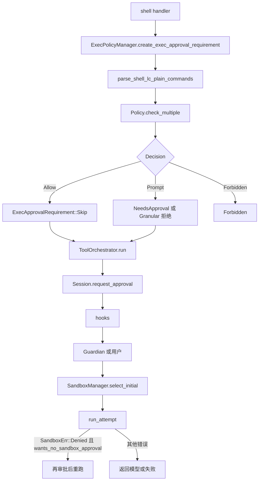

# L08 · 审批、命令安全、execpolicy、Orchestrator

基线：`67f0994b532b8740f14b5b738af7b7b2a915b1d6`。`file:line` 已用 `rg` 核对。

Linux 上沙箱实现主要是 bubblewrap（L09）。**命令是否危险**在 crate `codex-shell-command` 和 `codex-execpolicy`，不在沙箱里。

## 结论

- 两个正交旋钮：`AskForApproval`（何时问人）和文件系统/网络权限（沙箱让命令能不能碰到资源）。问人 ≠ 放开沙箱。
- 默认审批是 `OnRequest`（serde 别名 `on-failure`）。无匹配规则时，非危险命令在受限沙箱里直接跑；危险命令仍要问。
- `rm -rf` 命中 `DangerousCommandMatch::ForcedRm`。在没有 execpolicy allow 规则时，**三种沙箱形态都不会自动放行**：`Never` 直接 Forbidden，其余策略 Prompt。
- `bash -lc "..."` 先被拆开。execpolicy 用「纯命令序列」`parse_shell_lc_plain_commands`；危险启发式用更宽的 `parse_shell_lc_literal_commands`（复杂语法也能抽出字面命令，但不能用来证明安全）。
- 多条规则的 decision 用 `Ord` 取 max。枚举顺序是 `Allow < Prompt < PromptUser < Forbidden`，所以 Forbidden 赢。
- `ToolOrchestrator::run` 的顺序是：审批 → 选沙箱 → `run_attempt` → 只有 `SandboxErr::Denied` 且工具愿意升级时，才可能再问一次并重跑。`OnRequest` 默认 **不** 做无沙箱重跑。

## 学习目标

- 画 `AskForApproval` × 沙箱形态下 `rm -rf build` 的处理表，并能指到函数。
- 说清 execpolicy DSL、启发式、Guardian、用户审批谁先谁后。
- 会写一条 `prefix_rule` 并用 `codex execpolicy check` 看 decision。

## 前置

- L07：工具分发。本节从 handler 进入 `ToolOrchestrator` 开始。
- L09：沙箱如何执行。本节只讲「选不选沙箱、失败后升不升级」。

## 调用链



`request_approval` 内部顺序（`core/src/tools/approvals.rs`）：

| 顺序 | 位置 | 行为 |
|---|---|---|
| 1 | `approvals.rs:596` | permission hooks。Deny 直接拒绝；Allow 且不要求人工则通过 |
| 2 | `approvals.rs:687` `request_reviewer_approval` | `requires_human_approval`（`PromptUser` / `NeedsHumanApproval`）则只问人 |
| 3 | `approvals.rs:689` | 否则先 `request_guardian_approval`；Guardian 没给出决定再问人 |

## 关键代码导读

| file | symbol | 作用 | 阅读要点 |
|---|---|---|---|
| `protocol/src/protocol.rs:1146` | `AskForApproval` | 何时问人 | `UnlessTrusted`=`untrusted`；`OnRequest` 默认，别名 `on-failure`；`Granular`；`Never` |
| `protocol.rs:1172` | `GranularApprovalConfig` | 分项开关 | `sandbox_approval`、`rules`、`skill_approval`、`request_permissions`、`mcp_elicitations`。字段 false 表示自动拒绝，不是改问别人 |
| `protocol.rs:1232` | `SandboxPolicy` | 旧沙箱形态 | `danger-full-access` / `read-only` / `workspace-write`。运行时更多走 `PermissionProfile` |
| `protocol/src/approvals.rs:42` | `ExecPolicyAmendment` | 「以后允许这个前缀」 | 透明包装 `Vec<String>` |
| `approvals.rs:275` | `ExecApprovalKind` | Command / HumanCommand / WriteStdin | `HumanCommand` 不能用自动审批 |
| `approvals.rs:284` | `ExecApprovalRequestEvent` | 发给 UI 的审批事件 | 协议契约，core / TUI / app-server 共用 |
| `shell-command/src/parse_command.rs:54` | `parse_command` | 给 UI 的命令摘要 | 注释写明解析有损，目标是可读说明，不是安全证明 |
| `shell-command/src/bash.rs:124` | `parse_shell_lc_plain_commands` | execpolicy 拆分 | 仅 word-only 命令 + 安全运算符。失败则整条 argv 当一条 |
| `bash.rs:136` | `parse_shell_lc_literal_commands` | 危险命令拆分 | 接受复杂语法；丢掉动态词和重定向。**不能**用来证明安全 |
| `shell-command/src/command_safety/is_dangerous_command.rs:28` | `DangerousCommandMatch` | `ForcedRm` 或 `Other` | `rm` 带 `-f`/`--force` 即 `ForcedRm`（205 行） |
| `is_dangerous_command.rs:38` | `dangerous_command_match` | 启发式入口 | 会剥 `sudo`/`env`/`exec`，并递归 `bash -lc` |
| `command_safety/mod.rs:1` | 模块注释 | PowerShell | tree-sitter 用于生产分类；子进程 parser 只在 `#[cfg(test)]` 当 oracle |
| `execpolicy/src/decision.rs:9` | `Decision` | Allow / Prompt / PromptUser / Forbidden | `Decision::parse` 只接受 `allow`/`prompt`/`forbidden`。`prompt-user` 不在 `parse` 里 |
| `execpolicy/src/policy.rs:274` | `Policy::check` | 单条命令 | 无规则时用 heuristics fallback |
| `policy.rs:301` | `check_multiple` | 多子命令 | 匹配集合并后取 decision 的 max |
| `policy.rs:493` | `Evaluation::from_matches` | 合并 | `matched_rules.iter().map(decision).max()` |
| `execpolicy/src/parser.rs:349` | `prefix_rule` | Starlark DSL | `pattern` 第一个 token 是程序名；默认 decision 是 Allow |
| `execpolicy/src/amend.rs:65` | `blocking_append_allow_prefix_rule` | 把 allow 规则追加到文件 | 生成 `prefix_rule(pattern=[...], decision="allow")` |
| `core/src/exec_policy.rs:337` | `create_exec_approval_requirement_for_command` | 命令 → 审批需求 | 测试可见；生产走 `_for_platform`（348） |
| `exec_policy.rs:807` | `render_decision_for_unmatched_command_for_platform` | 无规则时的启发式 | 危险 **或** Windows 无沙箱后端 → Prompt；`Never` 则 Forbidden |
| `exec_policy.rs:220` | `prompt_is_rejected_by_policy` | Prompt 被策略否决 | `Never` 一律拒绝。`Granular` 用 `rules` 或 `sandbox_approval` |
| `exec_policy.rs:490` | `append_amendment_and_update` | 持久化 amendment | 写到 `$CODEX_HOME/rules/default.rules`（56–58 行常量） |
| `core/src/tools/sandboxing.rs:349` | `wants_no_sandbox_approval` | 谁允许无沙箱重试 | `UnlessTrusted` true；`Never`/`OnRequest` false；`Granular` 看 `sandbox_approval` |
| `core/src/tools/orchestrator.rs:54` | `run_attempt` | 一次执行 | 先 `begin_network_approval`，再 `tool.run` |
| `orchestrator.rs:125` | `ToolOrchestrator::run` | 全程 | 见下面升级条件 |
| `orchestrator.rs:446` | 升级注释 | `Never`/`OnRequest` 不无沙箱重跑 | `OnRequest` 仅当网络审批上下文存在且默认需求是 `NeedsApproval` 时例外 |
| `core/src/safety.rs:19` | `SafetyCheck` | AutoApprove / AskUser / Reject | patch 用，命令路径不走这里 |
| `safety.rs:67` | `assess_patch_safety` | patch 是否可自动过 | L10 详细读。`UnlessTrusted` 直接 `AskUser` |
| `protocol/src/shell_environment.rs:138` | 默认 env 过滤 | 子进程环境 | 去掉 `*KEY*`、`*SECRET*`、`*TOKEN*`，除非 `ignore_default_excludes` |
| `core/src/exec_env.rs:32` | `create_env` | 调上面的过滤 | 注释：先 `env_clear` 再灌这张表，避免泄漏 |

计划勘误：

| 计划写法 | 代码事实 |
|---|---|
| `shell-command/src/command_safety/parse_command.rs` | 解析在 `shell-command/src/parse_command.rs`；`bash -lc` 拆分在 `shell-command/src/bash.rs` |
| `codex execpolicy` 子命令细节未写清 | CLI 是 `codex execpolicy check`（`cli/src/main.rs:510`），参数类型 `ExecPolicyCheckCommand`（`execpolicy/src/execpolicycheck.rs:17`） |
| 危险命令表会随 read-only / workspace-write / full access 变化 | 对 `ForcedRm` 且无 allow 规则时，三种形态的 **Decision 相同**。沙箱形态影响的是非危险命令，以及批准之后是否真的进沙箱 |

### `rm -rf build` 处理表

前提：argv 已是 `["rm","-rf","build"]` 或被拆成这条；没有匹配的 execpolicy 规则。`dangerous_command_match` 返回 `ForcedRm`（测试 `rm_rf_is_dangerous` 在 `is_dangerous_command.rs:226`）。随后 `render_decision_for_unmatched_command_for_platform`（836 行）只看是不是危险和 `AskForApproval`，不看 read-only / workspace-write / full access。

| `AskForApproval` | read-only / workspace-write / danger-full-access |
|---|---|
| `OnRequest`（默认） | `Decision::Prompt` → `NeedsApproval` → 问人。拒绝则命令不跑 |
| `UnlessTrusted` | 同上，Prompt |
| `Never` | `Decision::Forbidden` → `ExecApprovalRequirement::Forbidden`，不跑 |
| `Granular` 且 `sandbox_approval=true` | 启发式 Prompt 不是 policy rule（`prompt_is_rule=false`）→ 仍问人 |
| `Granular` 且 `sandbox_approval=false` | `prompt_is_rejected_by_policy` 返回拒绝 → Forbidden |

批准之后沙箱才分叉：full access / unrestricted 可能 `SandboxType::None`；read-only 与 workspace-write 仍进沙箱。`rm -rf build` 在 workspace-write 里能不能删掉 `build/`，取决于该路径是不是 writable root，这是 L09，不是审批 Decision。

`bash -lc "git status && rm -rf /"`：

| 层 | 函数 | 结果 |
|---|---|---|
| execpolicy | `parse_shell_lc_plain_commands` | 脚本若只是 word 命令 + `&&`，拆成 `git status` 与 `rm -rf /` 再 `check_multiple` |
| 启发式 | `parse_shell_lc_literal_commands` + `dangerous_command_match_with_depth` | `rm -rf /` 命中 `ForcedRm` |
| 合并 | `Evaluation::from_matches` 取 max | 任一子命令 Forbidden/Prompt 会盖过另一条的 Allow |

若脚本含管道、替换、重定向，plain parser 可能返回 `None`，整段当成一条命令交给启发式；字面量解析仍会从 AST 里抽出 `rm`。两条解析器用途不同，不要混用。

无沙箱重跑（`orchestrator.rs:402` 起）全部满足才发生：

| 条件 | 代码 |
|---|---|
| 错误是 `SandboxErr::Denied` | 其他沙箱错误直接返回 |
| `tool.escalate_on_failure()` | 默认 true（`sandboxing.rs:363`） |
| `wants_no_sandbox_approval(policy)` | `OnRequest` 为 false，故默认 **不** 重跑；网络策略拦截另有例外（450 行） |
| `unsandboxed_execution_allowed` 或存在网络审批上下文 | 文件系统不允许提权且不是网络问题时放弃 |
| 未 bypass 时再 `request_approval` | Guardian 对第一次的批准 **不** 覆盖升级后的权限（文件头注释） |

## 演示命令

```bash
cd codex-rs
rg -n "enum AskForApproval|enum Decision|fn wants_no_sandbox_approval|fn render_decision_for_unmatched" \
  protocol/src/protocol.rs execpolicy/src/decision.rs core/src/tools/sandboxing.rs core/src/exec_policy.rs
cargo test -p codex-shell-command --lib command_safety
cargo test -p codex-execpolicy --lib
```

`codex execpolicy check`（不必先构建整份 CLI，库测试已覆盖 parser）示例规则文件 `example.rules`：

```python
prefix_rule(
    pattern=["git", "status"],
    decision="allow",
    match=[["git", "status"], ["git", "status", "--short"]],
    not_match=[["git", "push"]],
)
```

```bash
cargo run -p codex-execpolicy -- check -r example.rules -- git status
cargo run -p codex-execpolicy -- check -r example.rules --pretty -- rm -rf build
```

`check` 只打印规则匹配，**不**跑 `dangerous_command_match`（`execpolicycheck.rs:45` 的 heuristics fallback 是 `None`）。在本环境用编出来的 `codex-execpolicy check -r example.rules --pretty -- rm -rf build`，输出是 `{"matchedRules":[]}`，退出码 0，没有 `decision` 字段。这不表示 agent 会放行 `rm -rf`。agent 路径的启发式在 `core/src/exec_policy.rs`。同一条规则下 `git status` 的输出是 `{"matchedRules":[...],"decision":"allow"}`。

## 动手练习

1. 抄上表到笔记，并在 `render_decision_for_unmatched_command_for_platform` 旁写下：危险命令为什么与沙箱形态无关。
2. 在 `is_dangerous_command.rs` 的 `mod tests` 里加 3 个断言（文件已有 `rm_rf_is_dangerous` 可当模板）：
   - `git push --force`：先 `rg` 确认现有规则是否把它标成危险。若没有对应 match，测试应断言 `None`，不要发明一条你希望存在的规则。
   - `find . -delete`：同样，只断言代码今天的行为。
   - `["bash","-lc","git status && rm -rf /"]`：断言 `Some(ForcedRm)`。
3. `cargo test -p codex-shell-command --lib is_dangerous_command`。
4. 写一条 `prefix_rule`，用上一节的 `cargo run -p codex-execpolicy -- check` 看 JSON 里的 `decision`。

期望：新断言与当前实现一致；execpolicy check 对 allow 规则返回 `allow`。若 `git push --force` 今天不是危险命令，测试锁定 `None` 就是对的。

回滚：

```bash
git checkout -- codex-rs/shell-command/src/command_safety/is_dangerous_command.rs
rm -f example.rules
```

不要把练习规则写进 `$CODEX_HOME/rules/default.rules`。那是 `append_amendment_and_update` 的真实持久化位置。

## 引导问题

1. approval policy 与 sandbox policy 如何组合？为何默认 `OnRequest`？
   - 参考答案：`AskForApproval` 决定问不问人；`SandboxPolicy` / `PermissionProfile` 决定进程的文件系统和网络。`OnRequest`（`protocol.rs:1156` 的 `#[default]`）让非危险、未要求提权的命令在 Restricted 沙箱里 `Decision::Allow`（`exec_policy.rs:865`），危险命令和提权请求才 Prompt。`Never` 连危险命令也不问，直接 Forbidden，而不是悄悄在沙箱外执行。`UnlessTrusted` 对未命中 allow 规则的命令一律 Prompt。
2. `bash -lc "git status && rm -rf /"` 如何拆开判定？
   - 参考答案：见上表。execpolicy 用 plain parser；危险检测用 literal parser，递归进 `dangerous_command_match_with_depth`。合并取最严 decision。literal parser 注释写明不能证明安全。
3. `run_attempt` 失败后何时请求无沙箱重跑？
   - 参考答案：仅 `SandboxErr::Denied`，且 `escalate_on_failure`，且 `wants_no_sandbox_approval`。默认 `OnRequest` 不满足第三项，拒绝结果回到模型（注释 446 行：把沙箱拒绝交回去，不重试）。`UnlessTrusted` 会再问人，批准后的 retry 使用 `SandboxType::None`（当 `unsandboxed_allowed`）。第一次 Guardian 批准不算升级批准。

## 面试题

1. 为什么不能用正则判断 `rm -rf` 安不安全？Codex 的分层是什么？
2. 对比：三级权限 `read/draft/destructive` 和 Codex 的 approval × sandbox，哪个更不容易配错？

<details>
<summary>参考答案</summary>

1. shell 有引号、`&&`、`sudo`/`env` 包装、`bash -c` 嵌套。正则既会漏（`/bin/rm -fr`）也会误伤。Codex 分层：tree-sitter 把 `bash -lc` 拆开（plain 供策略，literal 供危险检测）→ execpolicy 前缀规则 → 无规则才用启发式 → `AskForApproval` 把 Prompt 变成问人或 Forbidden → 剩下的交给沙箱。启发式只覆盖已知危险形状（`ForcedRm` 等），不是完备的安全证明。`parse_command` 自己的注释也说解析是有损的，给 UI 看的。
2. 三级权限好讲、好映射到产品（读、起草、破坏），但一个级别里混了「问人」和「OS 隔离」。Codex 拆开之后，workspace-write + `OnRequest` 可以自动跑 `git status`，同时仍然拦截 `rm -rf`。代价是组合表变大，默认值必须写进代码（`OnRequest` + 危险命令仍 Prompt）。可以借鉴的是：destructive 不要等于「用户点过一次就永远无沙箱」。Codex 的 amendment 是前缀 allow，并且升级重跑要重新审批。

</details>

## 与 supply-chain-copilot 对比

| 维度 | Codex | supply-chain-copilot | 可借鉴 |
|---|---|---|---|
| 权限 | approval policy × filesystem/network profile，再加 execpolicy 规则 | `read` / `draft` / `destructive` | 保留三级作为产品语言；实现上把「问人」和「OS 约束」分开 |
| 危险命令 | 解析 + 规则 + 启发式，Forbidden 优先 | 级别直接决定能不能做 | 对 destructive 不要只靠级别名；拆开组合命令再判定 |
| 失败重试 | 沙箱 Denied 最多再问一次，且 `OnRequest` 默认不问 | retry + circuit breaker | 沙箱拒绝不是瞬态错误，不该自动重试。熔断适合网络/模型 5xx，不适合 `rm` 被拒绝 |
| 环境变量 | `*KEY*`/`*SECRET*`/`*TOKEN*` 默认不进子进程 | redaction | 子进程 env 和日志 redaction 都要做。`create_env` 是执行边界，redaction 是 trace 边界 |
| 审计 | `ExecApprovalRequestEvent`、amendment 写入 `rules/default.rules` | JSONL trace | 批准与规则变更要进 trace，否则「以后都允许」无法复查 |

## 待确认

- 已跑通（Rust 1.95，临时去掉 v8 patch 与 `code-mode-host` / `code-mode-runtime` / `v8-poc` 三个 member，以便不拉取 `rusty_v8`；测完还原 `Cargo.toml` / `Cargo.lock`，不进提交）：
  - `cargo test -p codex-shell-command`：192 passed
  - `cargo test -p codex-execpolicy`：lib 7 passed，`tests/basic.rs` 29 passed
- `git push --force`、`find . -delete` 是否算危险：练习要求自己 `rg` 后写断言。本课不把它们写成「一定危险」或「一定安全」。
- Guardian 在自动审查关闭时是否返回 `None` 再落到用户弹窗：`request_guardian_approval`（701 行）后半段依赖 `approvals_reviewer`，未对真实 config 做实验。
- `codex execpolicy check` 对无规则的 `rm -rf build` 已在本环境执行，见上面的演示命令。agent 里的 `ForcedRm` 判定没有再跑一遍 core 集成测试。
