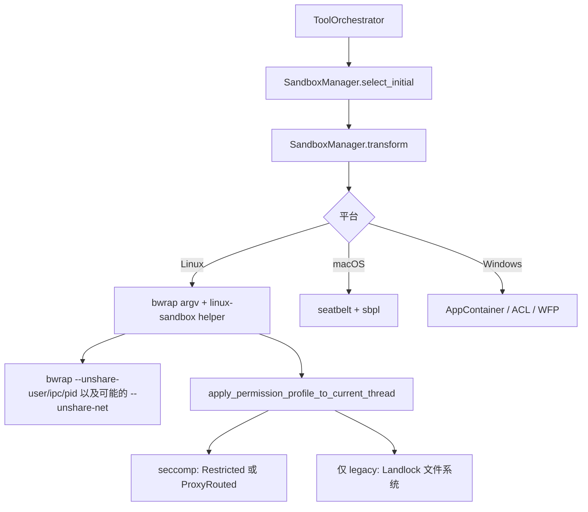

# L09 · Sandbox

基线：`67f0994b532b8740f14b5b738af7b7b2a915b1d6`。`file:line` 已用 `rg` 核对。

本课平台是 Linux。文件系统隔离的主路径是 **bubblewrap（bwrap）**。Landlock 文件系统是遗留实现，helper 对受限文件系统拒绝走 legacy。seccomp 负责网络 syscall 和 VM socket，不是文件系统主隔离。

## 结论

- 统一入口是 `sandboxing/src/manager.rs` 的 `SandboxManager`：`should_sandbox` → `select_initial` → `transform` 把用户命令包进平台命令。
- Linux 上 `get_platform_sandbox` 返回的枚举值叫 `SandboxType::LinuxSeccomp`。名字是历史的。真正的目录挂载在 `linux-sandbox` 的 bwrap 参数里。
- workspace-write 仍把 `.git`、`.agents`、`.codex`、`.aws` 收成只读。实现在 `protocol/src/permissions.rs` 的默认 filesystem policy，沙箱后端只执行这张表。
- 网络有两条，不是二选一的口头禅：bwrap `--unshare-net` 拿走宿主 netns；seccomp 在 Restricted 模式禁掉 `connect`/`bind` 和非 `AF_UNIX` 的 `socket`。Proxy 模式仍 unshare netns，但允许 `AF_INET`/`AF_INET6` 去连 namespace 里的本地代理。
- 「是不是沙箱杀的」没有确定性。`denial.rs::is_likely_sandbox_denied` 看退出码和输出关键字；`violation.rs` 用同一组关键字做分类。exit 0 不算拒绝。

## 学习目标

- 对照 macOS Seatbelt、Linux bwrap+seccomp、Windows AppContainer/ACL/WFP，说出各自挡什么。
- 在 Linux 上用 **实际存在的 CLI** 做一次拒绝实验，而不是计划里的 `sandbox linux` 子命令。
- 能从一次失败区分：普通非零退出 vs 疑似沙箱拒绝。

## 前置

- L08：Orchestrator 已经决定 `SandboxType` 和权限。本课只讲进程怎么被包起来。
- 不需要先会写 Seatbelt profile。macOS/Windows 路径本课标为阅读，不在 Linux 上执行。

## 调用链



| 顺序 | 位置 | 做什么 |
|---|---|---|
| 1 | `sandboxing/src/manager.rs:313` `select_initial` | 不该沙箱则 `SandboxType::None`，否则 `get_platform_sandbox` |
| 2 | `manager.rs:50` `get_platform_sandbox` | Linux → `LinuxSeccomp`；macOS → `MacosSeatbelt`；Windows 看开关 |
| 3 | `manager.rs:355` `transform` | 按 `SandboxType` 改 argv。Linux 分支在 477 行 |
| 4 | `sandboxing/src/landlock.rs` | `create_linux_sandbox_command_args_for_permission_profile` 生成 helper 命令行 |
| 5 | `linux-sandbox/src/bwrap.rs:107` `BwrapNetworkMode` | `FullAccess` / `Isolated` / `ProxyOnly`。后两者 `--unshare-net` |
| 6 | `linux-sandbox/src/seccomp.rs:45` | 当前线程装 seccomp，子进程继承。文件系统注释指向 bwrap |
| 7 | `sandboxing/src/denial.rs:13` | 执行后判断是不是像沙箱拒绝 |
| 8 | `sandboxing/src/violation.rs:139` | 把输出分类成 `FileSystemSandboxViolation` |

`process-hardening/src/lib.rs:12` `pre_main_hardening` 是进程自身加固（禁 core dump、清 `LD_`），不是用户命令的沙箱。

## 关键代码导读

| file | symbol | 作用 | 阅读要点 |
|---|---|---|---|
| `sandboxing/src/manager.rs:44` | `SandboxablePreference` | Auto / Require / Forbid | Forbid 直接不沙箱 |
| `manager.rs:313` | `select_initial` | 选 `SandboxType` | 先问 `should_sandbox`。没有平台实现就 `None` |
| `manager.rs:334` | `should_sandbox` | 要不要隔离 | Auto 时看 profile 是否需要平台沙箱，或是否有 managed network |
| `manager.rs:355` | `transform` | 命令变形 | `SandboxType::None` 原样 argv |
| `manager.rs:568` | `transform_for_direct_spawn` | 直接 spawn 的另一入口 | Windows 测试覆盖了它 |
| `sandboxing/src/denial.rs:13` | `is_likely_sandbox_denied` | 启发式 | `SandboxType::None` 或 exit 0 → false。exit 2/126/127 直接当普通失败。Linux `SIGSYS`（128+SIGSYS）当拒绝 |
| `denial.rs:45` | `is_likely_executor_managed_sandbox_denied` | 远端执行器 | 在 stdout/stderr 里找关键字 |
| `sandboxing/src/violation.rs:11` | `SANDBOX_DENIED_KEYWORDS` | 同一组词 | `operation not permitted`、`permission denied`、`read-only file system`、`seccomp`、`sandbox`、`landlock`、`failed to write file` |
| `protocol/src/permissions.rs:40` | `PROTECTED_METADATA_PATH_NAMES` | `.git` `.agents` `.codex` `.aws` | 为什么要保护：seatbelt 测试注释写了 `.git/hooks` 可被写成后门（`seatbelt_tests.rs` 约 3107 行） |
| `permissions.rs:860` | `append_default_read_only_project_root_subpath_if_no_explicit_rule` | workspace 可写时仍把这些子树标只读 | 显式规则可以覆盖默认 |
| `sandboxing/src/bwrap.rs` | bwrap 参数构造（sandboxing crate 侧） | 与 linux-sandbox 里的另一份 bwrap 参数配合 | 读 Linux 时以 `linux-sandbox/src/bwrap.rs` 的 `--unshare-net` 为准 |
| `linux-sandbox/src/seccomp.rs:3` | 模块注释 | 文件系统归 bwrap | legacy Landlock 只在 `apply_landlock_fs` |
| `seccomp.rs:149` | `install_filesystem_landlock_rules_on_current_thread` | 遗留 | 全盘只读，只给 writable roots 和 `/dev/null` 写。helper 对「非全盘可读」直接 `UnsupportedOperation`（82 行） |
| `seccomp.rs:181` | `install_network_seccomp_filter_on_current_thread` | 网络 filter | Restricted：禁 `connect` 等，`socket` 只留 `AF_UNIX`。ProxyRouted：允许 IPv4/IPv6 |
| `seccomp.rs:117` | `network_seccomp_mode` | 模式选择 | 网络已放开且不是 proxy 时可以不装 filter；proxy 用 `ProxyRouted` |
| `linux-sandbox/src/bwrap.rs:290` | `--unshare-net` | netns | `Isolated` 与 `ProxyOnly` 都会 unshare |
| `linux-sandbox/src/proxy_routing.rs` | 代理路由 | proxy 模式把流量送进 netns 里的桥 | 与 seccomp 允许 IP socket 是配套，不是替代 |
| `sandboxing/src/seatbelt.rs` | `create_seatbelt_command_args` | macOS | profile 在 `seatbelt_*.sbpl` |
| `sandboxing/src/windows.rs` | Windows 桥 | 具体在 `windows-sandbox-rs/` | 本环境不跑 |
| `cli/src/main.rs:465` | `SandboxCommand` | `codex sandbox` | Linux 的 host 参数类型是 `LandlockCommand`（481 行）。子命令只有 `Uninstall` |
| `cli/src/lib.rs:108` | `LandlockCommand` | 调试入口 | 命令是 trailing vararg，没有 `linux` 子命令 |
| `cli/src/debug_sandbox.rs:692` | 默认只读 | legacy config | 注释：`codex sandbox` 历史上默认 read-only，除非这次显式覆盖了 legacy `sandbox_mode`，或 config 已用 permission profiles |

计划勘误：

| 计划写法 | 代码事实 |
|---|---|
| `codex sandbox linux -- touch /etc/x` | 本 commit 的 `SandboxSubcommand` 只有 `Uninstall`。Linux 上是 `codex sandbox -- touch /etc/x` |
| Landlock + seccomp 是 Linux 主隔离 | 文件系统主路径是 bwrap。Landlock FS 是 legacy，且不支持「不是全盘可读」的策略 |
| 网络要么 seccomp 要么 netns | 两者一起用。netns 由 bwrap `--unshare-net`；seccomp 限制 socket 族。Proxy 模式是 unshare 之后再桥接 |

### 三平台对照

| | macOS | Linux（本 commit） | Windows |
|---|---|---|---|
| 进程包装 | `sandbox-exec` + SBPL | bwrap（user/ipc/pid，按需 net） | restricted token / AppContainer（`windows-sandbox-rs`） |
| 文件 | seatbelt allow/deny | bwrap bind mount；legacy 才是 Landlock | ACL |
| 网络 | seatbelt 网络 profile | `--unshare-net` + seccomp；或 proxy netns | WFP（`wfp_setup.rs`） |
| `.git` 只读 | 同一张 `FileSystemSandboxPolicy` | 同一张 policy | 同一张 policy |
| 拒绝信号 | 输出关键字；可选 `log stream`（`--log-denials`） | 关键字、`SIGSYS` | 平台错误文本 |

## 演示命令

先看帮助，不要加 `linux`：

```bash
cd codex-rs
rg -n "struct LandlockCommand|enum SandboxSubcommand|fn get_platform_sandbox" \
  cli/src/lib.rs cli/src/main.rs sandboxing/src/manager.rs
cargo test -p codex-sandboxing --lib denial -- --test-threads=8
cargo test -p codex-sandboxing --lib violation -- --test-threads=8
```

二进制实验（需要已构建的 `codex`，以及系统上的 `bwrap`）：

```bash
# legacy config 下调试沙箱默认偏 read-only，见 debug_sandbox.rs:692
codex sandbox -- touch /etc/x
codex sandbox -- curl -I https://example.com
```

若本机 config 使用 permission profiles，这次 `codex sandbox` **不会**强制改回 read-only，而会沿用当前 profile（同一函数 712 行）。要强制只读，用一个临时 `CODEX_HOME`：

```bash
rm -rf /tmp/codex-sandbox-home
mkdir -p /tmp/codex-sandbox-home
CODEX_HOME=/tmp/codex-sandbox-home codex sandbox -- touch /etc/x
```

期望（代码推断，未在本环境执行二进制）：写 `/etc/x` 应失败；输出里常有 `Read-only file system` 或 `Operation not permitted`，从而被 `is_likely_sandbox_denied` 当成沙箱拒绝。`curl` 在网络受限时失败方式可能是 seccomp `EPERM` 或 netns 里没有路由，两者都算隔离，退出码不一定相同。

macOS 练习（只读，不在 Linux 改规则）：打开 `sandboxing/src/seatbelt_base_policy.sbpl`，对照 `seatbelt_tests.rs` 里 `.git` 只读用例。不要在 Linux 上跑 seatbelt。

## 动手练习

1. 读 `permissions.rs:820` 起的默认 workspace policy，列出：根只读、项目根可写、然后四个元数据目录被加回只读。
2. 读 `seccomp.rs` 的 `NetworkSeccompMode` 三分支，用一句话写 Restricted 和 ProxyRouted 允许的 socket 族。
3. 跑 `cargo test -p codex-sandboxing --lib denial` 与 `violation`。期望：关键字与 `SIGSYS` 的单测通过。
4. 可选：在临时 `CODEX_HOME` 下跑 `codex sandbox -- touch /etc/x`。把退出码和 stderr 贴回笔记，对照关键字表。

回滚：

```bash
rm -rf /tmp/codex-sandbox-home
# 本练习不应改仓库。若改了 sbpl 或测试：
git checkout -- codex-rs/sandboxing codex-rs/linux-sandbox
```

不要对真实 `~/.codex` 做实验。

## 引导问题

1. workspace-write 下 `.git` 为什么仍只读？在哪实现？
   - 参考答案：可写仓库里若允许写 `.git/hooks` 或 `.git/config`，沙箱里的命令就能在下次 git 操作时跑宿主代码。默认 policy 在 `protocol/src/permissions.rs:860` 把 `.git`、`.agents`、`.codex`、`.aws` 加为只读，除非已有显式规则。Seatbelt/bwrap/Windows 都消费这张 `FileSystemSandboxPolicy`，不是各写一套黑名单。
2. Linux 网络隔离是 seccomp 禁 socket，还是 netns + proxy？
   - 参考答案：都有。`BwrapNetworkMode::Isolated` 与 `ProxyOnly` 都 `--unshare-net`（`bwrap.rs:121`）。没有 proxy 时 seccomp `Restricted` 禁 `connect` 且 `socket` 仅 `AF_UNIX`。`ProxyRouted` 允许 `AF_INET`/`AF_INET6`，流量由 `proxy_routing.rs` 在 netns 里接到代理。文件系统不靠这层，靠 bwrap。另外即使网络放开，非全盘写权限仍可能装 `VmSocketRestricted`，只挡 `AF_VSOCK`（`seccomp.rs:60` 注释：WSL 互通）。
3. 如何识别「沙箱失败」而不是普通失败？
   - 参考答案：`is_likely_sandbox_denied`：无沙箱或 exit 0 则不是；2/126/127 当普通失败（命令不存在等）；Linux seccomp 的 `SIGSYS` 算是；其余看输出关键字。注释承认这不是完备判定（用户 shell 启动脚本也可能打出 `permission denied`）。Orchestrator 只把已归类的 `SandboxErr::Denied` 拿去考虑升级（L08）。

## 面试题

1. 为什么 coding agent 不能只靠「提示模型不要删文件」？Linux 上 Codex 挡了哪几层？
2. 设计题：workspace-write 还要把 `.git` 设成只读，这和「让代理改代码」矛盾吗？

<details>
<summary>参考答案</summary>

1. 模型会犯错，也会被不可信的仓库内容带偏。Linux 上：审批/execpolicy 决定命令能不能启动（L08）；bwrap 限制看见和写入的路径；seccomp + netns 限制网络；`pre_main_hardening` 降低沙箱进程被 ptrace/preload 的风险。任何一层都有洞：bwrap 需要 setuid 或 user namespace；关键字检测会误判；legacy Landlock 甚至不支持细粒度只读。所以是纵深，不是单一开关。枚举名叫 `LinuxSeccomp` 容易让人以为文件系统也是 seccomp，面试里要主动纠正。
2. 不矛盾。改代码需要写工作区文件；改 `.git` 会改变提交、钩子和对象库，等于逃出「只改工作树」的授权。默认只读子树是策略，显式规则可以打开，但打开就要当成提权。supply-chain-copilot 的 `draft` 若只表示「生成补丁不落盘」，还缺这一层：补丁一旦应用到工作区，仍要禁止写 `.git`。OS 策略比应用级 if 更靠近系统调用。

</details>

## 与 supply-chain-copilot 对比

| 维度 | Codex | supply-chain-copilot | 可借鉴 |
|---|---|---|---|
| 隔离 | OS：bwrap / seatbelt / Windows sandbox | 应用级 `read`/`draft`/`destructive` | 三级权限决定 **是否调用**；调用之后仍要 OS 沙箱。只有级别等于没有隔离 |
| 网络 | netns + seccomp + 可选 proxy | 未见独立网络沙箱（以你项目现状为准） | `destructive` 以外的读操作也不该随便出网 |
| 失败 | 沙箱拒绝不是普通非零；默认不自动裸奔重试 | retry + circuit breaker | 把 `SandboxDenied` 从可重试错误里划出去，否则熔断器会计错 |
| 元数据 | `.git` 等默认只读 | draft 可能直接写工作区 | draft 应用前检查目标路径不在 `.git` |
| 痕迹 | `violation.rs` 记录原因 | JSONL trace | trace 里区分 `exit_code` 和 `sandbox_denied`，便于 redaction 之后还能审计 |

## 待确认

- `cargo test -p codex-sandboxing`：lib 83 passed（同一套临时去掉 v8 patch 的 workspace，测完还原，不进提交）。其中包含 `denial` / `violation` 的单测。
- `codex sandbox -- touch /etc/x` **没有执行**。`codex` CLI 没有在本环境编出来。拒绝文案、退出码、本机 bwrap 是否可用都未实测。
- 当前用户的 `~/.codex/config.toml` 是否启用 permission profiles：未读。若启用，不带 `-P` 的 `codex sandbox` 不会强制 read-only（`debug_sandbox.rs:712`）。
- Windows `windows-sandbox-rs` 只核对了 `acl.rs`、`wfp_setup.rs` 等文件在树上，没有通读。
- `use_legacy_landlock` 的每一个调用点没有逐一执行。`seccomp.rs` 写明 legacy Landlock 不支持「不是全盘可读」的文件系统策略。
