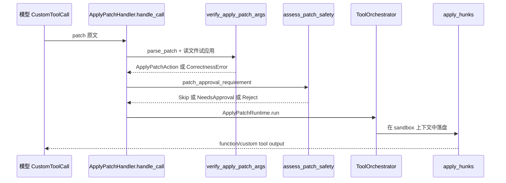

# L10 · apply_patch

基线：`67f0994b532b8740f14b5b738af7b7b2a915b1d6`。`file:line` 已用 `rg` 核对。

## 结论

- Codex 不用 unified diff 当模型协议。模型写的是 `*** Begin Patch` 块：Add / Delete / Update / Move。unified diff 只出现在 Update 块的内部，以及成功之后给 UI 的展示。
- 应用分两段：`verify_*` 在内存里算出每个文件的新内容（失败则还没写）；`apply_hunks_to_files` 才落盘。审批看的是已经验证过的 `ApplyPatchAction`。
- 定位用 `seek_sequence`：精确行 → 去掉行尾空白 → 去掉两端空白 → Unicode 标点折成 ASCII。没有模糊到「改几个字符也算匹配」。
- 工具名是 `apply_patch`，payload 是 `ToolPayload::Custom`，不是 JSON function arguments（`handlers/apply_patch.rs:321`）。
- shell 里的 `apply_patch <<'EOF'` 会被 `invocation.rs` 认出来，走同一条验证，而不是真的去 exec 一个 shell 补丁程序。
- 部分失败时 `ApplyPatchFailure.delta` 带上已经提交的文件变更。`exact` 表示这些变更是否都按精确匹配落地。

## 学习目标

- 手写一个含 Add、Update、Delete、Move 的 patch，并用 `codex-apply-patch` 二进制应用。
- 说清 verify → `assess_patch_safety` → Orchestrator → 落盘。
- 故意写错一行上下文，看解析错误和上下文找不到的差别。

## 前置

- L07：`CustomToolCall` 也由 `build_tool_call` 变成 `ToolCall`。
- L08：`SafetyCheck` 与 `ToolOrchestrator`。patch 用 `assess_patch_safety`，不走 shell 的 `ForcedRm`。
- L09：落盘时的文件系统沙箱来自 `FileSystemSandboxContext`，不是 patch 语法的一部分。

## 调用链



shell 拦截是另一入口：`intercept_apply_patch`（`handlers/apply_patch.rs:423`）调用 `maybe_parse_apply_patch_verified`。不是 patch 时返回 `Ok(None)`，调用方继续当普通命令。

| 顺序 | 位置 | 做什么 |
|---|---|---|
| 1 | `handlers/apply_patch.rs:305` `handle_call` | 只接受 `ToolPayload::Custom` |
| 2 | `handlers/apply_patch.rs:464` `prepare_patch_request` | `parse_patch` 失败立刻 `RespondToModel` |
| 3 | `apply-patch/src/invocation.rs:180` `verify_apply_patch_args` | 对照文件系统算出 `ApplyPatchAction` |
| 4 | `core/src/apply_patch.rs:15` `patch_approval_requirement` | `assess_patch_safety` → `ExecApprovalRequirement` |
| 5 | `core/src/safety.rs:67` `assess_patch_safety` | 空 patch Reject；`UnlessTrusted` 直接 AskUser；路径都在可写根内则 AutoApprove |
| 6 | `tools/runtimes/apply_patch.rs:172` `ApplyPatchRuntime::run` | 真正调用 `apply_patch` |
| 7 | `apply-patch/src/lib.rs:307` `apply_patch` | 再解析一次原文并 `apply_hunks` |

验证和落盘都会解析 patch。验证阶段的目的是在问人之前发现上下文不匹配，避免批准一个已经不可能应用的补丁。

## 关键代码导读

| file | symbol | 作用 | 阅读要点 |
|---|---|---|---|
| `apply-patch/src/parser.rs:1` | 文法注释 | 官方形状 | `*** Begin Patch` / `Add File` / `Delete File` / `Update File` / `Move to` / `End of File` |
| `parser.rs:37` | `BEGIN_PATCH_MARKER` 等 | 字面标记 | 解析器比文法略宽，允许标记两侧空白 |
| `parser.rs:66` | `Hunk` | AddFile / DeleteFile / UpdateFile | Update 含 `chunks` 与可选 `move_path` |
| `parser.rs:53` | `PARSE_IN_STRICT_MODE = false` | 始终宽松 | 注释点名 gpt-4.1 需要宽松解析，于是所有模型都宽松 |
| `apply-patch/src/lib.rs:136` | `ApplyPatchFileChange` | 验证后的变更 | Update 同时带 `unified_diff` 和 `new_content` |
| `lib.rs:152` | `MaybeApplyPatchVerified` | shell 识别结果 | `Body` / `ShellParseError` / `CorrectnessError` / `NotApplyPatch` |
| `lib.rs:169` | `ApplyPatchAction` | 绝对路径 → 变更 | `is_empty` 会在 safety 里被拒绝 |
| `lib.rs:214` | `AppliedPatchDelta` | 已落盘的前缀 | `exact` 表示匹配是否精确；`append` 会与之后的 exact 取与 |
| `lib.rs:282` | `ApplyPatchFailure` | 错误 + delta | `delta()` 给调用方报告已经写了什么 |
| `lib.rs:307` | `apply_patch` | 二进制与 runtime 的落盘入口 | 解析失败不带 delta |
| `lib.rs:369` | `apply_hunks` | 已解析 hunk 的入口 | 内部 `apply_hunks_to_files` |
| `apply-patch/src/seek_sequence.rs:12` | `seek_sequence` | 找上下文 | 四级，见下表。空 pattern 返回 `start`；pattern 比文件长返回 `None` |
| `apply-patch/src/invocation.rs:27` | `APPLY_PATCH_COMMANDS` | `apply_patch` 与 `applypatch` | 从 argv 或 heredoc 识别 |
| `invocation.rs:162` | `maybe_parse_apply_patch_verified` | shell 路径的验证 | `cwd` 必须是环境内绝对路径 |
| `invocation.rs:180` | `verify_apply_patch_args` | 工具路径的验证 | 同一文件两段操作直接错误 |
| `apply-patch/src/standalone_executable.rs:11` | `run_main` | CLI | 恰好一个 UTF-8 参数，或从 stdin 读。多参数退出码 2 |
| `core/src/apply_patch.rs:15` | `patch_approval_requirement` | safety → 审批需求 | Reject 变成 `RespondToModel("patch rejected: ...")`，不弹窗 |
| `core/src/safety.rs:67` | `assess_patch_safety` | 路径是否落在可写根 | 可写但仍要沙箱：注释写了 hard link 可能指向根外 |
| `safety.rs:146` | `is_write_patch_constrained_to_writable_paths` | 逐路径 | Update 的 `move_path` 目标也要可写 |
| `tools/handlers/apply_patch.rs:69` | `ApplyPatchHandler` | 工具入口 | `tool_name` 是 plain `apply_patch`（289 行） |
| `tools/runtimes/apply_patch.rs:71` | `ApplyPatchRuntime` | Orchestrator 的 `ToolRuntime` | `wants_no_sandbox_approval` 对 `OnRequest` 返回 **true**（138 行），和 shell 默认相反 |
| `core/tests/suite/apply_patch_cli.rs` | 集成测试 | CLI/heredoc/路径穿越 | 单测名字就是行为说明，例如 `apply_patch_cli_reports_missing_context` |

### `seek_sequence` 容错

| 顺序 | 比较 | 目的 |
|---|---|---|
| 1 | 切片完全相等 | 精确 |
| 2 | `trim_end` | 行尾空白漂移 |
| 3 | `trim` | 行首也漂移 |
| 4 | 把弯引号、各类 dash、不间断空格折成 ASCII 后再 `trim` | 模型用纯 ASCII，文件里是排版标点 |

`eof=true` 时先从文件末尾对齐再退回 `start`。找不到返回 `None`，由上层变成上下文错误，不会「大概改一下」。

### 为什么不用 unified diff

| unified diff | 这个格式 |
|---|---|
| 依赖 `@@ -l,n +l,n @@` 行号，模型经常算错 | Update 用 `@@` 上下文锚，行号不是协议的一部分 |
| 新增文件要 `/dev/null` 惯例 | `*** Add File:` / `*** Delete File:` 是显式操作 |
| 改名是 git 元数据，不是 diff 正文 | `*** Move to:` |
| 一个错误行号会导致整个 patch 失败在错误的位置 | `seek_sequence` 只放宽空白和少量标点 |

落盘后的 `unified_diff` 字段是给人看的结果，不是模型输入。

## 演示命令

```bash
cd codex-rs
rg -n "fn seek_sequence|enum MaybeApplyPatchVerified|fn assess_patch_safety|fn verify_apply_patch_args" \
  apply-patch/src core/src/safety.rs core/src/apply_patch.rs
cargo test -p codex-apply-patch
```

二进制（在临时目录，避免改仓库）：

```bash
tmpdir=$(mktemp -d)
cd "$tmpdir"
printf 'hello\nworld\n' > note.txt
printf 'gone\n' > old.txt
printf 'payload\n' > moved-src.txt
cargo run -p codex-apply-patch -- "$(cat <<'EOF'
*** Begin Patch
*** Add File: created.txt
+created
*** Delete File: old.txt
*** Update File: note.txt
@@
 hello
-world
+codex
*** Update File: moved-src.txt
*** Move to: moved-dst.txt
@@
-payload
+payload
*** End Patch
EOF
)"
# 期望：created.txt 内容为 created；old.txt 消失；note.txt 第二行是 codex；
# moved-src.txt 消失且 moved-dst.txt 内容为 payload。
# 同一路径不要在一个 patch 里又 Add 又 Delete：verify 路径会拒绝重复目标。
# 上面的 Add 与 Delete 作用在不同文件上。
rm -rf "$tmpdir"
```

错一行上下文：

```bash
tmpdir=$(mktemp -d)
cd "$tmpdir"
printf 'hello\nworld\n' > note.txt
cargo run -p codex-apply-patch -- "$(cat <<'EOF'
*** Begin Patch
*** Update File: note.txt
@@
 hello
-WORLD
+codex
*** End Patch
EOF
)"
# 期望：退出码 1。stderr 含
#   Failed to find expected lines in <dir>/note.txt:
#   hello
#   WORLD
# note.txt 仍是 hello/world。本课在 67f0994b 上用 target/debug/apply_patch 跑过这个样例。
rm -rf "$tmpdir"
```

语法错误（缺少 End）应在解析阶段失败，同样不应改文件。`ApplyPatchFailure` 只有在已经开始写之后才带非空 delta。

## 动手练习

1. 跑 `cargo test -p codex-apply-patch`。期望：crate 测试通过。失败时先看是环境缺依赖还是断言，不要改期望去迎合。
2. 做上面两个 `cargo run`。成功用例核对 `created.txt`、`note.txt`、`moved-dst.txt`，并确认 `old.txt` 与 `moved-src.txt` 不在。失败用例用 `cat note.txt` 确认原文件未变。
3. 读 `assess_patch_safety`：把 `UnlessTrusted`、路径在可写根内、路径在根外且 `AskForApproval::Never` 三种结果写成三行。
4. 选读 `core/tests/suite/apply_patch_cli.rs` 里 `apply_patch_cli_rejects_path_traversal_outside_workspace` 与 `apply_patch_cli_verification_failure_has_no_side_effects` 的名字即可，不必整文件读完。

回滚：

```bash
rm -rf "$tmpdir"
git status --short codex-rs/apply-patch codex-rs/core
# 本练习不应出现已修改的源文件。若有：
git checkout -- codex-rs/apply-patch codex-rs/core/src/apply_patch.rs codex-rs/core/src/safety.rs
```

## 引导问题

1. 为什么不用 unified diff？
   - 参考答案：见上表。协议把「新增、删除、改名、按上下文替换」分开，避免模型编行号。容错放在 `seek_sequence` 的空白和标点，不放在模糊编辑距离。
2. `seek_sequence` 的容错层级？
   - 参考答案：精确、`trim_end`、`trim`、Unicode 标点归一化。空模式返回起点；超长返回 `None`。没有第五级「允许 N 个字符不同」。
3. patch 如何先 verify 再送审批？
   - 参考答案：`prepare_patch_request` 先 `parse_patch`，再 `verify_apply_patch_args`（读原文件、算 new content）。只有 `MaybeApplyPatchVerified::Body` 才进 `patch_approval_requirement` → `assess_patch_safety`。`CorrectnessError` 直接 `RespondToModel`，用户看不到审批卡。`AutoApprove` 变成 `ExecApprovalRequirement::Skip`；`AskUser` 变成 `NeedsApproval`；`Reject` 也回模型。真正写入在 `ApplyPatchRuntime::run`。

## 面试题

1. 模型改文件，为什么要「先验证后审批」？如果反过来会怎样？
2. 对比：`draft` 权限生成一份补丁，和 Codex `apply_patch`，差在哪一步最容易丢数据？

<details>
<summary>参考答案</summary>

1. 审批的人（或 Guardian）看到的应是已经能对上当前文件的变更。先审批后验证会让用户批准一个上下文已经过期的补丁，然后工具失败，模型再盲改一次。Codex 在 `verify_apply_patch_args` 里读文件并生成 `new_content`，失败走 `RespondToModel`。代价是验证和落盘之间文件可能被别人改掉，所以落盘时 `seek_sequence` 再找一次；失败则 `ApplyPatchFailure.delta` 报告已经写进去的前缀。`exact=false` 提醒 UI 匹配放宽过，不要把这次 diff 当成字节级精确。
2. `draft` 若只是把文本放在对话里，风险是人没看就应用。Codex 把应用收成单独工具：解析、路径必须落在可写根、`UnlessTrusted` 必问、`Never` 对越界直接拒绝。最容易丢数据的是多文件 patch 写到一半失败。`AppliedPatchDelta` 就是为了让调用方还能报告已提交前缀，而不是假装事务回滚。你的项目若没有这个 delta，至少应一个文件一个事务，并在 JSONL 里记下每个路径的前后哈希。redaction 不要红掉 patch 路径，否则审计补丁时看不到改了哪。

</details>

## 与 supply-chain-copilot 对比

| 维度 | Codex | supply-chain-copilot | 可借鉴 |
|---|---|---|---|
| 写文件 | `apply_patch`：verify → safety → 可选审批 → 沙箱落盘 | `draft` 与 `destructive` 分级 | draft 对应「生成并验证补丁」；真正写入再升一级，不要和 `read` 混在一个 if |
| 格式 | 自有 patch，上下文匹配有上限 | 未指定（不要假设你用了 unified diff） | 若用 unified diff，准备接受行号错误；或改成上下文锚 |
| 失败 | `ApplyPatchFailure.delta` 报告已写前缀 | retry + circuit breaker | 补丁失败不要整段重试写入。重试前要重新 verify，否则会双写 |
| 路径 | 可写根 + `.git` 只读（L09） | 应用级权限 | draft 应用到磁盘前做路径检查，含 `..` 与符号链接 |
| 痕迹 | turn diff / rollout | JSONL trace | trace 存 patch 原文和 delta 路径；密钥仍走 redaction，但要保留路径 |
| 步数 | 一次工具调用改多文件，仍算 harness 的一步 | max steps / cost cap | 多文件 patch 省步数，但失败面更大；cap 仍要留着 |

`ApplyPatchRuntime::wants_no_sandbox_approval` 在 `OnRequest` 下是 true，shell 工具的同名方法是 false。patch 被沙箱拒绝时，Orchestrator **可以**再问人要不要无沙箱重放。这是代码差异，不是笔误（`runtimes/apply_patch.rs:138` 与 `tools/sandboxing.rs:349`）。

## 待确认

- 已跑通（同样临时去掉 v8 patch，测完还原，不进提交）：
  - `cargo test -p codex-apply-patch`：lib 68 passed，`tests/all.rs` 28 passed
  - 上面的成功 patch：退出码 0，stdout 为 `A created.txt`、`M note.txt`、`M moved-dst.txt`、`D old.txt`；`moved-src.txt` 消失，`moved-dst.txt` 内容是 `payload`
  - 错上下文：退出码 1，stderr 以 `Failed to find expected lines` 开头，`note.txt` 未改
- 多文件 patch 写到一半失败时是否回滚：`ApplyPatchFailure` 带 delta，说明已提交变更会被报告。`file_update.rs` 的每条错误路径没有逐行读完，不能说所有文件系统都无回滚。
- `streaming_parser.rs` 与最终 `parse_patch` 不一致时谁赢：未做对照实验。最终应用以 `parse_patch` 为准。
