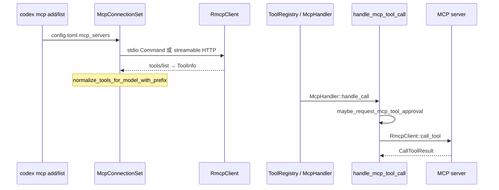

# L11 · MCP client（及 mcp-server 现状）

- 代码基线：`67f0994b532b8740f14b5b738af7b7b2a915b1d6`
- 行号在该 commit 用 `rg -n` 核对。计划里的 `codex-rs/mcp-server/` **不存在**。

## 结论

- Codex 在这条链上是 **MCP client**：配置里的 server 由 `codex-mcp` 拉起，工具经 `McpHandler` 进 `handle_mcp_tool_call`，结果写回模型。
- 「Codex 作为被 IDE / SDK 调用的 server」不是 MCP server，而是 **app-server**（JSON-RPC over stdio / websocket）。见 L12。
- 模型可见名与协议名分开：`ToolInfo.tool.name` 原样回给 MCP server；`callable_namespace` / `callable_name` 才进 Responses API。冲突时给 namespace 或 tool 名加 SHA-1 后缀，而不是静默覆盖。
- MCP tool call **不走** shell 那条 `ToolOrchestrator`（approval → OS sandbox → 升级重试）。它有自己的 approval（`AppToolApproval` + `AskForApproval`）。stdio 子进程用 `Command` 直接 spawn；远程 executor 路径显式 `sandbox: None`。
- `codex mcp-server` 与 crate `codex-mcp-server` 已在 `531f3836a1`（PR #42993，2026-09-05）删除。更早的 `d9dbf48828`（PR #4471）把历史上混在一起的 MCP server 与 app server 拆开。

## 学习目标

- 能从 `codex mcp add` 讲到一次 `tools/call` 写回 `function_call_output`。
- 能说明工具名冲突、审批、以及为什么不要再找 `mcp-server`。
- 能对照 supply-chain-copilot：那边是 **自己实现的只读 MCP server**，这边是 **消费外部 MCP server 的 client**。

## 前置

- L07：`ToolRouter` → `ToolRegistry::dispatch_any_with_state` → handler。
- L08：`AskForApproval` 与 `Session::request_approval`。MCP 复用审批事件，不复用 sandbox orchestrator。

## 调用链



阅读顺序：`cli/src/mcp_cmd.rs` → `codex-mcp/src/connection_manager.rs` → `rmcp-client/src/rmcp_client.rs` → `codex-mcp/src/tools.rs` → `core/src/tools/handlers/mcp.rs` → `core/src/mcp_tool_call.rs`。

## 关键代码导读

| file | symbol | 作用 | 阅读要点 |
|---|---|---|---|
| `codex-rs/cli/src/main.rs` | `Subcommand::Mcp`（L166） | CLI 入口只有 MCP **管理** | 没有 `mcp-server` 变体 |
| `codex-rs/cli/src/mcp_cmd.rs` | `McpSubcommand`（L74） | `list` / `get` / `add` / `remove` / `login` / `logout` | `add` 写入 `~/.codex/config.toml`；stdio 用 trailing command，HTTP 用 `--url` |
| `codex-rs/codex-mcp/src/connection_manager.rs` | `McpConnectionSet`（L335）、`McpConnectionSet::new`（L353） | 一组已发布的 MCP 连接 | `prefix_mcp_tool_names`、`non_prefixed_mcp_tool_servers` 在这里进 view |
| `codex-rs/codex-mcp/src/connection_manager.rs` | `McpServerConnection::client`（L198）、`client_for_call`（L205） | 取已就绪 client；失败时可后台重连 | startup 与 call 分开，避免每次 call 重握手 |
| `codex-rs/rmcp-client/src/rmcp_client.rs` | `RmcpClient::new_stdio_client`（L490）、`call_tool`（L983） | 传输 + `tools/call` | 协议调用用 raw tool name |
| `codex-rs/rmcp-client/src/stdio_server_launcher.rs` | `LocalStdioServerLauncher::launch_server`（L451） | 本地 `Command::new` spawn | Unix 用 `DescriptorPolicy::Explicit`，**没有** `SandboxManager` |
| `codex-rs/rmcp-client/src/stdio_server_launcher.rs` | `ExecutorStdioServerLauncher::launch_server`（L895） | 远程 executor 起进程 | `ExecParams.sandbox = None`（L941） |
| `codex-rs/rmcp-client/src/oauth.rs` | `save_oauth_tokens`（L462）、`delete_oauth_tokens`（L638） | MCP OAuth token 存储 | `codex mcp login/logout` 走这里，不是 ChatGPT login |
| `codex-rs/codex-mcp/src/tools.rs` | `ToolInfo`（L25）、`normalize_tools_for_model_with_prefix`（L113） | 模型可见名去重、截断到 128 | 同 raw identity 直接 skip；namespace / tool 碰撞加 12 hex 后缀 |
| `codex-rs/core/src/config/mod.rs` | `Config::prefix_mcp_tool_names`（L2004） | 是否加 `mcp__` 前缀 | `Feature::NonPrefixedMcpToolNames` 关掉前缀，除非配置了 `non_prefixed_mcp_tool_servers` |
| `codex-rs/core/src/tools/handlers/mcp.rs` | `McpHandler::handle_call`（L222） | registry 里的 MCP handler | 直接 `handle_mcp_tool_call`，不进 `ToolOrchestrator` |
| `codex-rs/core/src/mcp_tool_call.rs` | `handle_mcp_tool_call`（L137） | 解析参数、发 lifecycle、审批、调用 | `AskForApproval::Never` 且仍需审批时 **拒绝**，不弹窗（`request_mcp_tool_user_approval` L1691） |
| `codex-rs/core/src/mcp_tool_call.rs` | `maybe_request_mcp_tool_approval`（L1550）、`request_mcp_tool_user_approval`（L1664） | human-in-the-loop | `AppToolApproval::{Auto, Prompt, Writes, Approve}` |
| `codex-rs/config/src/mcp_types.rs` | `AppToolApproval`（L29） | 每工具审批模式 | `Auto` 默认：destructive / 非 read-only / open-world 才问 |
| `codex-rs/core/src/mcp_tool_call.rs` | `augment_mcp_tool_request_meta_with_sandbox_state`（L924） | 把 sandbox 状态塞进 MCP request meta | 仅当 server 声明该 capability；不是 OS sandbox |
| `codex-rs/core/src/mcp_tool_exposure.rs` | `McpHandlerCache`（L28）、`append_mcp_tools`（L107） | 工具多时延迟暴露 | 配合 `tool_search` |
| `codex-rs/core/src/tools/handlers/tool_search.rs` | `ToolSearchHandler::handle_call`（L209） | BM25 搜 deferred tools | 注释要求 MCP 发现走 `tool_search`，不要用 list resources 代替 |
| `codex-rs/core/src/session/mcp_runtime.rs` | `Session::prepare_mcp_call`（L60） | 为这一次 call 固定 client 与 catalog | `McpHandler` 注释：之后的 catalog 刷新不能改这次绑定 |
| `codex-rs/message-board-mcp/src/lib.rs` | `MessageBoardMcpServer`（L44） | 仓内 MCP server **示例** | 不是 Codex 自己的对外 server |

## 演示命令

本环境 **未执行**（无预编译 `codex`，`just` 未安装，rustc 1.83 < edition 2024）。命令来自 CLI 定义，跑之前用 `--help` 再确认。

```bash
git rev-parse HEAD   # 期望 67f0994b532b8740f14b5b738af7b7b2a915b1d6
rg -n "enum McpSubcommand" codex-rs/cli/src/mcp_cmd.rs
rg -n "fn normalize_tools_for_model_with_prefix" codex-rs/codex-mcp/src/tools.rs
test ! -d codex-rs/mcp-server && echo "mcp-server crate absent"
git show -s --format='%h %s' 531f3836a1e38ea61eaaba3dccda6711eb6c0dca
```

在线（需要登录 / 本地 MCP server，本课未跑）：

```bash
codex mcp add filesystem -- npx -y @modelcontextprotocol/server-filesystem "$PWD"
codex mcp list --json
codex mcp remove filesystem
```

## 动手练习

1. **只读跟踪一次工具名**
   - 在临时目录放一个最小 stdio MCP server（或用仓内 `message-board-mcp` 的测试，不要改主分支）。
   - `codex mcp add` 后打开 `config.toml` 的 `[mcp_servers.<name>]`，再在会话里让模型调用该工具。
   - 期望：rollout / `--json` 里看到 server 名 + raw tool 名；模型侧名字带 namespace（默认 `mcp__`），与 `ToolInfo.callable_*` 一致。
   - 还原：`codex mcp remove <name>`；确认 `config.toml` 里该表消失。不要提交 config。

2. **冲突实验（离线单测更安全）**
   - 读 `codex-mcp/src/tools.rs` 里 `colliding_namespaces` / `colliding_tools`。
   - 期望：两个不同 raw identity 落到同一 callable 名时，其中一个名字带 `_` + 12 hex，而不是后者覆盖前者。
   - 还原：不改仓库。若你加了测试，放在 `study/L11-mcp-name` 分支，不要留在本课文档分支。

## 引导问题

1. 多个 MCP server 工具名冲突怎么处理？
2. MCP tool call 走不走审批 / 沙箱？
3. 为什么去掉独立 mcp-server，统一到 app-server？

## 面试题

<details>
<summary>1. 设计题：两个 MCP server 都暴露 <code>read_file</code>，模型怎么调用才不会打错 server？</summary>

结论：协议身份和模型可见名是两套。`ToolInfo.server_name` + `tool.name` 负责路由；`callable_namespace` / `callable_name` 才给模型。`normalize_tools_for_model_with_prefix`（`codex-mcp/src/tools.rs` L113）先按 raw identity 丢掉完全重复项，再对撞车的 namespace / tool 加 SHA-1 短后缀，并保证全名 ≤ 128。默认还会加 `mcp__` 前缀（`Config::prefix_mcp_tool_names`）。取舍：名字变长、偶发 hash 后缀不直观，但避免静默路由到错误 server。supply-chain-copilot 若只有一个只读 MCP server，冲突问题小；接多个上游时要抄这套「raw identity ≠ model name」。

</details>

<details>
<summary>2. 对比题：MCP 工具为什么不进 shell 的 ToolOrchestrator？</summary>

结论：MCP server 是另一个进程（或 HTTP 服务），副作用在 server 里，seatbelt / bwrap 包不住对端。Codex 做的是：连接前过滤 `enabled_tools` / `disabled_tools`（`ToolFilter`）；调用前按 `AppToolApproval` 与 annotation（`read_only_hint`、`destructive_hint`、`open_world_hint`）决定要不要 `request_approval`；`AskForApproval::Never` 时需要审批的调用直接拒绝。沙箱只在 server 支持时作为 **request meta** 附带（`augment_mcp_tool_request_meta_with_sandbox_state`）。本地 stdio 用普通 `Command` spawn。这和 supply-chain-copilot「stdio 上只暴露 read-only tools」是同一思路的更细版本：权限放在工具契约上，而不是假装 OS sandbox 能罩住所有 MCP。

</details>

## 与 supply-chain-copilot 对比

| 维度 | Codex（本课） | supply-chain-copilot |
|---|---|---|
| 角色 | MCP **client**；对外集成面是 app-server JSON-RPC | 自己是 MCP **server**（stdio，只读 tools） |
| 工具面 | 外部 server 的 tools/list，可 deferred + `tool_search` | 只读工具，面更小 |
| 权限 | `AppToolApproval` × 全局 `AskForApproval`；不走 OS sandbox | permission levels；只读降低审批需求 |
| 失败 | startup 失败可保留旧连接；`client_for_call` 可后台重连 | retry + circuit breaker（进程级） |
| 可观测 | MCP call metrics / span（`mcp_tool_call.rs` telemetry） | JSONL trace & replay |

可借鉴：只读工具默认不审批（对齐 `read_only_hint`）；写操作单独 prompt。不必先做 Codex 那种 hash 后缀，除非你同时挂多个上游 server。

## 待确认

- 本环境未跑 `codex mcp add/list`，也未跑 `cargo test`（rustc 1.83，workspace `edition = "2024"`）。
- `AppToolApproval::Approve` 在 `requires_mcp_tool_approval_for_mode` 里返回 `false`（L2624）。命名和「总是批准 / 从不询问」的产品语义，以该 match 为准；未在 UI 文案里再核对。
- 本地 stdio 子进程是否另有 seccomp / bwrap 包装：`LocalStdioServerLauncher::launch_server` 只看到 `Command`。未发现第二条 sandbox 包装。
