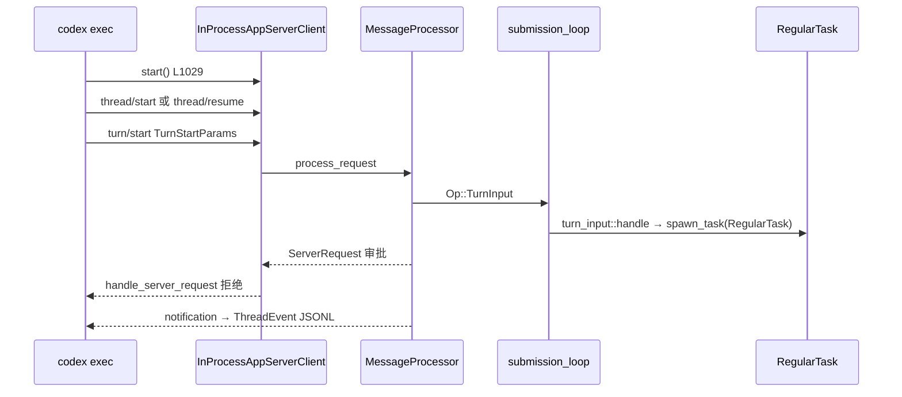

# L12 · `codex exec` 与 app-server（JSON-RPC）

- 代码基线：`67f0994b532b8740f14b5b738af7b7b2a915b1d6`
- 行号在该 commit 用 `rg -n` 核对。
- 计划里的「exec 直接调 core」已过时：`codex exec` 通过 **in-process app-server client** 发 `thread/*` 与 `turn/start`。

## 结论

- app-server 是 IDE / TUI / SDK / `codex exec` 共用的 **双向 JSON-RPC**。默认传输 `stdio://`，也可 `ws://` 或 unix socket（`cli/src/main.rs` `AppServerCommand.listen`）。
- 协议 v2 的生命周期是 **thread → turn → item**。client→server 用 request（`thread/start`、`turn/start`）；server→client 也用 request（审批），不是单向事件流。
- `codex exec` 默认把 harness override 设成 `AskForApproval::Never`（headless）。审批请求到达 exec 时被 **reject**，不会在终端里等人点。
- 若解析出的 `approvals_reviewer == AutoReview` 且没有 `--yolo`，exec 会丢掉这个 Never override 再构建一次 config（`build_exec_config`）。
- `--json` 打出的是 `exec_events::ThreadEvent`，不是 core 的 `EventMsg`。字段名是 `type=thread.started|turn.started|item.*|error`。
- `TurnAdmission` 在关停 / 切 workspace 时挡住新 turn：`closed` 返回 draining，`paused` 要求重试。

## 学习目标

- 画出 exec → in-process app-server → core `Op::TurnInput` 的边界。
- 说清 headless 审批为什么是 Never，以及 server request 如何等 client 回复。
- 对照 supply-chain-copilot 的 JSONL trace：exec 的 JSONL 是 **产品事件**，rollout 才是 **可 resume 的日志**（L14）。

## 前置

- L02：`Op` / `EventMsg`、`submission_loop`。本课的 `Op::TurnInput` 在 `protocol/src/protocol.rs` L749。计划中的 `Op::UserInput` **没有这个变体**。
- L11：不要把 app-server 说成 MCP server。

## 调用链



## 关键代码导读

| file | symbol | 作用 | 阅读要点 |
|---|---|---|---|
| `codex-rs/exec/src/lib.rs` | `run_main`（L271） | headless 入口 | L595–597：`approval_policy: Some(AskForApproval::Never)` |
| `codex-rs/exec/src/lib.rs` | `build_exec_config`（L786） | Never 与 AutoReview 的二次构建 | `preserve_headless_approval_policy` 只有 `--yolo` 时为 true |
| `codex-rs/exec/src/lib.rs` | `InProcessAppServerClient::start`（L1029） | exec 不直接 `CodexThread::submit` | resume/fork 走 `thread/resume`、`thread/fork`（L1036 注释） |
| `codex-rs/exec/src/lib.rs` | `ClientRequest::TurnStart`（L1242） | 真正开 turn | `approval_policy: Some(default_approval_policy)` |
| `codex-rs/exec/src/lib.rs` | `handle_server_request`（L2146） | 处理 server→client request | 审批类一律 `reject_server_request`，文案写明 exec mode 不支持 |
| `codex-rs/exec/src/cli.rs` | `Cli.json`（L70） | `--json` / `--experimental-json` | stdout JSONL，tracing 在 stderr |
| `codex-rs/exec/src/exec_events.rs` | `ThreadEvent`（L11） | JSONL schema | `#[serde(tag = "type")]`：`thread.started`、`turn.started`、`turn.completed`、`turn.failed`、`item.started`、`item.updated`、`item.completed`、`error` |
| `codex-rs/exec/src/event_processor_with_jsonl_output.rs` | `emit`（L105） | core/app-server 通知 → `ThreadEvent` | 对照时看 `process_server_notification`，不要假设与 `EventMsg` 1:1 |
| `codex-rs/cli/src/main.rs` | `Subcommand::Exec`（L154）、`Subcommand::AppServer`（L172） | 两个子命令 | app-server 标 experimental |
| `codex-rs/cli/src/main.rs` | `AppServerCommand`（L572） | `--listen` 默认 `stdio://` | 另有 `unix://`、`ws://IP:PORT`、`off`；`--stdio` 等价 stdio |
| `codex-rs/app-server/src/lib.rs` | `run_main`（L448）、`run_main_with_transport_options`（L509） | server 主入口 | `run_main` 固定 `AppServerTransport::Stdio` + `SessionSource::VSCode` |
| `codex-rs/app-server/src/transport.rs` | `start_stdio_connection`、`start_websocket_acceptor`（re-export L34–35） | 传输实现在 `app-server-transport` | 本文件管连接状态与出站过滤 |
| `codex-rs/app-server/src/message_processor.rs` | `process_request`（L657） | JSON-RPC method 分发 | 线程/turn 的具体逻辑在 `request_processors/` |
| `codex-rs/app-server/src/bespoke_event_handling.rs` | `EventMsg::ExecApprovalRequest` 分支（L671） | core 事件 → `ServerRequest` | `outgoing.send_request(...)` 后 `tokio::spawn` 等 oneshot，再 `Op::ExecApproval` |
| `codex-rs/app-server/src/turn_admission.rs` | `TurnAdmission::admit`（L74）、`begin_drain`（L61） | 关停时拒绝新 turn | `TurnPermit` Drop 时 `active -= 1` |
| `codex-rs/app-server-protocol/src/protocol/v2/thread.rs` | `ThreadStartParams`（L62）、`ThreadResumeParams`（L354）、`ThreadForkParams`（L544） | thread 生命周期 | archive / delete / unsubscribe 同文件 |
| `codex-rs/app-server-protocol/src/protocol/v2/turn.rs` | `TurnStartParams`（L174）、`TurnStatus`（L34） | turn 生命周期 | `Completed` / `Interrupted` / `Failed` / `InProgress`；另有 steer、interrupt |
| `codex-rs/app-server-protocol/src/protocol/v2/item.rs` | `ThreadItem`（L238）、`ThreadItemPayload`（L299） | item 生命周期 | command / file change / MCP 都是 item payload |
| `codex-rs/app-server-protocol/src/export.rs` | `generate_ts_with_options`（L125）、`generate_internal_json_schema`（L209） | TS / JSON Schema 导出 | 客户端类型从 Rust 生成，避免手写漂移 |
| `justfile` | `exec`（L21）、`app-server-test-client`（L45） | 开发入口 | `just` 在 `codex-rs/` 下跑 `cargo run` |

## 演示命令

本环境未执行：无 `codex` 二进制，未装 `just`，rustc 1.83 无法编 edition 2024。下列命令与源码一致，跑前再 `--help`。

```bash
rg -n "AskForApproval::Never" codex-rs/exec/src/lib.rs
rg -n "enum ThreadEvent" codex-rs/exec/src/exec_events.rs
rg -n "fn handle_server_request" codex-rs/exec/src/lib.rs
rg -n "enum TurnStatus" codex-rs/app-server-protocol/src/protocol/v2/turn.rs
```

在线（会打模型，本课未跑）：

```bash
cd codex-rs && just exec --json --skip-git-repo-check "list files"
# jq 统计 type。期望看到 thread.started、turn.started、item.*、turn.completed 或 turn.failed
```

`just app-server-test-client` 会先 `cargo build -p codex-cli`。本环境未跑。

## 动手练习

1. **JSONL 对照表**
   - 跑一次 `codex exec --json`（加 `--skip-git-repo-check` 若 cwd 不是 git repo；`run_main` L1020 会直接 exit）。
   - `jq -r '.type' events.jsonl | sort | uniq -c`
   - 期望：类型集合是 `ThreadEvent` 的 serde rename，而不是 `EventMsg` 的 debug 名。
   - 还原：删掉你重定向的 jsonl。不要改 `exec_events.rs`。

2. **看一次 server→client request（读代码即可）**
   - 从 `bespoke_event_handling.rs` L671 跟到 `conversation.submit(Op::ExecApproval)`。
   - 期望：能说出 request id、pending oneshot、回复后才 `submit`。
   - 还原：无改动。

## 引导问题

1. exec 默认审批策略是什么？为什么？
2. 审批请求如何作为 server→client request 发出并等待回复？
3. v2 里 thread / turn / item 的生命周期？

## 面试题

<details>
<summary>1. 为什么 <code>codex exec</code> 默认 <code>AskForApproval::Never</code>，而不是 <code>OnRequest</code>？</summary>

结论：exec 没有 TUI。`run_main` 注释写明 headless 默认不问（L595）。真正交互式的审批在 app-server 上是 **server request**；exec 的 `handle_server_request` 对 command / file / patch / permissions / MCP elicitation 全部 reject。若仍用 `OnRequest`，模型会被拒绝结果打断，CI 会挂起或随机失败。例外：`approvals_reviewer == AutoReview` 且不是 `--yolo` 时，`build_exec_config` 会去掉 Never，把审批交给自动审查。`--yolo` 另外把 sandbox 设成 `DangerFullAccess`（L352），那是第二个开关，不要和 Never 混成一件事。supply-chain-copilot 的 permission levels 若在无人值守作业里遇到「必须问人」，应对齐这里：显式拒绝并写入 JSONL，而不是阻塞 worker。

</details>

<details>
<summary>2. 设计题：IDE 插件与 CLI 如何共用一个 agent loop？</summary>

结论：loop 只在 core。所有前端变成 app-server 的 JSON-RPC client。`codex exec` 甚至用 `InProcessAppServerClient`，这样 resume、fork、item 分页与 VS Code 走同一套 `thread/start`、`turn/start`。双向 RPC 解决审批：core 发出 `EventMsg::ExecApprovalRequest`，app-server 把它变成带 id 的 server request，等 client 的 response，再 `Op::ExecApproval` 进同一条 submission queue。Schema 用 `export.rs` 生成 TS，避免插件私自加字段。代价是多一跳，换来 TUI / exec / IDE 不各写一套 session。对比 supply-chain-copilot：若 harness 与 MCP server 焊在一个进程，加第二种 UI 时会把权限和 trace 再实现一遍。

</details>

## 与 supply-chain-copilot 对比

| 维度 | Codex exec / app-server | supply-chain-copilot |
|---|---|---|
| 控制面 | JSON-RPC v2：thread / turn / item | Harness loop 直接调工具 |
| 无人值守 | 默认 `Never`；需要人的 request 被拒绝 | permission levels；只读工具可无人值守 |
| 事件 | `--json` 的 `ThreadEvent`；另外有 rollout（L14） | JSONL trace & replay |
| 背压 | `TurnAdmission`；in-process 丢事件时用 `thread/items/list` 回补（`maybe_backfill_turn_completed_items` L1749） | circuit breaker 停新调用 |
| 对外协议 | app-server，不是 MCP | MCP server over stdio |

可借鉴：把「作业事件」和「可回放日志」分成两条流。exec JSONL 给 CI 看，rollout 给 resume 用。你的 JSONL 若同时承担两者，replay 时要定义哪些行是产品事件、哪些是模型输入。

## 待确认

- `just exec --json`、`just app-server-test-client`、`codex exec --help` 均未在本环境执行。
- `--skip-git-repo-check` 的 flag 名来自 `run_main` 使用的 `skip_git_repo_check` 变量；clap 字段未在本课逐行贴出。跑之前以 `codex exec --help` 为准。
- websocket 鉴权参数在 `AppServerCommand.auth`（`codex_websocket_auth::WebsocketAuthArgs`）。具体 header 名未展开。
