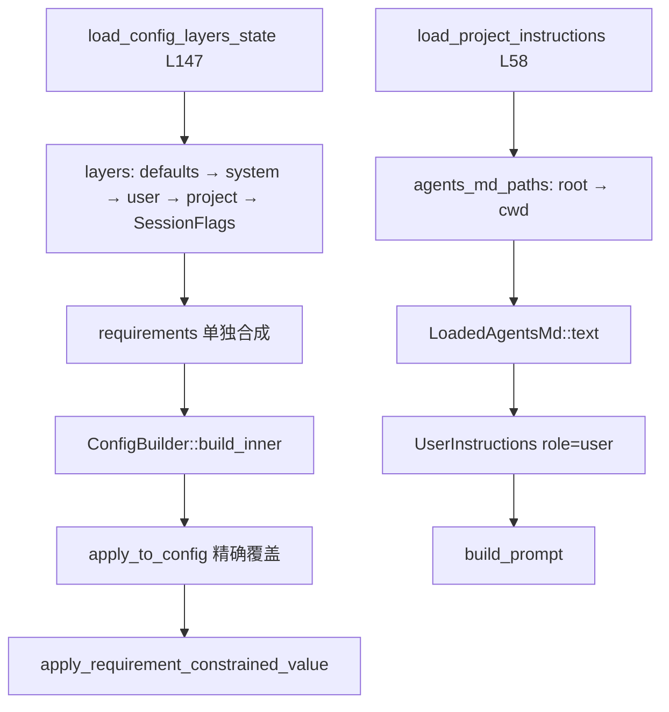

# L13 · Config 分层与 AGENTS.md

- 代码基线：`67f0994b532b8740f14b5b738af7b7b2a915b1d6`
- 行号在该 commit 用 `rg -n` 核对。
- `ConfigBuilder` 在 `core/src/config/mod.rs` L1497；`load_with_cli_overrides` 在 L2077。与计划一致。

## 结论

- 配置是 **有序 layer 合并**，不是单个 `config.toml`。数字越大越能覆盖：`-c` / `--config` 是 `SessionFlags`，precedence **30**，高于 user（20/21）和 project（25），低于 legacy `managed_config.toml`（40/50）。
- **requirements** 不是又一层 TOML 覆盖。`requirements.toml` 先合成约束，再在 `apply_to_config` / `apply_requirement_constrained_value` 里 **替换或打回** 已合并的值，并写 startup warning。管理员可以否决用户和 `-c`。
- `AGENTS.md` 从 project root 到 cwd **由外到内**拼接。每个目录只取一个文件：先 `AGENTS.override.md`，再 `AGENTS.md`，再 `project_doc_fallback_filenames`。
- 总预算 `project_doc_max_bytes`，默认 **32 KiB**（`DEFAULT_PROJECT_DOC_MAX_BYTES`）。超出的那个文件被截断，之后的目录不再读。
- 注入位置是 **user** fragment，标记 `# AGENTS.md instructions` … `</INSTRUCTIONS>`（`context/user_instructions.rs`）。不是 system prompt。
- untrusted project **不读** 仓库里的 AGENTS.md，只保留 host 给的 user instructions。

## 学习目标

- 给定 `-c`、`~/.codex/config.toml`、`.codex/config.toml`、`requirements.toml`，能说出谁赢。
- 能画出多层 `AGENTS.md` 的拼接顺序和截断点。
- 对照 supply-chain-copilot：规则文件要有预算和不可信目录策略，否则仓库里的说明会变成 prompt injection。

## 前置

- L05：`build_prompt` 把 instructions 放进 `Prompt`。本课只追 AGENTS.md 这一段的来源。
- L08：requirements 还能约束 `approval_policy` 与 permission profile。

## 调用链



## 关键代码导读

| file | symbol | 作用 | 阅读要点 |
|---|---|---|---|
| `codex-rs/config/src/loader/mod.rs` | `load_config_layers_state`（L147） | 收集 layer | 文件头 L124–136 的顺序注释 |
| `codex-rs/config/src/loader/mod.rs` | `load_requirements_toml`（L684） | 读系统 `requirements.toml` | Unix：`/etc/codex/requirements.toml`（L736） |
| `codex-rs/config/src/loader/mod.rs` | `SessionFlags` 入栈（L427–432） | `-c` 变成一层 | 在 project layers **之后** push |
| `codex-rs/config/src/loader/mod.rs` | `load_project_layers`（L1789） | 仓库内多层 config | 注释：靠近 `project_root` 的层更低，靠近 cwd 的更高；同为 `Project` precedence 25 |
| `codex-rs/config/src/config_layer_source.rs` | `ConfigLayerSource::precedence`（L33） | 覆盖数字 | 见下表 |
| `codex-rs/core/src/config/mod.rs` | `ConfigBuilder`（L1497） | 组装 `Config` | `cli_overrides` 与 `harness_overrides` 分开 |
| `codex-rs/core/src/config/mod.rs` | `load_with_cli_overrides`（L2077） | 只带 `-c` 的加载入口 | exec 用的是 `load_with_cli_overrides_and_harness_overrides`（L2130） |
| `codex-rs/core/src/config/mod.rs` | `requirements::apply_to_config` 调用点（L3430） | 精确字段被 requirements 替换 | 实现在 `config/requirements.rs` L17 |
| `codex-rs/core/src/config/mod.rs` | `apply_requirement_constrained_value`（L2360） | 不允许的值回退到约束默认值 | 冲突记 startup warning，不静默成功 |
| `codex-rs/core/src/config/mod.rs` | Never + 不允许 danger-full-access（L4383） | 避免「只读 + 永不审批」 | 直接 `InvalidInput` |
| `codex-rs/core/src/agents_md.rs` | 模块注释（L1–18） | 发现规则 | 不越过 project root；默认 marker `.git` |
| `codex-rs/core/src/agents_md.rs` | `DEFAULT_AGENTS_MD_FILENAME`（L43）、`LOCAL_AGENTS_MD_FILENAME`（L45） | 文件名 | override 优先于 `AGENTS.md` |
| `codex-rs/core/src/agents_md.rs` | `load_project_instructions`（L58） | 合并 host user instructions 与项目文档 | L64：`active_project.is_untrusted()` 则跳过项目文件 |
| `codex-rs/core/src/agents_md.rs` | `read_agents_md`（L125）、`agents_md_paths`（L192） | 读与发现 | 超预算 `truncate`（L156）并 `warn` |
| `codex-rs/core/src/agents_md.rs` | `LoadedAgentsMd::text`（L378）、`legacy_text`（L386） | 拼接 | user/thread 在前；进入 project 段时插入 `\n\n--- project-doc ---\n\n` |
| `codex-rs/core/src/agents_md.rs` | `candidate_filenames`（L272） | 每目录候选名 | `AGENTS.override.md`、`AGENTS.md`、fallback；含路径分隔符的 fallback 被忽略 |
| `codex-rs/config/src/config_toml.rs` | `DEFAULT_PROJECT_DOC_MAX_BYTES`（L77） | 32 KiB | `core` 里别名 `AGENTS_MD_MAX_BYTES`（`config/mod.rs` L259） |
| `codex-rs/core/src/context/user_instructions.rs` | `UserInstructions`（L8） | 进 prompt 的形态 | `role()` 返回 `"user"`；markers L31 |
| `codex-rs/core/src/prompt_debug.rs` | `build_prompt_input`（L26） | 打印最终 prompt 的调试入口 | 不是 CLI 子命令。`rg -n build_prompt_input` 只有库函数 |

### Layer precedence（高覆盖低）

| precedence | `ConfigLayerSource` | 典型来源 |
|---|---|---|
| -10 | `PackagedDefaults` | 二进制内嵌 `defaults.toml` |
| 0 | `Mdm` | macOS managed preferences |
| 10 | `System` | `/etc/codex/config.toml` |
| 15 | `EnterpriseManaged` | cloud bundle |
| 20 / 21 | `User` | `$CODEX_HOME/config.toml`；选中 profile 为 21 |
| 25 | `Project` | 仓库 `.codex/config.toml`，root → cwd |
| 30 | `SessionFlags` | `-c key=value` |
| 40 / 50 | legacy managed | 文件 / MDM 的 `managed_config.toml` |

requirements 在合并之后再约束，不占上表的数字。

## 演示命令

`cargo test` 未跑（toolchain 见 L15 待确认）。过滤名与源码一致：`agents_md.rs` 的测试在 `agents_md_tests.rs`。

```bash
rg -n "fn load_project_instructions|const DEFAULT_AGENTS_MD_FILENAME|AGENTS_MD_SEPARATOR" codex-rs/core/src/agents_md.rs
rg -n "fn precedence" codex-rs/config/src/config_layer_source.rs
rg -n "fn apply_requirement_constrained_value" codex-rs/core/src/config/mod.rs
# 工具链足够新时：
cargo test -p codex-core --lib agents_md
```

## 动手练习

1. **两层 AGENTS.md**
   - 建临时 git repo：根目录 `AGENTS.md` 写 `ROOT`，子目录 `AGENTS.md` 写 `CHILD`。
   - 在子目录起一次会话，用 L05 的 `prompt_debug::build_prompt_input` 或已有测试观察 user instructions。
   - 期望：正文里先出现 `ROOT`，后出现 `CHILD`（`agents_md_paths` 把目录 reverse 成 root → cwd）。两者都在 `# AGENTS.md instructions` 标记内。
   - 还原：删掉临时 repo。不要把练习文件放进本仓库。

2. **截断**
   - 同一临时 repo 把 `project_doc_max_bytes` 调到小于两份文件之和（`-c project_doc_max_bytes=N` 或测试里改 `Config`）。
   - 期望：日志有 `project doc exceeds remaining budget; truncating`（`read_agents_md` L161）；后半段目录可能整段消失。
   - 还原：去掉 `-c`。默认回到 32 KiB。

3. **requirements 压过 `-c`（读测试，不必改系统文件）**
   - 读 `apply_requirement_constrained_value` 与 `config/requirements.rs` 的 `apply_exact_requirement`。
   - 期望：能说出「layer 合并后仍可能被 requirements 回退，并留下 startup warning」。
   - 还原：无。

## 引导问题

1. 嵌套目录多个 AGENTS.md 的拼接顺序与截断规则？
2. `-c key=value` 的优先级在哪一层？
3. 管理员 requirements 如何限制用户配置？

## 面试题

<details>
<summary>1. 根目录和子目录都有 AGENTS.md，模型先看到谁？截断时丢的是谁？</summary>

结论：先 root 后 cwd，与「越近越具体」一致，但具体内容在后面，模型仍能看到仓库级规则。发现算法：从 cwd 向上收到 project root（默认 marker `.git`），再反转（`agents_md_paths` L223–236）。每个目录按 `AGENTS.override.md` → `AGENTS.md` → fallback 取第一个存在的文件。预算是字节不是文件数：当前文件超过 `remaining` 就截断，`remaining` 归零后停止。untrusted checkout 直接不读这些文件（`load_project_instructions` L64），避免把别人仓库的说明当系统指令。注入角色是 user，便于和稳定的 base instructions 分开，利于 prompt cache（L05）。supply-chain-copilot 若把仓库规则无预算地拼进 system，一次大文件就会挤掉工具 schema。

</details>

<details>
<summary>2. 设计题：用户 <code>-c approval_policy=never</code>，公司 requirements 不允许 full access。最后怎样？</summary>

结论：`-c` 赢过 user/project config（precedence 30），但赢不过 requirements。`apply_requirement_constrained_value` 在 `can_set` 失败时回退到约束允许的值并 warning。更硬的一条在 `config/mod.rs` L4383：若 sandbox 被 requirements 打成 read-only，同时 approval 仍是 `never`，加载直接报错，避免「不能问人、也不能写」的死配置。精确字段（如 `model_provider`）走 `apply_exact_requirement`：配置值被 required value 替换。这是供应链里「主数据约束 > 门店本地覆盖」的同一结构。supply-chain-copilot 的 permission levels 应有同等的「作业参数不能放宽到策略以上」。

</details>

## 与 supply-chain-copilot 对比

| 维度 | Codex | supply-chain-copilot |
|---|---|---|
| 配置 | 多层 TOML + requirements 约束 | 未在本课源码中核对；若只有一个 settings 文件，就没有「管理员否决」 |
| 项目说明 | `AGENTS.md` 链 + 32 KiB + untrusted 跳过 | 若把业务规则直接写进 system prompt，缺少截断与不可信目录 |
| CLI 覆盖 | `SessionFlags` precedence 30 | 作业级 override 应低于合规约束 |
| 注入角色 | user fragment，带显式 markers | 建议同样不要把仓库文件放进不可覆盖的 system |

可借鉴的三点：字节预算、root→cwd 顺序、untrusted 不加载。不必先做 MDM。

## 待确认

- `cargo test -p codex-core --lib agents_md` 未执行。
- project config 在 untrusted 时是「加载但 disabled」还是完全不读：loader 顶部注释 L133–135 写 loaded but disabled。AGENTS.md 则是 `is_untrusted()` 时直接 return。两套策略不要混为一谈。
- `prompt_debug::build_prompt_input` 没有对应的 `codex` 子命令（`rg` 只命中 `core/src/prompt_debug.rs`）。练习 1 若没有现成调试入口，用单测断言 `LoadedAgentsMd::text` 即可。
