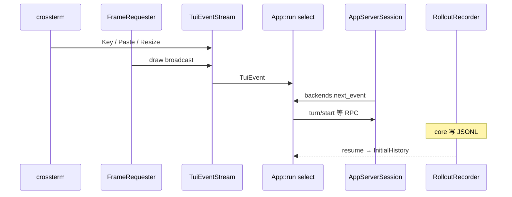

# L14 · TUI 事件循环 + rollout / resume + otel（login 选读）

- 代码基线：`67f0994b532b8740f14b5b738af7b7b2a915b1d6`
- 行号在该 commit 用 `rg -n` 核对。
- 计划写 `tui/src/app.rs` 里有 `tokio::select!`。本 commit 的主循环在 **`tui/src/app/startup.rs` 的 `App::run`**（`select!` 于 L1431）。`app.rs` 是 `App` 状态与子模块的门面，没有 `select!`。

## 结论

- TUI 不直接拿 core 的 `Op` channel。它通过 `app_server_session.rs` 连 app-server，和 exec / IDE 同一条协议（L12）。
- 主循环把多路事件收进一个 `select!`：App 内部事件、当前 thread 事件、终端输入、app-server 事件、重连、限流轮询。键盘与重绘先在 `TuiEventStream` 合成 `TuiEvent`，再进入这个 `select!`。
- `FrameRequester` 是单独的 actor：多次 `schedule_frame` 合成一次 draw，上限约 120 FPS（`frame_requester.rs` 模块注释）。
- rollout 是 `$CODEX_HOME/sessions/.../rollout-*.jsonl` 的 append-only 日志。`policy.rs` 决定哪些 `ResponseItem` / `EventMsg` 落盘。resume 用 `RolloutRecorder::get_rollout_history` 得到 `InitialHistory`，再用 `reconstruct_history_from_rollout` 还原模型历史。
- SQLite（`rollout/src/state_db.rs`、`Config.sqlite`）是线程索引与查询；JSONL 仍是会话正文。`list_threads_from_state_db` 与扫文件是两条 list 路径。
- otel 默认 **不导出 log/trace**（`OtelExporterKind::None`）。metrics 默认 `Statsig`。`codex exec` 的 `DEFAULT_ANALYTICS_ENABLED = true`（`exec/src/lib.rs` L183）。`log_user_prompt` 默认 **false**。
- login 选读：PKCE 在 `login/src/oauth/pkce.rs` 的 `generate_pkce`，不是计划写的 `login/src/pkce.rs`。device code 在 `login/src/device_code_auth.rs`。

## 学习目标

- 能指出 TUI `select!` 的每一路对应哪种输入。
- 能说清 resume 读的是 JSONL 还是只读 SQLite。
- 能回答「默认会不会把 prompt 打到 collector」。

## 前置

- L02：`EventMsg`，尤其 `TurnStarted` / `TurnComplete` / `ItemCompleted`。
- L12：app-server notification 与 server request。TUI 的审批弹窗吃的是后者转换后的 `AppEvent`。
- L06：compaction item 会进 rollout，resume 时要按 compaction 边界重建。

## 调用链



## 关键代码导读

| file | symbol | 作用 | 阅读要点 |
|---|---|---|---|
| `codex-rs/tui/src/lib.rs` | `run_main`（L1171）、`run_ratatui_app`（L1212） | 进程入口 | panic hook 先 `tui::restore_after_exit`（L1249）再交给原 hook |
| `codex-rs/tui/src/app/startup.rs` | `App::run`（L233）、`select!`（L1431） | 主循环 | 分支：`app_event_rx`、`active_thread_rx`、`tui_events.next()`、`backends.next_event`、reconnect、daemon restart |
| `codex-rs/tui/src/app.rs` | 模块注释（L1） | `App` 状态 | **不要**在这里找 `select!` |
| `codex-rs/tui/src/tui.rs` | `Tui`（L691）、`frame_requester`（L693）、`event_stream`（L1082） | 终端与帧调度句柄 | `set_modes` L251、`restore` L392 |
| `codex-rs/tui/src/tui/frame_requester.rs` | `FrameScheduler::run`（L96） | 合并重绘 | `select!` 在 scheduler 内部，不在 App |
| `codex-rs/tui/src/tui/event_stream.rs` | `EventBroker`（L53）、`TuiEventStream` | 键盘 + draw → `TuiEvent` | 暂停时 **drop** crossterm stream，避免抢走 vim 的 stdin |
| `codex-rs/tui/src/chatwidget.rs` | `ChatWidget` | 对话视图 | 审批 UI 在 `bottom_pane/` |
| `codex-rs/tui/src/bottom_pane/` | `ExecApprovalRequest` 等 | composer 与审批弹窗 | `app.rs` L31 起 re-export |
| `codex-rs/tui/src/app_server_session.rs` | `AppServerSession` | TUI ↔ app-server | 与 exec 的 in-process client 同协议、不同传输 |
| `codex-rs/rollout/src/recorder.rs` | `RolloutRecorder`（L86） | 写 / 读 rollout | `record_canonical_items` L1079、`persist` L1097、`flush` L1118 |
| `codex-rs/rollout/src/recorder.rs` | `get_rollout_history`（L1203） | resume 的文件侧入口 | 空文件 → `InitialHistory::New`；否则 `InitialHistory::Resumed` |
| `codex-rs/rollout/src/recorder.rs` | `find_latest_thread_path`（L816） | `resume --last` 找文件 | CLI：`ResumeCommand.last`（`cli/src/main.rs` L362） |
| `codex-rs/rollout/src/policy.rs` | `should_persist_response_item`（L81） | 哪些模型 item 落盘 | `Message`、`FunctionCall(Output)`、`Compaction` 等为 true；`CompactionTrigger` 与 `Other` 为 false |
| `codex-rs/rollout/src/policy.rs` | `persisted_event_msg`（L128） | 哪些事件落盘 | `TurnStarted` / `TurnComplete` / `TokenCount` 总是留；旧的 `UserMessage` 等只在 `ThreadHistoryMode::Legacy` |
| `codex-rs/core/src/session/rollout_reconstruction.rs` | `reconstruct_history_from_rollout`（L189） | 文件 item → 模型 history | 处理 compaction 边界与未完成 turn |
| `codex-rs/rollout/src/state_db.rs` | `list_threads_from_state_db` 的调用方在 `recorder.rs` L440 | SQLite 索引 | 正文仍以 JSONL 为准；db 用于 list / backfill |
| `codex-rs/utils/home-dir/src/lib.rs` | `find_codex_home`（L13） | 状态目录 | `CODEX_HOME`，否则 `~/.codex` |
| `codex-rs/core/src/otel_init.rs` | `build_provider`（L16） | 从 `Config.otel` 建 provider | metrics 为 Statsig 且 analytics 关闭时改成 `None`（L71） |
| `codex-rs/config/src/types.rs` | `OtelConfig::default`（L691） | 默认导出 | log/trace `None`；metrics `Statsig`；`log_user_prompt: false` |
| `codex-rs/otel/src/provider.rs` | `OtelProvider::try_new`（L196） | 三个 exporter 都是 None 则 `Ok(None)` | 有 Statsig metrics 时 provider 仍会建 |
| `codex-rs/otel/src/lib.rs` | `ToolDecisionSource`（L54） | 审批决策来源 | `AutomatedReviewer` / `Config` / `User` |
| `codex-rs/otel/src/events/session_telemetry.rs` | prompt 日志（L1184） | 隐私 | 仅 `log_user_prompts == true` 才记录 prompt 文本 |
| `codex-rs/otel/src/metrics/validation.rs` | `validate_metric_name`（L13）、`validate_tags`（L5） | metrics 名校验 | 选读 |
| `codex-rs/login/src/oauth/pkce.rs` | `generate_pkce`（L14） | S256 PKCE | verifier 不落日志（文件头注释） |
| `codex-rs/login/src/device_code_auth.rs` | device code 流程 | 无浏览器时的登录 | 选读；本课不展开 token 存储 |

路径形态（测试，不是猜测）：`rollout/src/tests.rs` 使用 `$CODEX_HOME/sessions/YYYY/MM/DD/rollout-<ts>-<uuid>.jsonl`。

## 演示命令

未执行在线会话，也没有本机 `~/.codex/sessions` 可供统计。只读核对：

```bash
rg -n "select!" codex-rs/tui/src/app/startup.rs
rg -n "fn should_persist_response_item" codex-rs/rollout/src/policy.rs
rg -n "log_user_prompt" codex-rs/config/src/types.rs
rg -n "fn get_rollout_history" codex-rs/rollout/src/recorder.rs
```

有登录与会话时（本课未跑）：

```bash
find "${CODEX_HOME:-$HOME/.codex}/sessions" -name 'rollout-*.jsonl' | head
# 用 jq 统计每行的 type 字段，再对照 policy.rs
codex resume --last
```

`codex resume --help` 未跑。源码里的 flag 是 `--last`、`--all`、`--include-non-interactive`（`ResumeCommand`）。

## 动手练习

1. **统计 rollout item**
   - 跑一轮真实会话后，对最新 `rollout-*.jsonl` 做 `jq` 计数。
   - 期望：能看到与 `should_persist_response_item` / `persisted_event_msg` 一致的类型；`CompactionTrigger` 不应作为 response item 出现。
   - 还原：只读。不要手改 jsonl，否则 resume 会按损坏历史重建。

2. **resume**
   - `codex resume --last`。
   - 期望：新进程调用 `get_rollout_history` → `InitialHistory::Resumed`，而不是空 thread。
   - 还原：不需要。这是只读恢复。

3. **选做：bottom pane 提示**
   - 计划里的 insta 快照练习会改 UI。放在 `study/L14-approval-hint` 分支。
   - 还原：`git checkout -- codex-rs/tui` 或丢掉该分支。本课文档分支不要带上 UI diff。

4. **选做 otel**
   - 仅当 `[otel]` 配了 OTLP 且 `log_user_prompt = true` 才期望看到 prompt。默认不该出现。
   - 还原：删掉临时 `config.toml` 覆盖。

## 引导问题

1. 键盘、core/app-server 事件、定时重绘如何汇合？
2. 哪些 item 被持久化？resume 如何重建 `InitialHistory`？
3. otel 默认是否导出？是否记录 prompt？

## 面试题

<details>
<summary>1. TUI 为什么用一个巨大的 <code>select!</code>，而不是每个来源一个线程？</summary>

结论：UI 状态（`ChatWidget`、overlay、审批弹窗）不是线程安全的。`App::run` 把终端、app-server、内部 `AppEvent`、重连放在同一个 task 里串行处理，避免锁住 widget。重绘被拆出去：`FrameRequester` 合并请求，`TuiEventStream` 把 draw 通知变成 `TuiEvent::Draw`，主循环只在轮到时 `draw`。暂停输入时 drop crossterm stream（`event_stream.rs` 文件头），否则外部编辑器读不到 stdin。这和 actor mailbox 一样：多生产者，单消费者。supply-chain-copilot 若把 JSONL replay 和 live loop 放进两个线程写同一 history，会出现 Codex 用 submission queue 避免的竞态。

</details>

<details>
<summary>2. 对比题：JSONL rollout 和 SQLite 各干什么？prompt 会进 otel 吗？</summary>

结论：JSONL 是会话的 source of truth，`get_rollout_history` 把文件变成 `InitialHistory::Resumed`，`reconstruct_history_from_rollout` 再修 compaction / 未完成 turn。SQLite 是索引（list、metadata、backfill），丢了 db 仍可能从文件恢复，丢了 jsonl 就不能把模型 history 拼回来。持久化有过滤器：新 history mode 不再把每条 legacy `UserMessage` 事件重复写入，改留 `ItemCompleted`。otel 默认 log/trace exporter 是 None；exec 默认允许 Statsig metrics。`log_user_prompt` 默认 false，`session_telemetry.rs` 在 flag 关闭时不写 prompt 文本。supply-chain-copilot 的 JSONL trace & replay 更接近 rollout，而不是 otel。replay 前要有与 `policy.rs` 同等的「哪些行算历史」规则，否则工具 call 和 output 会配不平。

</details>

## 与 supply-chain-copilot 对比

| 维度 | Codex | supply-chain-copilot |
|---|---|---|
| UI | TUI 只是 app-server client | 无 TUI；MCP stdio 即接口 |
| 轨迹 | rollout JSONL + 可选 otel | JSONL trace & replay |
| 恢复 | `InitialHistory::Resumed` + reconstruction | replay 应能重放到某个 tool 边界 |
| 隐私 | prompt 默认不进 otel | trace 若含业务单据，要有同等开关 |
| 崩溃 | append-only；`flush` / `shutdown` 有 ack | circuit breaker 打开时应仍把失败行写入 trace |

可借鉴：把「给模型的 history」和「给人看的 trace」用一个 policy 函数分开，而不是整包 JSONL 原样塞回 prompt。

## 待确认

- 本环境没有样本 rollout，未执行 `codex resume --last`。
- `FrameRateLimiter` 的具体间隔常量在 `tui/src/tui/frame_rate_limiter.rs`（`MIN_FRAME_INTERVAL` 被测试引用）。未在正文引用毫秒数，避免和注释里的 120 FPS 不一致时写错数字。
- analytics 在 TUI 进程里的默认值未逐个调用点核对。已核对的是：`OtelConfig` 默认、exec 的 `DEFAULT_ANALYTICS_ENABLED = true`、app-server CLI 注释写明 app-server 默认关闭 analytics，除非 `--analytics-default-enabled`。
