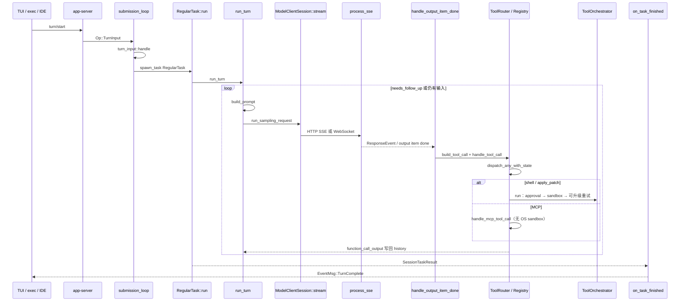

# L15 · Capstone：一个 turn 的全链路

- 代码基线：`67f0994b532b8740f14b5b738af7b7b2a915b1d6`
- 行号在该 commit 用 `rg -n` 核对。
- 计划图里的 `Op::UserInput` **不存在**。用户输入是 `Op::TurnInput`（`protocol/src/protocol.rs` L749）。
- `EventMsg::TurnComplete` 不在 `run_turn` 末尾构造，而在 `Session::on_task_finished`（`tasks/mod.rs` L655，事件 L894）。

## 结论

- 一个 turn = 一次 `RegularTask`。里面 `run_turn` 反复「组 prompt → 采样 → 执行工具 → 写回 history」，直到 `needs_follow_up == false` 且没有待处理输入。
- UI 不进这个循环。TUI / exec / IDE 都先到 app-server，再变成 `Op`。exec 用 in-process client（L12）。
- 工具分发是固定管道：`handle_output_item_done` → `ToolRouter::build_tool_call` → `ToolCallRuntime` → `ToolRegistry::dispatch_any_with_state`。shell / apply_patch 再进 `ToolOrchestrator`（审批 → sandbox → 失败可升级）。MCP **不进** orchestrator（L11）。
- 采样在 `output_item.done` 时就开始跑工具，不等整段 `response.completed`（`stream_events_utils.rs` L352 注释：`handle_tool_call` 在 future 被 poll 之前就会 dispatch）。
- 安全是两根轴：何时问人（`AskForApproval`）× 能做什么（permission profile / sandbox）。exec 默认不问人，但不等于默认 full access。
- 相对 supply-chain-copilot：Codex 把 harness、权限、轨迹拆成可替换的层；你的项目把 loop、permission levels、retry+circuit breaker、JSONL replay、只读 MCP server 放在一个更小的 Python 进程里。小是优点，缺的是「工具失败后的升级」和「call/output 不变量」。

## 学习目标

- 10 分钟讲完分层与一个 turn，函数名能落到文件。
- 用一张表比较 Codex 与 supply-chain-copilot 的 harness / permissions / trace。
- 能答 15 个追问，不发明不存在的类型。

## 前置

L02–L14。本课不引入新 crate，只把已核对的符号串起来。

## 调用链

### 函数落点（按发生顺序）

| 顺序 | file:line | symbol | 作用 |
|---|---|---|---|
| 1 | `protocol/src/protocol.rs:749` | `Op::TurnInput` | 客户端提交的用户 turn |
| 2 | `core/src/codex_thread.rs:244` | `CodexThread::submit` | 进入 submission queue |
| 3 | `core/src/session/handlers.rs:459` | `submission_loop` | 消费 `Op` |
| 4 | `core/src/session/handlers.rs:582` | `Op::TurnInput` 分支 | 调用 `turn_input::handle` |
| 5 | `core/src/session/turn_input.rs:234` | `turn_input::handle` | 校验后 `spawn_task` |
| 6 | `core/src/session/turn_input.rs:466` 与 `:642` | `spawn_task` / `start_task(..., RegularTask::new())` | 显式用户输入走 `spawn_task`；`start_if_idle` 走 `start_task`。都是 `RegularTask` |
| 7 | `core/src/tasks/mod.rs:273` | `Session::spawn_task` | 启动 `SessionTask` |
| 8 | `core/src/tasks/regular.rs:40` | `RegularTask::run` | 发 `TurnStarted`，再循环 `run_turn` |
| 9 | `core/src/session/turn.rs:177` | `run_turn` | 采样循环 |
| 10 | `core/src/session/turn.rs:1751` | `build_prompt` | history + tools + instructions → `Prompt` |
| 11 | `core/src/session/turn.rs:1792` | `run_sampling_request` | 带 retry 的一次采样 |
| 12 | `core/src/session/turn.rs:1854` | `build_prompt(...)` 调用点 | 在 retry 循环内重装 prompt |
| 13 | `core/src/client.rs:328` | `ModelClientSession` | turn 级 client |
| 14 | `core/src/client.rs:2499` | `ModelClientSession::stream` | WebSocket 优先，失败再 HTTP |
| 15 | `core/src/client.rs:1905` | `stream_responses_http` | HTTP SSE |
| 16 | `codex-api/src/sse/responses.rs:566` | `process_sse` | SSE → `ResponseEvent` |
| 17 | `core/src/session/turn.rs:2729` | `try_run_sampling_request` | 消费流 |
| 18 | `core/src/stream_events_utils.rs:316` | `handle_output_item_done` | tool → `needs_follow_up = true` |
| 19 | `core/src/tools/router.rs:271` | `ToolRouter::build_tool_call` | `ResponseItem` → `ToolCall` |
| 20 | `core/src/tools/parallel.rs:107` | `ToolCallRuntime::handle_tool_call` | 并行锁或独占锁 |
| 21 | `core/src/tools/router.rs:367` | `dispatch_tool_call_with_state` | 交给 registry |
| 22 | `core/src/tools/registry.rs:724` | `dispatch_any_with_state` | pre-tool hook + handler |
| 23 | `core/src/tools/orchestrator.rs:125` | `ToolOrchestrator::run` | 仅 shell / patch 等 runtime |
| 24 | `core/src/unified_exec/process_manager.rs:1518` | `ToolOrchestrator::new` | exec_command 进入 orchestrator |
| 25 | `core/src/tools/handlers/apply_patch.rs:592` | 同上 | patch 进入 orchestrator |
| 26 | `core/src/session/turn.rs:636` | `needs_follow_up` | `model_needs_follow_up \|\| has_pending_input` |
| 27 | `core/src/tasks/mod.rs:894` | `EventMsg::TurnComplete` | task 结束后发给 UI |

## 10 分钟架构讲解提纲

| 时间 | 讲什么 | 停在哪句 |
|---|---|---|
| 0:00–1:00 | 分层：protocol / core / codex-api / tools / sandboxing / app-server / tui+exec | 「UI 只说话，loop 只在 core」 |
| 1:00–3:00 | 一个 turn 的时序：`TurnInput` → `submission_loop` → `RegularTask` → `run_turn` | 指上表 1–9 |
| 3:00–5:00 | 采样：全量 history、`stream`、`process_sse`、item done 就执行工具 | `needs_follow_up` |
| 5:00–7:00 | 工具与安全：router/registry；orchestrator = 问人 × sandbox；MCP 为例外 | 两根轴，不要合成一个 enum |
| 7:00–8:00 | 集成：app-server JSON-RPC；exec 默认 Never；mcp-server 已删除 | L11–L12 各一句 |
| 8:00–9:00 | 状态：AGENTS.md 预算、rollout JSONL、otel 默认不记 prompt | resume 读 jsonl |
| 9:00–10:00 | 对比 supply-chain-copilot，给 3 个会抄的点 | 见下方取舍表 |

口播骨架（背这个，不背行号）：

1. Codex 是 actor：一条 submission queue，一个活动 task。
2. Turn 是 ReAct 循环，结束条件是模型不再要工具且输入队列空。
3. 危险命令先解析再审批再 sandbox，失败可以请求无沙箱重跑。
4. 我的项目已经有 loop、permission levels、retry+circuit breaker、JSONL replay、只读 MCP；差在工具输出配对、审批与沙箱正交、以及 trace policy。

## 与 supply-chain-copilot 的设计取舍

用户项目（本仓库外，按给定描述，未打开其源码）：Harness loop、permission levels、retry + circuit breaker、JSONL trace & replay、stdio 上的只读 MCP server。

| 题目 | Codex 的选择 | 代价 | supply-chain-copilot | 若重做会抄什么 |
|---|---|---|---|---|
| Harness | `run_turn` 直到 `needs_follow_up` 为 false；task 结束才 `TurnComplete` | 循环长，取消要补 call/output 配对 | 一个 Harness loop | 保留你的 loop；结束条件写成显式谓词，不要靠「模型没说话」 |
| 权限 | `AskForApproval` × permission profile / sandbox | 状态组合多 | permission levels | 把「问人」和「允许的副作用」拆开。只读 MCP 工具 = 低 level 且不必问 |
| 失败 | 模型流 retry（`responses_retry`）+ sandbox 升级重试；MCP 另有重连 | 两种 retry 语义不同 | retry + circuit breaker | 对上游 HTTP 用熔断；对「沙箱拒绝」不要熔断，改走审批升级 |
| 轨迹 | rollout policy 过滤后再 resume；exec JSONL 是另一条产品流；otel 默认无 prompt | 三套日志 | 一份 JSONL 兼 trace 与 replay | 给 JSONL 加 policy：哪些行可 replay 进模型 |
| 工具面 | 内置 shell/patch + 外部 MCP client | 名冲突、审批分叉 | 自己暴露只读 MCP tools | 保持只读 server。不要为了「像 Codex」先做写工具 |
| 集成 | app-server 替换已删除的 mcp-server | 客户端要讲 JSON-RPC 而不是 MCP | 调用方已经会 MCP | 继续用 MCP。只有第二种 UI 时再加 app-server 式双向 RPC |
| 上下文 | compaction + AGENTS.md 32 KiB | 摘要会丢细节 | 未在描述中出现 | 先做字节/token 预算，再做摘要 |

三句收束：

1. 抄 **call 与 output 必须成对**（`context_manager/normalize.rs` 的 `ensure_call_outputs_present` / `remove_orphan_outputs`，L06）。
2. 抄 **审批与沙箱正交**，只读工具走 fast path。
3. 抄 **rollout policy**：replay 用的历史和给人看的 trace 不要是同一个未过滤文件。

## 引导问题

1. 能否 5 分钟讲清架构和一个 turn？（用上一节口播骨架，压缩到 5 分钟时删掉 otel 与 AGENTS.md。）
2. harness / permissions 和你的项目差在哪？（用取舍表，不要加未核对的 Python 符号。）
3. 重做你会借鉴哪 3 点？（上一节三句收束。）

## 面试题

15 个追问。先自己答，再展开。

1. 用户敲下回车之后，第一个 core 类型是什么？

`Op::TurnInput`，不是 `Op::UserInput`。app-server 收到 `turn/start` 后，`submission_loop`（`handlers.rs` L582）调用 `turn_input::handle`。`UserInput` 仍出现在 app-server v2 与 exec 的输入枚举里，那是协议 DTO，不是 `Op`。

2. 为什么 UI 和 core 用 Op / EventMsg，而不是函数调用？

这样 TUI、exec、IDE 可以换传输（stdio、websocket、in-process），core 仍是单线程消费的 actor。取消、排队、审批回复都是同一条 queue 上的 `Op`，顺序由 queue 保证。

3. turn 进行中用户又发了一条消息会怎样？

不会再 spawn 第二个 `RegularTask`。输入进 `session/input_queue.rs`。`run_turn` 在采样后看 `has_pending_input`，把它并进 `needs_follow_up`（`turn.rs` L636）。`RegularTask::run` 在 `run_turn` 返回后若队列仍非空，会再调一次 `run_turn`（`regular.rs` L115–134）。

4. Interrupt 如何避免 function_call 没有 output？

`tasks/mod.rs` 有 `interrupted_turn_history_marker`（L103）。中断走 `TurnAborted` 而不是假装 `TurnComplete`。历史规范化会补上缺失的 call output（L06 的 `ensure_call_outputs_present`）。讲的时候说「中断是一种终止事件 + 历史修复」，不要说「删掉未完成的 tool call」。

5. 工具是流式边到边执行，还是等 response.completed？

边到边。`handle_output_item_done` 在 item 完成时 `build_tool_call` 并立刻 `handle_tool_call`。注释写明 dispatch 发生在 future 被 poll 之前。`needs_follow_up` 在这里置 true。等整包完成会拉长首个工具的延迟，也会让中途取消更难配对。

6. turn 什么时候算结束？

`run_turn` 里 `needs_follow_up = model_needs_follow_up || has_pending_input`。为 false 时跑 stop hooks，task 返回。`on_task_finished` 若没有 abort reason，发 `EventMsg::TurnComplete`（含 `turn_id`、`last_agent_message`、token 时间）。中断则是 `TurnAborted`。

7. 每轮请求带全量 history 还是 previous_response_id？

`run_sampling_request` 每次 `clone_history` 再 `for_prompt` 再 `build_prompt`（`turn.rs` L1842–1854）。稳定前缀（base instructions）用来吃 prompt cache。服务端状态不是唯一来源，否则 resume / fork 无法在新连接上重放。细节以 `client.rs` 的请求体为准；本课没有把 `previous_response_id` 说成已经不用。

8. WebSocket 相对 HTTP SSE 多什么？

`ModelClientSession::stream` 在 provider 允许时先 `stream_responses_websocket`，失败再 `stream_responses_http`（L2513–2538）。少一次次的连接建立，适合多轮工具。HTTP 仍是退路。不要讲成「只有 WebSocket」。

9. 哪些工具可以并行？

`ToolCallRuntime::handle_tool_call_with_source` 问 `tool_supports_parallel`（`parallel.rs` L177）。MCP 在 `read_only_hint` 或 handler 自己标记时可并行（`McpHandler::supports_parallel_tool_calls`）。写工具拿独占锁。并行性是工具声明的，不是模型声明的。

10. shell 失败后何时无沙箱重跑？

`ToolOrchestrator::run` / `run_attempt`（`orchestrator.rs` L125 / L54）先审批再选 sandbox。沙箱拒绝且策略允许时，再向用户要一次更高权限。这不是无限重试。MCP 没有这条路径。

11. approval policy 和 sandbox 为什么是两维？

问不问人，与进程能碰哪些路径，是两个失败模式。`Never` + read-only 仍然安全；`OnRequest` + full access 仍然危险。exec 默认 Never（`exec/src/lib.rs` L597），sandbox 仍来自 config，除非 `--yolo` 把 sandbox 设为 `DangerFullAccess`。requirements 若禁止 full access 又碰上 Never，加载会报错（`config/mod.rs` L4383）。

12. exec 里弹出审批会怎样？

不会弹出。`handle_server_request` 对审批类 `ServerRequest` 调用 `reject_server_request`。需要人的 MCP 调用在 `AskForApproval::Never` 下直接拒绝（`request_mcp_tool_user_approval` L1691）。AutoReview 且非 yolo 时，Never override 会被拿掉。

13. 多个 MCP server 的 <code>read_file</code> 会覆盖吗？

不会。`normalize_tools_for_model_with_prefix` 用 raw identity 区分，碰撞则加 hash 后缀。路由仍用 `server_name` + raw `tool.name`。见 L11。

14. 为什么没有 <code>codex mcp-server</code>？

`531f3836a1` 删除了子命令和 `codex-mcp-server` crate。历史上 PR #4471 把 MCP server 和 app server 拆开；现在对外只留 app-server。`codex mcp` 只管理上游 server。你的项目若自己是只读 MCP server，这是不同角色，不要删。

15. resume 时模型看到的历史从哪来？prompt 会进 otel 吗？

`$CODEX_HOME/sessions/**/rollout-*.jsonl` → `RolloutRecorder::get_rollout_history` → `InitialHistory::Resumed` → `reconstruct_history_from_rollout`。SQLite 是索引。`should_persist_response_item` 决定哪些 item 在文件里。otel 默认不导出 log/trace；`log_user_prompt` 默认 false。exec 默认仍可能发 Statsig metrics（`DEFAULT_ANALYTICS_ENABLED = true`）。

## 动手练习

1. **对照一次 JSONL（在线，本环境未跑）**
   - `codex exec --json --skip-git-repo-check "say hi"`（flag 以 `--help` 为准）。
   - 期望：`thread.started` → `turn.started` → 若干 `item.*` → `turn.completed` 或 `turn.failed`。
   - 把每条 `type` 标到上表。没有 tool call 时，表中 18–25 行不出现，这是正常的。
   - 还原：删除重定向文件。

2. **5 分钟口述**
   - 按提纲讲给录音，只允许看「函数落点」表。
   - 期望：能说到 `Op::TurnInput`、`needs_follow_up`、orchestrator 与 MCP 的分叉、`TurnComplete` 在 `on_task_finished`。
   - 还原：无。

3. **一页对比**
   - 把取舍表抄到自己的笔记，第三列只写你确认过的行为。
   - 还原：无。

## 待确认

| 项 | 状态 |
|---|---|
| `git rev-parse HEAD` | 已核对：`67f0994b532b8740f14b5b738af7b7b2a915b1d6` |
| `codex-rs/mcp-server/` | 已核对：不存在 |
| 上表每个 `file:line` 与符号 | 已用 `rg -n` 核对 |
| mcp-server 删除提交 | 已核对：`531f3836a1`，信息含 PR #42993 |
| `rustc` / `cargo` | 已核对：1.83.0。workspace `edition = "2024"`，需要 rustc ≥ 1.85。**未跑** `cargo check`、`cargo test` |
| `just` | 未安装 |
| `target/debug/codex` | 不存在。**未跑** `codex exec --help`、`just exec`、`just app-server-test-client` |
| supply-chain-copilot 源码 | 不在本仓库。对比只使用题目中的五点，没有虚构其文件或函数 |
| `previous_response_id` 是否仍随请求发送 | 未逐字段读完 `stream_responses_http`。上表只断言会 `build_prompt` 全量 history |
| `FrameRateLimiter` 的精确帧间隔 | 未写入正文，见 L14 |
